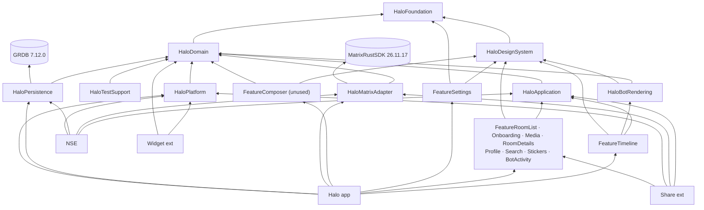

# Halo — Deep Architecture Audit

Date: 2026-11-27 · Revision: `2b98ee7` (`main` after #109; first drafted on `e5a804d` and re-verified after #104–#109 merged) · Reviewer: AI agent (Claude), at the founder's request.

A read-only audit: no source code, decision or behaviour was changed. Every finding cites the code it rests on.
Labels: **VERIFIED** = shown by reading the code path (and, where stated, a command); **PLAUSIBLE** = the code path allows it,
not reproduced; **RISK** = a design hazard, not a defect today. This audit does not repeat the read-state findings of
[CODEBASE_REVIEW.md](CODEBASE_REVIEW.md) (2026-11-21, R-01…R-25); it checks where the architecture stands now.

**Follow-up status (2026-11-27, branch `docs/architecture-audit-fixes`):** the doc-only rows of §4 are resolved — row 5 (CONCURRENCY §2),
row 6 (D128: AGENTS §8, CODE_CONVENTIONS §3, SDK_INTEGRATION §2), row 7 (MODULE_BOUNDARIES §1, TEST_STRATEGY, CI_CD), row 8
(MODULE_BOUNDARIES §1) and row 9 (D127, [ADR-0025](adr/0025-composer-stays-in-feature-timeline.md): the composer stays in
`FeatureTimeline`). Rows 4, 10 and 11 are code fixes where the docs are right; they and the deletion of `FeatureComposer` stay open.

What was run: `scripts/check-boundaries.sh` → `check-boundaries: all checks passed`; import scans of every module; size, test-count,
`@unchecked Sendable` / `nonisolated(unsafe)` / `Task.detached` / `try? await` / `Task {` counts. **Not run:** the test suites,
an app build, Instruments. Performance statements below are from code reading, not measurement.

---

## 1. Verdict

**The architecture is sound and does not need restructuring.** The layer boundary is real and compiler-enforced, the Rust/Swift
boundary holds without exception, the concurrency model is disciplined, and the hardest pipelines (timeline, room list, sync)
follow a good pattern: lossless diffs into an actor, latest-value snapshots out to the UI. It can carry the remaining M20–M22 work.

It is **not yet comfortably maintainable at the edges**, and the debt is concentrated in four places:

1. **The composition root has become an untested application layer** (`App/`: 2,661 lines, zero unit tests).
2. **Two god objects** carry most of the change traffic: `TimelineViewModel` (~2,430 lines over 3 files) and the `MatrixSessionPort` actor (817 lines, every adapter port funnels through it).
3. **Linear work per update** on the main actor (timeline) and over the FFI (room list) — fine at today's sizes, the first thing to break at 1,000 rooms or long histories.
4. **Documentation drift** — several architecture documents now describe a system slightly different from the code. For a project run largely by AI agents, which trust `docs/` over code, this is a correctness risk, not a cosmetic one.

No **P0** architectural defect was found. The P1 list is short and cheap; most of it is deletion or relocation, not new design.

| Question | Answer |
|---|---|
| Production-ready (architecture)? | Yes, with the P1 items done before Beta 1. |
| Maintainable? | Yes in `HaloCore` and the adapter; strained in `App/` and `FeatureTimeline`. |
| Scalable? | To a few hundred rooms as built; 1,000 rooms needs the P1/P2 room-list and timeline work (already partly on ROADMAP M19-2/M19-3). |
| Suitable for AI agents long-term? | Yes — unusually so (boundaries scripted, handoff enforced) — **if** the docs are brought back in line with the code (§4) and logic stops accumulating in the untested composition root. |

---

## 2. Architecture overview (as built)

| Package / target | Modules | Lines (src) | Role in practice |
|---|---|---:|---|
| `HaloCore` (Linux-buildable) | `HaloFoundation` 407 · `HaloDomain` 6,739 · `HaloApplication` 4,980 · `HaloTestSupport` 2,967 | 15,093 | Pure models, 25 port protocols, policies; 30+ actor coordinators; fakes + contract suites |
| `HaloApple` | `HaloMatrixAdapter` 5,014 · `HaloPersistence` 1,571 · `HaloPlatform` 1,577 · `HaloDesignSystem` 3,110 · `HaloBotRendering` 212 · 11 `Feature*` 17,474 | 28,958 | SDK adapter, GRDB stores, iOS services, UI kit, screens |
| Xcode targets | `Halo` 2,661 · `HaloNotificationService` 219 · `HaloShareExtension` 249 · `HaloWidgetExtension` 179 | 3,199 | Composition roots |
| Tests | 23 test targets (~990 `@Test`/`test…`) + `HaloUITests` (28) | 25,117 | |

Runtime shape (verified):

- **Sync:** Halo owns the classic `/sync` loop (`MatrixSessionPort.runSync`, `MatrixSessionPort.swift:411-471`) over `Client.syncOnceV2`, with energy-aware backoff (`SyncEnergyPolicy`), and fans `SyncChange` out to subscribers (`:486`). No `SyncService`, no sliding sync (D73/D74).
- **Room list:** not the SDK's `RoomListService`; `MatrixRoomListPort.updates` rebuilds summaries from `client.rooms()` per sync change and diffs them itself (`MatrixRoomListPort.swift:125-234`) → `RoomListCoordinator` actor → three `SnapshotBroadcaster` streams → `ReadStateCoordinator` + `RoomListViewModel`.
- **Timeline:** SDK listener → `TimelineMapper` → `.unbounded` diff stream → `TimelineCoordinator` actor applies diffs with `ListReducer` and publishes whole snapshots (`TimelineCoordinator.swift:345-420`) via `bufferingNewest(1)` → `TimelineViewModel.apply` maps to rows on the main actor (`TimelineViewModel+Mapping.swift:9-80`).
- **Read state / badge:** `ReadStatePolicy.evaluate` per room in `ReadStateCoordinator.recompute` (`ReadStateCoordinator.swift:427-474`) → `BadgePort` (`SystemBadge`, `AttentionCache` in the App Group) → widgets; NSE recomputes a fallback in `NotificationProcessor.fallbackBadge`.
- **Persistence:** `halo.sqlite` (GRDB pool, App Group, suspension-aware: `HaloDatabase.swift:14-20`) and a per-account private `search-index.sqlite` (`SearchIndexStore.swift:110-122`).

---

## 3. Actual dependency graph

From `Package.swift` (both), `project.yml` and the import scan. Solid = declared and imported. Every edge matches
`MODULE_BOUNDARIES.md §1`; no forbidden edge exists.

Observations on the graph (all VERIFIED):

- `HaloDomain` imports only `Foundation` + `HaloFoundation`; `HaloApplication` only adds `Observation` and `Synchronization`. The Linux core is genuinely pure.
- `MatrixRustSDK` is imported only in `HaloMatrixAdapter`; no public adapter signature exposes an SDK type (grep of `public` declarations).
- `FeatureSettings` depends on neither `HaloApplication` nor `HaloDomain`; it is wired entirely by closures from `App/Composition/SettingsAssembly.swift` (395 lines).
- The `Share` extension → `FeatureRoomList` edge is documented (ADR-0023).
- Apple-framework imports are spread wider than the doc implies: `FeatureTimeline` imports `AVFoundation`, `CoreLocation`, `MapKit`, `UIKit`; `HaloDesignSystem` imports `AVKit`, `Photos`, `QuickLook`, `VisionKit` (see F-07).

---

## 4. Documented architecture vs. implementation

| # | Document says | Code does | Status |
|---|---|---|---|
| 1 | Only the adapter imports `MatrixRustSDK`; no upstream type in ports (AGENTS §4.3) | Holds everywhere | ✅ VERIFIED |
| 2 | Feature → feature imports forbidden | None | ✅ VERIFIED |
| 3 | `HaloDomain`/`HaloApplication` UI-free, Linux-buildable | Holds | ✅ VERIFIED |
| 4 | "One read-state function … no counters, no increments, no badge logic anywhere else" (AGENTS §4.2); badge from `BadgeCalculator` | `BadgeCalculator.badge` (`ReadState.swift:413`) is **called only from tests**. Production totals: `BadgeSnapshot.total` (`BadgePort.swift:20`), per-room aggregation with `max(…,1)` and a `+= 1` for records of not-yet-listed rooms (`ReadStateCoordinator.swift:448,455`), NSE `baseline + max(…,1)` and `reduce(0,+)` (`NotificationProcessor.swift:133-134`) | ⚠️ drift (F-01) |
| 5 | Adapter services are `actor`s wrapping FFI objects (CONCURRENCY §2) | One actor (`MatrixSessionPort`); 23 ports are `final class … Sendable` over `Mutex` state that call into it | ⚠️ doc drift (benign) |
| 6 | Every `TaskHandle` owned by a `SubscriptionToken` (AGENTS §8) | No `SubscriptionToken` type exists; handles are cancelled with `defer`/`onTermination` per call site (`MatrixRoomPort.swift:141,159`, `MatrixTimelinePort.swift:235`, `MatrixMessageIndexSource.swift:293`) | ⚠️ doc drift |
| 7 | `HaloPersistence` builds on Linux ✅ (MODULE_BOUNDARIES §1) | Lives in `HaloApple`; Linux CI runs only `HaloCore` | ⚠️ doc wrong |
| 8 | `HaloDesignSystem` holds the HTML-subset → `AttributedString` renderer | `HTMLText` and, since #109, the 777-line `RichTextParser` are in `HaloBotRendering`; `FeatureTimeline` uses them for every formatted message | ⚠️ doc drift |
| 9 | `FeatureComposer` is a feature module (ADR-0022) | Nothing outside the module uses it (F-04) | ⚠️ dead → D127/ADR-0025: composer stays in `FeatureTimeline`; module removal open |
| 10 | Composition roots are "wiring only" (AGENTS §5) | `App/` contains view code, state machines, a disk cache and a search engine (F-02) | ❌ violated in spirit |
| 11 | Apple APIs live in `HaloPlatform` (AGENTS §5) | Audio engine/recorder (`FeatureTimeline/AVAudioPlayerEngine.swift`, `VoiceRecorder.swift`), Photos saving (`HaloDesignSystem/Media/PagedPhotoViewer.swift:374`, `VideoPlayerSheet.swift:193`), `UserDefaults` in features/design system — while `VideoPreparer` *is* in `HaloPlatform` | ⚠️ inconsistent (F-07) |
| 12 | Timeline/room-list diffs `.unbounded`; single-value streams `bufferingNewest(1)` (CONCURRENCY §3) | Holds: diffs unbounded (`MatrixRoomListPort.swift:126`, `MatrixTimelinePort.swift:235`), every broadcaster carries a whole snapshot (`SnapshotBroadcaster.swift:9`, `RoomReadSnapshot`) | ✅ VERIFIED |
| 13 | `@unchecked Sendable` needs a written justification | All 10 uses have one | ✅ VERIFIED |
| 14 | No `Task.detached`, `DispatchQueue.main.sync`, semaphores | None in production code | ✅ VERIFIED |

---

## 5. Findings

### 5.1 Critical architectural violations

None of the forbidden-dependency rules is broken. The two items closest to "violation" are rule drift, not boundary breaks:

**F-01 · Badge aggregation lives in three places outside `BadgeCalculator` — VERIFIED (drift), defect PLAUSIBLE only for edge paths**
- `ReadStateCoordinator.recompute` builds the per-room count map itself, including `counts[record.roomID, default: 0] += 1` for records of rooms not yet in the list before the first sync (`ReadStateCoordinator.swift:445-466`).
- `NotificationProcessor.fallbackBadge` (NSE) computes `(baseline.counts[room] ?? 0) + max(evaluate(since).badgeCount, 1)` and sums with `reduce(0, +)` (`NotificationProcessor.swift:110-135`).
- `BadgeSnapshot.total` and `UnreadWidgetSnapshot.totalUnread` sum again (`BadgePort.swift:20`, `UnreadWidgetSnapshot.swift:14`).
- Mitigation that exists: a property test asserts the room-list path equals `BadgeCalculator.badge` (`RoomListViewModelTests.swift:177`). No equivalent guards the pre-sync record path or the NSE path.
- Why it matters: AGENTS §4.2 is the project's P0 invariant and is stated absolutely; agents reading it will believe `BadgeCalculator` is the authority and edit the wrong function. Either make the code match (move the aggregation into `HaloDomain` as one pure function used by app, NSE and widget) or reword the rule.

**F-02 · The composition root carries untested application logic — VERIFIED**
- `App/HaloApp.swift` (954 lines) is mostly `RootView`: navigation, search presentation, user-facing strings, filter tables, profile refresh, and a private on-disk `OwnProfileCache` (`HaloApp.swift:803-824`).
- `AppRoot` (351 lines, ~45 stored dependencies, `AppRoot.swift:21-120`) plus six `Composition/*Assembly.swift` (1,182 lines) hold behaviour: room-open orchestration (`beginRoomOpen`/`openWhenReady`), background refresh, bot-sender migration, settings closures, and a full search lifecycle object `MessageSearchEngine` with its own state machine, locks and listeners (`SearchAssembly.swift:16-80+`).
- The app target has **no unit-test target**; this code is only exercised by `HaloUITests`. CODEBASE_REVIEW flagged `AppRoot` at 465 lines as P3; the root has since grown to ~2,600 lines of non-view-wiring code.
- Why it matters: this is where account-switch and lifecycle regressions hide (R-03 was here), and it is the one layer `check-boundaries` cannot police.

### 5.2 High-risk design decisions

**F-03 · `MatrixSessionPort` is the single choke point of the adapter — RISK**
One actor owns auth, the sync loop, media download, encryption handles, the second "history" client for search, and room lookup (`MatrixSessionPort.swift` 817 lines; `room(_:)` `:497`, `mediaData` `:506`, `searchHistoryClient` `:550`). Every port's call hops onto it. Because actors are re-entrant at `await`, this is not a deadlock risk, but (a) it serialises every non-suspending step of 23 ports onto one executor and (b) any change to sign-out/restore ordering touches the same file as media and search. Not a rewrite candidate: extract the history client and media into their own small actors when next touched.

**F-04 · Two composers; `FeatureComposer` is dead — VERIFIED**
`ComposerBarView`, `ComposerRules`, `ComposerPendingPhoto` (`FeatureComposer/ComposerBar.swift`) have no user outside their module; `App/HaloApp.swift:3` imports the module and uses nothing. The live composer is `FeatureTimeline/TimelineComposer.swift` + `ComposerPanels.swift` + `ArticleComposer.swift`, with keyboard/panel state in `HaloDesignSystem/InputPanel/` (668 lines, including `UserDefaults` persistence at `ComposerInputController.swift:253`). An agent asked to "change the composer" has a one-in-two chance of editing dead code.

**F-05 · Two preference stores write the same `UserDefaults` keys — VERIFIED**
`FeatureSettings/AppPreferences.swift:9-15` and `HaloPlatform/UserDefaultsPreferencesStore.swift:12-16` declare the same keys (`halo.privateReadReceipts`, `halo.appearance`, `halo.botSenders`, …). Settings writes through `AppPreferences`, then calls back so `PreferencesStore` is updated and `reload()`ed (`SettingsView.swift:205-211`, `SettingsAssembly.swift:21-28`). It works today by convention; a new toggle that forgets the callback silently diverges — and one of these flags decides whether receipts are public.

**F-06 · `sessionUpdates()` registers its subscriber asynchronously — VERIFIED pattern, impact PLAUSIBLE (low)**
`MatrixSessionPort.sessionUpdates` returns the stream before `Task { await self.register(...) }` runs (`MatrixSessionPort.swift:284-292`); an event emitted in that window is dropped. Token persistence does not depend on it (the refresh handler persists synchronously first, `:703-710`), so the realistic loss is a `.loggedOut`/`.softLoggedOut` emitted right after `becomeReady` (`SessionCoordinator.swift:316-324`). Make `sessionUpdates` actor-isolated (as `syncChanges` already is, `:486`).

**F-07 · Platform side effects spread into Feature and DesignSystem — VERIFIED**
`PHPhotoLibrary` writes in `HaloDesignSystem` (`PagedPhotoViewer.swift:374-380`, `VideoPlayerSheet.swift:193-200`); `UserDefaults` in `TimelineViewModel` (`TimelineViewModel.swift:173-181`, emoji recents) and `ComposerInputController`; `AVAudioPlayerEngine`/`VoiceRecorder` in `FeatureTimeline`. None breaks a scripted rule, but they make these paths untestable without a device and contradict AGENTS §5 ("Apple APIs live here", "DesignSystem: no business logic"). Low urgency; relocate behind ports when each file is next changed.

### 5.3 ViewModel lifecycle, ownership, concurrency

Good (VERIFIED): `@MainActor @Observable` everywhere; `isolated deinit` cancels the timeline's tasks (`TimelineViewModel.swift:431`, `isolated deinit { observation?.cancel(); dwellTask?.cancel() }`); coordinators use generation counters to drop stale streams (`TimelineCoordinator.swift:348`, `RoomListCoordinator.swift:119,144`); `PreparedTimelines` holds at most one pre-started model (`PreparedTimelines.swift:13-60`).

Weak spots:

- **F-08 · `TimelineViewModel` is a god object — VERIFIED.** 784 + 1,022 (`+Actions`) + 627 (`+Mapping`) lines: landing/scroll, read tracking, drafts, mentions, emoji, typing, bots, polls, pins, media open/cancel, audio, video staging, camera, forwarding, message info, jump/focus. Every M20 feature lands in it (#104–#109 each touched it). Split along existing seams — composer state, bot tasks, media playback — into owned child models; this is the single highest-leverage maintainability change.
- **F-09 · Unordered fire-and-forget writes per keystroke — PLAUSIBLE.** Each `draft` change spawns `Task { await coordinator.setTyping(…) }` and `Task { await drafts.save(text, …) }` (`TimelineViewModel.swift:104-110`, `saveDraft` `:591`). Unstructured tasks carry no ordering guarantee, so a stale draft or a late "typing: true" can win. Funnel both through one serial owner (latest-value).
- **F-10 · `stop()` during `opening()` can reopen a closed timeline — PLAUSIBLE.** `opening()` suspends several times before it sets `observation` and calls `coordinator.open()` (`TimelineViewModel.swift:522-545`); `stop()` (`:598`) doesn't cancel or await `starting`. A fast open-then-back leaves an open coordinator and a live observation until the model deallocates. Cancel/await `starting` in `stop()`.
- **F-11 · Polling waits in production code — VERIFIED.** `jump(toEvent:)` polls `show(target)` 200 × 10 ms (`TimelineViewModel.swift:683-686`); `opening` waits similar. Works, but couples UX to timing; prefer awaiting the next snapshot.
- **F-12 · ~380 unstructured `Task {` sites** (20 in `TimelineMessageRowView.swift`, 18 in `RoomListView.swift`). Most are button actions and fine; they are not counted or linted, so the AGENTS §9 rule "no fire-and-forget without a comment" is unenforced.

### 5.4 Unnecessary complexity / simplification opportunities

| ID | What | Evidence | Simplification |
|---|---|---|---|
| S-1 | Dead `FeatureComposer` module | F-04 | Delete module, product, App import, docs row |
| S-2 | Duplicate preference store | F-05 | `FeatureSettings` reads/writes through `PreferencesStore` only |
| S-3 | `TimelineCoordinator` is ~25 pass-through methods | `TimelineCoordinator.swift:196-338` each `guard session … try await session.x(...)` | Keep the actor for state; expose `sendingSession()` to callers or group sends into one `perform(_:)` — saves ~150 lines and one edit per new message type (polls added 2 here + 2 in port + 2 in fake) |
| S-4 | Compatibility alias `BadgeCoordinator = ReadStateCoordinator` | `ReadStateCoordinator.swift:478` | Rename the tests, delete alias |
| S-5 | Three image caches (32 MB encoded `MediaLoader`, 64 MB decoded `ImagePipeline`, 32 MB `TimelineThumbnailMemory`) | `MediaLoader.swift:22`, `ImagePipeline.swift:23`, `AppRoot.swift:56` | Document the layering or merge the two decoded-image caches; 128 MB ceiling on top of the SDK |
| S-6 | Stamped `try?` comments | 40+ `try? await` lines in the adapter carry identical boilerplate ("best-effort: a read; the caller falls back…"), including where the fallback changes behaviour, e.g. room export treats a pagination error as "reached start" and drops reducer errors (`MatrixRoomPort.swift:281-312`, `exportMessages`) | Review those sites individually; a silently truncated export breaks "Honest UI" (AGENTS §4.4) — **VERIFIED code path** |

No module was found that should be rewritten. The port/adapter/fake triad is heavier than strictly needed for a solo project, but it is what makes the Linux core and contract tests possible — keep it.

### 5.5 Performance and scalability risks

| ID | Area | Finding | Evidence | Status |
|---|---|---|---|---|
| P-1 | Room list | Every sync response that names any room scans `client.rooms()` (3 FFI calls per room), re-filters, sorts and diffs the whole list; a push-rule change rebuilds **all** summaries (`forceAll`) with up to 8 concurrent per-room FFI fan-outs | `MatrixRoomListPort.swift:145-190, 216-225, 270-299` | VERIFIED; cost RISK at 1,000 rooms (ROADMAP M19-3 notes the coordinator side) |
| P-2 | Room list | The event loop doesn't coalesce: sync events queue in an `.unbounded` stream and each is rebuilt separately; during catch-up bursts the list lags behind | `MatrixRoomListPort.swift:195-224` | VERIFIED; merge queued `changed` sets before rebuilding |
| P-3 | Read state | `recompute` re-evaluates every room per change and reads all notification records synchronously (`records?.all()`) inside the actor | `ReadStateCoordinator.swift:427-474`, `:355` | VERIFIED; idle polls are skipped (M19-7), active rooms are not |
| P-4 | Timeline | Each snapshot runs ~8 linear passes on the main actor (read tracker, bot tracker, poll reconcile, profiles, sender names, map, grouping, state-run collapse, has-message) and copies the whole item array to `BotActivityCoordinator` | `TimelineViewModel+Mapping.swift:9-80` | VERIFIED; the row cache (`:240-259`) removes the mapping cost, not the passes. ROADMAP M19-2 already lists this |
| P-5 | Timeline | Any change in sender names, reader profiles or the day drops the whole row cache (`mappingContext`) — one new member in a big room re-maps every row, including `HTMLText.attributed` parsing | `TimelineViewModel+Mapping.swift:218-246` | VERIFIED; key the cache context per sender instead |
| P-6 | Media | `MediaLoader` LRU is an array: `order.removeAll { $0 == key }` per hit is O(n) on the actor | `MediaLoader.swift:100-112` | VERIFIED; minor |
| P-7 | Search | Per-room listeners cost ~20 MB at 1,000 rooms (at the limit); live results only for the 200 most recent rooms | HANDOFF §5 | Known, documented |
| P-8 | Sync | Own loop is well bounded (12 s long-poll < 15 s request timeout, interruptible rest, offline wait) | `MatrixSessionPort.swift:300-471` | ✅ no finding |

### 5.6 Test coverage and what it doesn't catch

Strong (VERIFIED by file inventory): `HaloApplicationTests` 264, `HaloDomainTests` 170, `FeatureTimelineTests` 141, adapter 110 including live-server contract, fault and two-account interop suites; shared port contracts in `HaloTestSupport/Support/PortContracts.swift`; deterministic read-state scenario suites.

Gaps that matter architecturally:

1. **Composition root: 0 unit tests** for ~2,600 lines of behaviour (F-02). Room-open orchestration, background refresh, sign-out teardown order and search lifecycle are covered only by UI tests.
2. **NSE badge path vs. app path:** no test asserts the NSE fallback total equals what the app would compute for the same inputs (F-01).
3. **Thin feature suites:** `FeatureSearch` 3 tests (718 lines), `FeatureMedia` 3 (859), `FeatureComposer` 1 (dead), `FeatureBotActivity` 5.
4. **Lifecycle races** (F-09, F-10) aren't exercised: no test stops a `TimelineViewModel` mid-open or interleaves rapid draft edits.
5. **Scale:** `ScaleMeasurements` exists but wasn't run against the adapter over 1,000 rooms (HANDOFF M19-3); nothing fails CI when P-1/P-4 regress.
6. **Docs-vs-code:** `validate-docs.sh` checks structure, not claims; drift in §4 rows 4–11 passed every check.

### 5.7 Readiness for future features

| Upcoming (ROADMAP M20–M21) | Fit | Where it will hurt |
|---|---|---|
| Camera, Forward, Room lifecycle (built #105–#107); Report/block next | Good: new port methods + feature views | `TimelineViewModel` + `TimelineCoordinator` pass-through grow again (F-08, S-3) |
| Receipts & message info, Text rendering (GA-30) | Built (#108, #109) | The general renderer (`HTMLText`, `RichTextParser`) landed in `HaloBotRendering`, so every feature that shows formatted text must depend on the bot module |
| In-room search | Good: `SearchIndexStore`/`LocalMessageSearch` exist | `MessageSearchEngine` lives in the app target (F-02) |
| Moderation, Storage | Good | Settings closures in `SettingsAssembly` keep growing |
| Sliding sync / `SyncService` later | Contained: only `MatrixSessionPort` + `MatrixRoomListPort` change | Those two files are the largest adapter files |
| Multi-account (not planned) | Would need restructuring: `AppRoot` holds one session graph | — |

---

## 6. Prioritised recommendations

None of these needs a new dependency or a rewrite. Each is small enough for one autonomous-loop iteration.

### P0 — before anything else
*No P0 architectural defect was found.* (The P0 product invariants — read state, badge — are tested; F-01 is a drift to close in P1, not a reproduced wrong badge.)

### P1 — before Beta 1
1. ✅ **Close the badge-rule drift (F-01):** done — `BadgeCalculator.{roomCount, total, attentionCounts, countAfterUnsyncedPushes}` are used by `ReadStateCoordinator`, `NotificationProcessor`, `BadgeSnapshot` and the widget; `BadgeCalculatorTests` and `NotificationProcessorTests.fallbackMatchesAppEvaluation` (behaviour unchanged, so these guard rather than reproduce a bug).
2. **Fix the documentation drift (§4 rows 5–9)** — done on `docs/architecture-audit-fixes` (D127, D128).
3. ✅ **Delete `FeatureComposer` (S-1, D127) and the duplicate preference store (S-2/F-05):** done — `FeatureSettings` writes through the shared `PreferencesStore`; `AppPreferences` and `PreferencesStore.reload()` are gone; defaults moved to `UserDefaultsPreferencesStoreTests`.
4. ✅ **Stop growing the composition root (F-02):** done — `MessageSearchEngine` is in `HaloApplication` behind the new `AccountSearchIndexPort` and an `Environment` of iOS services (`MessageSearchEngineTests`); room-open orchestration is `PreparedTimelines.open` (`PreparedTimelinesTests.newerTapReplacesOlder`); `check_boundaries.py` now rejects a `class`/`actor` in a composition root other than `AppRoot`, OS entry points and `…Box` holders. Sync and search now share one `DeviceConditions`.
5. ✅ **F-10 and F-09 (drafts):** done, both now **VERIFIED** defects — `TimelineLifecycleTests.stopDuringStart` and `DraftCoordinatorTests.writesStayInOrder` failed before the fix (`stop()` cancels and awaits the start; `DraftCoordinator` chains store writes). Typing-notice order is left as is: ephemeral, throttled, and the server expires it.
6. ✅ **Review behaviour-changing `try?` sites (S-6):** done — room export (`FaultTests.exportWithBrokenHistory`), `GalleryCollector`, `HistoryMirror`, and `UnpinPolicy` now propagate reducer/read failures instead of silently truncating or skipping room unpins (`AdapterErrorPropagationTests`); misleading stamped comments on write/fail-closed sites (`MatrixSessionPort`, `MatrixRoomPort`, `MatrixReadMarkerPort`) replaced with accurate per-site reasons.

### P2 — during M20–M22
7. ✅ **Split `TimelineViewModel` (F-08):** done — extracted `TimelineBotTaskModel`, `TimelineComposerModel`, and `TimelineMediaModel` as owned `@MainActor @Observable` child models (`TimelineChildModelsTests`), cancelling bot task timeouts on `stop()`/`deinit`; `TimelineCoordinator` pass-through collapse (S-3) remains open.
8. ✅ **Room list scaling (P-1, P-2):** done — `MatrixRoomListPort.EventCoalescer` merges queued sync, push-rule, and filter events into one coalesced batch; live incremental syncs look up only `changed` rooms via `client.getRoom(roomId:)` instead of scanning `client.rooms()`; UI filter switches re-filter cached summaries with zero FFI calls (`RoomListMappingTests`). Push-rule changes still run a full refresh where the SDK doesn't identify individual rooms.
9. ✅ **Timeline mapping (P-4, P-5):** done — `TimelineViewModel.apply(.live)` folds profile, sender-name, poll-reconciliation, message-presence, and newest-own scanning into one pass (`scanSnapshot`), passes `senderNames` to `typingText`/`identityNotices`, builds cached + run-grouped + state-collapsed rows in one pass (`buildRows`), and scopes row-cache invalidation per row/sender/day (`rowContext`, `IncrementalTimelineTests.scopedContextInvalidation`).
10. **Extract media and the history client from `MatrixSessionPort` (F-03);** make `sessionUpdates` actor-isolated (F-06).
11. **Move platform side effects behind ports (F-07)** as files are touched; unify image caches (S-5).
12. **Add a scale gate:** run `ScaleMeasurements` (1,000 rooms) and a long-history timeline benchmark in the manual macOS workflow, with thresholds.

---

## 7. Evidence log

- `scripts/check-boundaries.sh` → `check-boundaries: all checks passed`.
- Import scan per module (grep of `import` lines under each `Sources/<module>`), summarised in §3.
- `@unchecked Sendable`: 10 sites, all with a justification (`SessionCoordinator.swift:370`, `ImagePipeline.swift:47`, `AppPreferences.swift:5`, `KlipyShelfStore.swift:9`, `SearchProcessingTask.swift:10`, `NotificationService.swift:15`, `UserDefaultsPreferencesStore.swift:8`, `FocusFilterIntent.swift:44`, `OpenChatIntent.swift:48`). `Task.detached`: 0. `try? await` (excluding sleeps) in production: 211, all commented. `Task {`: ~380.
- `BadgeCalculator` usages: definition `ReadState.swift:413`; tests `ReadStatePolicyTests.swift`, `RoomListViewModelTests.swift:177`; no production caller.
- `FeatureComposer` public symbols referenced outside the module: none.
