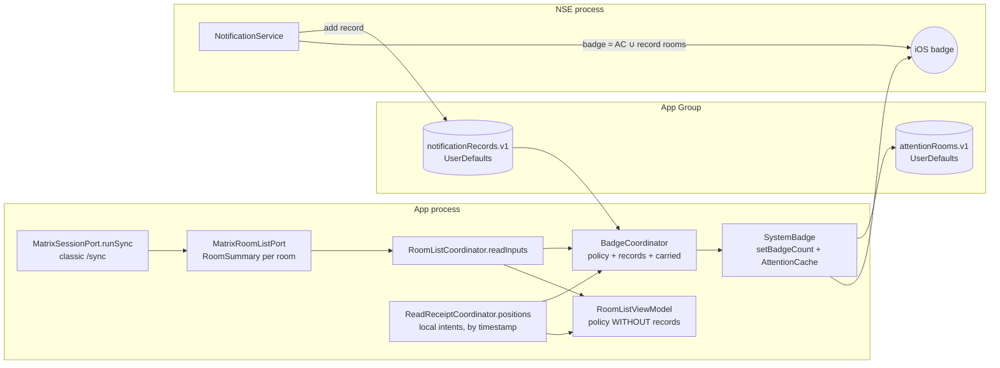

# Halo — Comprehensive Codebase Review

Date: 2026-11-21 · Reviewed revision: `6e51cbb` (`main`) · Reviewer: AI agent (Claude), at the founder's request.

This is a review, not a change: no product code, decision or behaviour was modified. Every finding below cites the code it
rests on. Findings are labelled **CONFIRMED** (shown by code reading plus a test, a server probe, or an unambiguous code
path), **LIKELY** (the code path is clear, one upstream behaviour is inferred and not yet reproduced), or **RISK**
(a latent hazard or architectural recommendation). Nothing marked LIKELY or RISK should be read as a reproduced bug.

---

## 1. Executive summary

**Verdict.** Halo is a well-structured, unusually well-documented codebase with a sound core idea: one pure read-state
policy (`ReadStatePolicy`), one badge function, a strict adapter boundary, a durable receipt outbox, and no counters. The
module boundary holds (only `HaloMatrixAdapter` imports `MatrixRustSDK`; `scripts/check-boundaries.sh` passes), the
package test suites are green, and the Swift 6 concurrency discipline is good.

It is **not yet a daily-driver client**, and the gap is concentrated exactly in the P0 area. The policy function is
deterministic, but *its inputs are not*: they are assembled in three places from different sources, ordered by
`origin_server_ts`, and supplemented by a cross-process store that is never pruned on the events that should prune it.
The result is a set of reproducible ghost-badge and missed-unread paths:

1. **In encrypted rooms the server counts events the SDK rightly ignores** (poll votes, encrypted reactions), and rule
   E3c turned that into a dot and a badge unit whenever no read position covered the latest event (R-01, CONFIRMED with
   two SDK clients against the dev Synapse; **fixed 2026-11-21, D78**).
2. **Undecryptable pushes leave a record stamped with the extension's wall clock**, which no read position can ever cover
   (R-02).
3. **Notification records and the carried-over attention set outlive the rooms they belong to** (left, kicked, hidden,
   other account) — ghost badge units for rooms the user cannot see (R-03, R-04).
4. **The room list and the badge evaluate the policy over different inputs**, so the badge can count rooms that show no
   indicator (R-05).
5. **Read positions and receipt advancement are ordered by timestamp**, so equal or skewed timestamps silently drop
   receipts and hide new messages; the scenario suite pins one of these as an accepted limitation (R-06).
6. **A read position that "covers the latest event" (E1/E1b) hid newer unread the SDK counts**, because the SDK's
   latest event skips undecryptable messages (R-07, CONFIRMED live; **fixed 2026-11-21, D79**).

Outside unread state, the most important issues are: the remote-logout path is not wired (R-10), the notification
extension does not run on the lightweight runtime it was designed for (R-09), token refresh in the extension is not
persisted (R-11, latent until OIDC), and the documented field encryption of `halo.sqlite` does not exist, so drafts typed
in encrypted rooms sit in plaintext in the App Group (R-16).

None of these require a rewrite. Most are fixed by **centralising input assembly in one read-state coordinator** (the
`ReadStateCoordinator` the docs already describe but the code never built), **ordering by timeline position instead of
timestamps**, and **making record lifetime follow room lifetime**. The roadmap in §14 sequences that work.

### What was verified, what was run

| Check | Command | Result |
|---|---|---|
| Handoff, docs, boundaries | `scripts/prepush.sh` (first three steps) | passed |
| Pure + Apple package tests | `scripts/prepush.sh` (`swift test` per package) | all passed: Foundation 13, Domain 76, TestSupport 11, Application 135, DesignSystem 2, Platform 13, Persistence 17, FeatureAuth 7, FeatureRoomList 25, FeatureTimeline 59, FeatureStickers 13, FeatureSettings 19, FeatureRoomDetails 18, FeatureBotActivity 5 |
| Secret scan | `gitleaks` (via prepush) | no leaks, 276 commits |
| Adapter unit tests | `xcodebuild -scheme HaloMatrixAdapter -destination 'platform=iOS Simulator,name=iPhone Air,OS=26.5' test -quiet` | passed (exit 0); contract tests skipped (no `TEST_RUNNER_HALO_DEV_*` exported) |
| App build | `xcodebuild -project ios/Halo.xcodeproj -scheme Halo-Debug -destination '…iPhone Air,OS=26.5' -quiet build` | succeeded (exit 0) |
| Server count rules | `tools/server-rules/check_server_rules.py` + 4 extra probes (scratch copy, throwaway users, local dev Synapse 1.165.0) | all 13 existing checks pass; probes: encrypted reaction **counts** (1,0); encrypted edit does not add; unencrypted reaction does not count |
| Contract tests against `infra/dev` | not run | they mutate the shared dev account; not needed for this review |
| On-device NSE, background push | not run | needs a signed device build and an APNs gateway |
| SwiftLint | skipped by prepush | not configured |

The SDK source consulted is the local checkout `~/Documents/GitHub/matrix-rust-sdk` (`c0fa915`, a fork merged from
upstream on 2026-10-29), **not** the pinned commit `b93751e9` (not present locally). Swift signatures were checked in the
pinned binary package's generated `matrix_sdk_ffi.swift` (`26.11.17`). Statements about SDK internals are therefore
close-but-not-exact; each one that matters is marked.

---

## 2. Repository and architecture overview

| Area | What exists (verified) |
|---|---|
| Swift packages | `HaloFoundation` (ids, `HaloError`, `HaloLog`), `HaloDomain` (models, ports, `ReadStatePolicy`, `BadgeCalculator`, `ReadStateAuditor`), `HaloApplication` (actors: `SessionCoordinator`, `SyncCoordinator`, `RoomListCoordinator`, `BadgeCoordinator`, `ReadReceiptCoordinator`, `TimelineCoordinator`, `PushCoordinator`, bots, stickers), `HaloMatrixAdapter` (only SDK importer), `HaloPersistence` (GRDB, 6 migrations), `HaloPlatform` (Keychain, badge, notification records, App Group), `HaloDesignSystem`, `HaloTestSupport` (fakes + port contracts), 7 feature packages |
| Composition roots | `ios/App/AppRoot.swift` (object graph), `ios/App/HaloApp.swift` (SwiftUI scene, lifecycle), `ios/NotificationService/NotificationService.swift` (NSE) |
| Rust | **None of Halo's own.** The upstream `matrix-rust-components-swift` binary (`26.11.17`) is consumed as is; `core/` does not exist (gate G-FFI: stay upstream) |
| Sync | Classic `/sync` loop over `Client.syncOnceV2` in `MatrixSessionPort.runSync` (D73/D74), foreground only; sliding sync is off |
| Unread | `ReadStatePolicy.evaluate` (pure) fed by `RoomListCoordinator.readInputs()` + `ReadReceiptCoordinator.positions()` + `NotificationRecordStore` (App Group `UserDefaults`); badge by `BadgeCoordinator` → `SystemBadge` |
| Push | `MatrixPushPort` registers an `event_id_only` HTTP pusher with a generic default payload; NSE fetches the event via `NotificationClient(.multipleProcesses)`. **No gateway is configured for Beta/Release** (`ios/Config/Release.xcconfig:6`, `Beta.xcconfig:6` empty) |
| Persistence | `halo.sqlite` (read intents, drafts, audit, bot tasks) in the App Group container; SDK SQLite stores per login, passphrase in the Keychain session payload |
| CI | GitHub Actions on Linux only: docs, boundaries, handoff, gitleaks, licences, `swift test` for the four Linux-portable packages. Adapter, platform, persistence, features and the app are validated only by `scripts/prepush.sh` on a Mac (D71) |

The diagram already shows the structural problem behind most P0 findings: **three evaluators** (badge, room list, NSE)
with **three different input sets**.

---

## 3. Critical findings (P0)

### R-01 · Server-only counts in encrypted rooms became a ghost unread (rule E3c) — CONFIRMED, FIXED (D78)

> **Correction (2026-11-21, during the fix).** The first version of this finding said encrypted *reactions* cause the ghost
> in every encrypted DM and that opening the room can't clear it. Both were overstated. The Rust SDK sends reactions in
> plaintext, and they count nowhere. And in the app a read position usually covers the latest event (E1 via the own
> receipt), which hides the server-only count. What follows is what the evidence actually shows.

- **Where:** `ReadState.swift`, rules E3b/E3c (before the fix: E3b required `sdk.unreadMessages > 0`; E3c gave
  `notify = 1`, `.dot`, attention whenever the server counted and the SDK counted no messages).
- **Evidence** (F-SDK-3; `ClassicSyncEvidenceTests.encryptedNonMessageEvidence`, two SDK clients over classic sync;
  `tools/server-rules/check_server_rules.py`): the server counts every `m.room.encrypted` event in all-messages mode,
  including an encrypted **poll vote** (server 1) and an encrypted reaction from clients that encrypt reactions. The SDK
  decrypts and re-evaluates the push rules: a vote counts **0**, a call invite counts **1 notification, 0 messages**, an
  event it can't decrypt counts **1 message, 1 notification**. Over classic sync the SDK holds the events the server
  counted, so a server count the SDK doesn't share means "not a message".
- **When it showed:** when no read position covered the room's latest event, for example a room that was joined but never
  opened, a failed receipt lookup, or a latest-eligible event after the receipt. Then E3c produced a dot and a badge unit for a
  vote. Call invites produced a *dot* instead of the count because E3b ignored the SDK's notification count when
  `unreadMessages == 0`.
- **Fix (done):** E3b uses the SDK counts whenever any of them is non-zero. E3c (server counts, all SDK counts zero)
  gives no unread and no attention, with reason `ENC_SERVER_ONLY`, which the auditor treats as explained. The trade-off is in
  D78: a message the SDK never received shows only through a push record (E4).
- **Tests:** policy unit test `encryptedServerOnly`; auditor `ENC_SERVER_ONLY`; scenario **S23**; S06 now models the
  real SDK (an undecryptable event is counted: `.count(1)`, then `.mentions(1)` after decryption); contract test
  `encryptedNonMessageEvidence` (fails on the old policy, passes now); three server-rules checks.
- **Left for later:** the vote's server count remains until a receipt passes it, so the next real message is shown as an
  approximate dot rather than a number (`ENC_SERVER_OVERCOUNT`). The timeline sends receipts for the newest visible
  *row*, and a vote is not a row. Sending the receipt for the latest *event* when the user is at the bottom (as
  `Room.markAsRead` does, verified to clear the vote's count) belongs with R-06.

### R-02 · Undecryptable pushes create records no read position can cover — CONFIRMED, FIXED

- **Where:** `ios/NotificationService/NotificationService.swift`, `MatrixNotificationPort.swift`, `ReadState.swift`, `BadgeCoordinator.swift`.
- **Fix (done):** `NotificationFetchResult.encrypted` and invite displays now carry the event's `origin_server_ts` (from `TimelineEvent.timestamp()` or `rawEvent` JSON); `ReadStatePolicy.notifiedThrough` and `partitionRecords` cover records via `notifiedThroughTs` (including `serverZero`) and supersede records once sync delivers the event (preserving S22 encrypted gap mentions); `MatrixRoomListPort.ownReadThrough` resolves receipts for rooms with active records even when counts are zero; `BadgeCoordinator.recompute` prunes superseded records.
- **Tests:** `ReadStatePolicyTests.partitionRecords`, `NotificationMapperTests.rawEventTimestamp`, `BadgeCoordinatorTests.supersededRecordsPruned`, scenario **S25**.

### R-03 · Notification records outlive their rooms and their account — CONFIRMED, FIXED

- **Where:** `RoomListPort.leftRooms()`, `RoomListCoordinator.excludedRoomChanges()`, `BadgeCoordinator`, `AppRoot`.
- **Fix (done):** `NotificationRecordPort` gained `clear(rooms:)`, `remove(events:)`, `clearAll()`; `MatrixRoomListPort` emits `rooms.left` from classic sync; `RoomListCoordinator` publishes excluded rooms (left, hidden sticker-pack rooms, ignored-inviter invitations); `BadgeCoordinator` prunes their records, excludes them from unknown-room counting, clears records in `forget(_:)` and `reset()`, and `NotificationRecordStore` scopes every row by `account` in GRDB.
- **Tests:** `BadgeCoordinatorTests.recordsPrunedOnLeaveHideIgnoreAndReset`, `NotificationRecordStoreTests.accountIsolation`, scenarios **S26**, **S27**.

### R-04 · The carried-over attention set never forgets rooms that don't reappear — CONFIRMED, FIXED

- **Where:** `RoomListPort.syncCompletions()`, `MatrixRoomListPort`, `RoomListCoordinator`, `BadgeCoordinator`.
- **Fix (done):** `MatrixRoomListPort` emits the complete joined/invited room ID set on `syncCompletions()` after each completed classic sync response has been applied; `BadgeCoordinator` intersects `carried` with that set (dropping rooms that never reappeared without flickering rooms whose diff is still in flight) and drops stale records for absent rooms. Partial pre-sync evaluations still keep stored attention (`partialEvaluationKeepsStoredAttention`).
- **Tests:** `BadgeCoordinatorTests.carriedRoomDroppedAfterFirstSync`, scenario **S28**.

### R-05 · The room list and the badge disagree by construction — CONFIRMED, FIXED

- **Where:** `ReadStateCoordinator` (`HaloApplication/ReadState/ReadStateCoordinator.swift`), `RoomListViewModel`, `scripts/check_boundaries.py`.
- **Fix (done):** `ReadStateCoordinator` (the single owner of read-state evaluation) publishes `[RoomID: RoomReadState]` via `states()` and `roomStates`; `RoomListViewModel` consumes `readState.states()` and no longer calls `ReadStatePolicy.evaluate` (enforced by `scripts/check_boundaries.py`).
- **Tests:** `RoomListViewModelTests.roomListAndBadgeAlwaysAgree` (PS31: 100 generated input sets with rooms, modes, encryption, and notification records; asserts `badge == rows.filter { $0.display != .none }.count` and exact attention-room match).

### R-06 · Read order is decided by timestamps — CONFIRMED, FIXED (D80, ADR-0020)

- **Where:** `TimelineReadTracker.swift`, `TimelineViewModel.swift`, `ReadReceiptCoordinator.swift`, `ReadIntentStore.swift` (migration v8), `ReadState.swift`, `ReadStateCoordinator.swift`, `MatrixRoomListPort.swift`, `MatrixTimelinePort.swift`.
- **Fix (done, D80 / ADR-0020):**
  - Open timelines pick receipt candidates by timeline index (`TimelineReadTracker`), not `origin_server_ts`, and target `Timeline.latestEventId()` when viewing the tail row (covering trailing non-row events such as encrypted poll votes, finishing the R-01 leftover).
  - `read_intent` gains monotonic `timeline_order` (migration `v8-read-intent-order`), allowing equal-millisecond and clock-skewed later events to advance cleanly while preserving P8.
  - `RoomSummary` / `RoomReadInputs` carry `ownReceiptEventID`, `localIntentEventID`, `localIntentConfirmed`, and optional `LatestEventRef.eventID`; E1 compares event IDs when both are known and yields (`INTENT_STALE`) once a sent receipt is confirmed by the server/sync yet counts remain non-zero (revisiting D47 and D72).
- **Tests:** `ReadStatePolicyTests.identityAndConfirmedIntent`, `ReadIntentStoreTests.timelineOrderAdvancesAcrossEqualAndSkewedTimestamps`, `ReadReceiptCoordinatorTests.timelineOrderAdvancesAcrossEqualAndSkewedTimestamps`, `TimelineReadTrackerTests` (PS28, PS29, tail poll-vote receipt), scenarios **S18** (inverted) and **S29**.

### R-07 · "Covers the latest event" (E1/E1b) overrode positive SDK counts — CONFIRMED (live), FIXED (D79)

- **Where:** `ReadState.swift`, rules E1/E1b. The SDK's latest event (`Room.latestEvent`) leaves out events it can't
  decrypt (F-SDK-3), so "the read position covers the latest event" was true while a newer message waited.
- **Live evidence** (`ClassicSyncEvidenceTests.encryptedNonMessageEvidence`, two SDK clients): (a) after the user read the
  room, an undecryptable event arrives. The SDK counts it (1 message, 1 notification), but the latest event is still the
  read one, so E1 showed the room as read. (b) After the user's own message the SDK's count goes back to 0 (an own
  event is an implicit receipt); an undecryptable event after it counts 1, but E1b showed the room as read.
- **Fix (done, D79):** the policy now gets the receipt the SDK holds (`RoomReadInputs.receiptReadThrough`) separately
  from the merged read position, and `LatestEventRef.isLocal` marks a local echo. E1 gives way when that receipt is at
  least the read position and the SDK counts anything. E1b gives way when the own latest event is on the server and the
  SDK counts anything. The reason is `SDK_UNREAD_AFTER_READ`, and evaluation continues with E2/E3. Instant clearing is
  kept where the SDK can't know yet: a local position ahead of its receipt, or a pending local echo.
- **Tests:** policy unit test `sdkCountsAfterRead`; property P11 (and P1 restated); scenario **S24** (a, b, c); S18 now
  expects a skewed late message to show; contract test (both live cases now pass; the `withKnownIssue` is gone);
  `policyOverRealInputs` passes the receipt like the app.
- **Still open:** a failed local echo that stays the latest event while others write keeps E1b in force (the SDK
  doesn't treat a local echo as a receipt, so its count includes messages the user read before sending). The SDK can
  be out of date for a moment while a receipt for an event in a gap is resolved (it counts every event it holds
  meanwhile); E2 hides that wherever the server can count.

---

## 4. Unread and notification architecture review

### 4.1 Authority of each piece of information (as implemented)

| Information | Authoritative source today | Where it enters | Assessment |
|---|---|---|---|
| Server counts (`notification_count`, `highlight_count`) | Synapse via classic sync → SDK `RoomInfo` | `MatrixRoomListPort.readCounts` | Correct source; over-trusted in encrypted rooms (R-01) |
| SDK counts (`num_unread_*`) | SDK event cache, after decryption and push-rule re-evaluation | same | Correct over classic sync; now decisive in encrypted rooms (D78) |
| Own receipt (any device) | Server; SDK replica (`loadUserReceipt`) | `ownReadThrough` — resolved to the target event's **timestamp** | Identity lost (R-06); only resolved for rooms that "look unread" (fine) |
| Local intent | `ReadReceiptCoordinator` + `read_intent` | `positions()` — timestamp only | Identity lost (R-06) |
| Marked unread | Room account data → `RoomInfo.isMarkedUnread` | `readCounts` | Correct |
| Notification mode | SDK `NotificationSettings.getRoomNotificationSettings` | `readCounts` (failure → all messages) | Correct, safe default |
| Latest event | SDK `Room.latestEvent()` | `latestEvent` (+ `isLocal`) | Lossy: skips UTDs and votes; since D79 the SDK's counts win over it once its receipt is applied |
| Push records | NSE, App Group `UserDefaults` | `BadgeCoordinator` only | No lifecycle (R-02, R-03), not seen by the room list (R-05), non-atomic store (R-13) |
| Attention set | App (`BadgeCoordinator`) | `AttentionCache` | Carry-over never ends (R-04) |
| Badge | App: `setBadgeCount`; **NSE: `content.badge` from its own union** | `SystemBadge`, `NotificationService.badge` | Two writers, two formulas (R-08) |

### 4.2 Races and stale snapshots

- **NSE overwrites a newer app badge (R-08, CONFIRMED ordering).** `NotificationService.run` writes the record
  (`:58`/`:65`), which posts a Darwin notification and makes the app recompute and call `setBadgeCount`, **then**
  delivers content whose `badge` is `AttentionCache ∪ record rooms` (`:59`, `:79-81`). iOS applies the notification's
  badge after the app's write, so the last writer is the NSE's formula, which ignores modes, read positions and records
  already read. Fix: when the app is running (or always), the NSE should leave `content.badge = nil` unless it can run
  the same evaluation; the cached-set fallback should be the *app's* last set, plus this room only if the policy would
  give it attention (mode-aware: a non-mention record in a mentions-only room must not add a unit).
- **Cross-process records store (R-13, CONFIRMED design, race LIKELY).** `NotificationRecordStore` does
  read-modify-write on `UserDefaults` from two processes (`NotificationRecordStore.swift:29-41`). An NSE `add` that read
  the list before the app's `clear` re-writes the cleared records → ghost attention. The file's own comment accepts "a
  lost record"; a *resurrected* record is the worse case and isn't mentioned. The docs (UNREAD_STATE §8, DATA_MODELS
  §3) specify a GRDB `notification_record` table with PK de-duplication and monotonic upserts; move to it.
- **Room open clears records before anything is seen (P2).** `TimelineCoordinator.open` clears all of the room's records
  as soon as the timeline opens (`TimelineCoordinator.swift:85`), contradicting D6 (only visible events count). A user
  who opens and immediately backs out loses the E4 evidence; with classic sync the server/SDK counts usually take over,
  so impact is limited, but the rule should be "records covered by the receipt that was sent".
- **Intents keep hiding server counts for 7 days (D72).** Combined with R-06 this turns one dropped receipt into a
  week-long divergence between devices. Revisit D72 once intents carry event ids: an intent whose receipt the server
  confirmed is redundant; one the server contradicts is wrong.

### 4.3 The deterministic architecture to aim for

1. **One owner.** A `ReadStateCoordinator` actor (HaloApplication) assembles `RoomReadInputs` for every room from
   (a) the room snapshot, (b) intents, (c) records, (d) the sync completeness flag, and publishes
   `[RoomID: RoomReadState]` + the badge. Room list, badge, auditor and NSE fallback all read its output. No view model
   calls `ReadStatePolicy.evaluate`.
2. **Identity and order, not time.** Inputs carry `latestEventID`, the own receipt's event id, intent event id, and a
   per-room order key the adapter derives from the event cache (or "unknown"). The policy compares ids/order; timestamps
   only break ties for display.
3. **Explicit state transitions for a record:** `created (NSE)` → `superseded (sync delivered the event)` →
   `pruned`; plus `dropped (room left/hidden/account reset)`. Each transition has an owner and a test.
4. **Reconciliation rules.**
   - After the first sync response of a run, the room set is complete: carried state not confirmed by it is dropped.
   - A confirmed receipt plus non-zero server counts means the intent is stale: drop the intent's suppression.
   - Server counts are authoritative for unencrypted rooms; in encrypted rooms only when the SDK is known blind.
   - The badge is written by one process at a time: the app when running; the NSE only with the app's last set plus a
     mode-aware delta.
5. **Sequence numbers.** UNREAD_STATE §4 specifies a per-room `sequence`; the adapter publishes whole-list `.reset`s
   from one serial loop, so ordering is currently safe, but the per-room sequence becomes necessary as soon as more than
   one producer exists (NSE-written state, timeline-driven updates).

---

## 5. Matrix protocol compliance

| Topic | Finding | Severity |
|---|---|---|
| Sync token | Owned by the SDK (`sync_once` uses the stored token); Halo keeps no token. Correct. First request `timeout 0`, then 8 s long poll (`MatrixSessionPort.swift:191-199`). | OK |
| Initial sync | No filter: `SyncSettingsV2` in the pinned FFI exposes only `timeoutMs` and `fullState` (`matrix_sdk_ffi.swift:30387`), so no `lazy_load_members`, no timeline limit. Heavy for large accounts (R-18). | P2 |
| Login | `loginPassword` refuses servers without native sliding sync (`MatrixSessionPort.swift:76`) although the client now uses classic sync (`.slidingSyncVersionBuilder(.none)`, `:327`). Stale gate from before D74; locks out servers Halo could serve (R-17). | P2 |
| Session invalidation | No `ClientDelegate` is registered (`Client.setDelegate` exists in the pinned FFI); no code emits `.softLoggedOut` or `.loggedOut`. A revoked token makes `runSync` end with `.failed` and `SyncCoordinator` restarts it forever with backoff (R-10). | P1 |
| Read receipts | Unthreaded (D17), public/private per setting (D7), durable outbox with backoff — good. Candidate selection and monotonicity by timestamp (R-06). `markRoomRead` re-implements `Room.markAsRead` / `Timeline.markAsRead` (R-20). | P0 / P2 |
| Fully-read marker | Set after each receipt via `markAsFullyReadUnchecked`; only drives the timeline marker. Correct use. | OK |
| Marked unread | `setUnreadFlag`; cleared on open once visible. Correct. | OK |
| Local echo / send queue | Text, replies, media go through the SDK send queue (transaction ids owned by the SDK); queues re-enabled after a recovered sync. Good. **Stickers bypass the queue** (`room.sendRaw`, `MatrixTimelinePort.swift` `sendSticker`): no local echo, no offline retry, may overtake queued text (R-21). | P2 |
| Retry | `retrySend`/`abortSend` map *every* error to `.notFound` — the cause is lost. | P3 |
| Event dedup | Timeline dedup is the SDK's; records dedup by event id in the store. | OK |
| Membership | Room list keeps joined/invited only; left rooms vanish without pruning dependent state (R-03, R-04). | P0 (via R-03/R-04) |
| E2EE / verification | `autoEnableCrossSigning`, `autoEnableBackups`, recovery via SDK; device verification only via recovery key (no SAS/QR yet, roadmap M5). | OK for scope |
| Push processing | `NotificationClient(.multipleProcesses)`, pusher `event_id_only`, no `aps.badge` in Halo's default payload. ADR-0015's Halo pushkin (`infra/sygnal/`) does not exist; stock Sygnal is used in `infra/dev` (R-24). | P2 |
| Account data | Bot allowlist under `one.mbm.halo.bot_allowlist` (D63 namespace). | OK |

**Reimplemented where the SDK already provides it:** room "mark as read" (R-20); unread latest-event heuristics
(E1b) that the SDK's own `RoomInfo` counts already reflect. **Must stay in Halo:** attention/badge policy, mode-aware
attention, push-record bridging for the NSE, receipt visibility rule (D6), outbox durability across relaunch.

---

## 6. Swift architecture review

Strengths (verified): actors for every coordinator; `@MainActor @Observable` view models; `SnapshotBroadcaster` gives
latest-value-wins streams; owned and cancelled tasks (generation counters in `RoomListCoordinator`,
`ReadReceiptCoordinator`, `TimelineCoordinator`); typed throws with `HaloError`; injected clocks/sleeps in tests; only
three `@unchecked Sendable`, each small. No `try!`, `DispatchQueue.main.sync` or `Task.detached` in production code.

| ID | Finding | Where | Severity |
|---|---|---|---|
| R-05 | Read-state evaluation duplicated in a view model with different inputs | `RoomListViewModel.swift:257-261` | P0 |
| R-12 | Restore timeout abandons a still-running `port.restore`; if it later succeeds, `MatrixSessionPort.adopt` installs a client while the UI shows "couldn't restore", and "Try again" builds a second `Client` on the same store in the same process. **LIKELY** | `SessionCoordinator.swift:205-221`, `MatrixSessionPort.swift:102-118` | P1 |
| R-22 | `receipts.flush()` on leaving the foreground runs without `beginBackgroundTask`, so iOS may suspend mid-request (the outbox recovers on next launch, but other devices stay unread meanwhile) | `HaloApp.swift:183-187` | P2 |
| — | `AppRoot` (465 lines) mixes wiring with behaviour (settings closures, storage sizing, bot scans); fine for now, but it is the place regressions in account switching hide (R-03 was there) | `ios/App/AppRoot.swift` | P3 |
| — | No `UNUserNotificationCenterDelegate`: tapping a notification doesn't open the room; foreground presentation uses defaults | `HaloApp.swift` | P2 (product) |
| — | `RoomListPort.setFilter` filters at the port, which would shrink the badge's input set if ever used; the app filters in the view model today, so it is latent | `MatrixRoomListPort.swift:89-94`, `RoomListCoordinator.publishReadInputs` | P3 |
| — | `TimelineViewModel` is 1,270 lines (landing, receipts, grouping, mentions, drafts, bots); the receipt part should move into a small, separately tested "read tracker" type when R-06 is fixed | `TimelineViewModel.swift` | P2 |

---

## 7. Rust architecture review

Halo has **no Rust code**; `core/` does not exist and AGENTS.md §7 applies only if gate G-FFI fails. The relevant Rust
questions are about the upstream SDK as consumed:

- **Binary trust and reproducibility.** The `26.11.17` XCFramework is built by Element (SDKVERSION.md, Q-SDK-BUILD).
  The checksum is pinned; the build is not reproduced. Acceptable for a proprietary app, but record it as a supply-chain
  dependency in the risk register.
- **Features in the binary.** `sdk_features: sentry` — the Sentry integration is compiled in; Halo passes
  `sentryConfig: nil` (`Bootstrap.swift:16-19`), so nothing is sent. Keep a test that asserts this stays nil.
- **Runtime.** `initPlatform(useLightweightTokioRuntime:)` is decided by the first call in a process. In the NSE the
  first call comes from `MatrixSessionPort.restore` → `MatrixBootstrap.initialise()` **with the default `false`**
  (`MatrixSessionPort.swift:103`); the `lightweightRuntime` flag passed to the NSE's `MatrixSessionPort` is only used by
  `loginDetails` (`:56`). The NSE therefore runs the full multi-threaded runtime against a ~24 MB memory budget (R-09,
  CONFIRMED). One-line fix: pass `lightweightRuntime` in `restore` and `loginPassword`.
- **A fork exists.** `~/Documents/GitHub/matrix-rust-sdk` is a fork with upstream merges. If Halo ever needs an SDK
  change (R-18's sync filter), upstream it rather than ship the fork; a fork would make the
  closed-source app responsible for Apache-2.0 notice duties of modified files (manageable, but a new obligation).

---

## 8. Swift–Rust integration review

- **Boundary:** clean. Ports carry Halo values only; `TimelineMapper` and `MatrixRoomListPort` map immediately.
- **Call volume.** `MatrixRoomListPort.summary` makes ~8 FFI calls per changed room (`isDirect`, `isEncrypted`,
  `roomInfo` twice, notification settings, `inviter`, `latestEvent`, `loadUserReceipt` ×2, `loadOrFetchEvent`),
  serially, for each room in each sync response, and `client.rooms()` (all rooms) on every response. On a 500-room
  account the first publish is ~4,000 sequential FFI round-trips before the list appears. `roomInfo()` is fetched twice
  per summary (`readCounts` and `isFavourite`). Fix: one `roomInfo()` per room, reused; parallelise per room with a
  bounded task group (P2, R-19).
- **Static cache.** `MatrixRoomListPort.eventTimes` is a process-global `Mutex<[String: Date]>` that never shrinks and
  survives sign-out (event ids aren't secret, but it is an unbounded, cross-account cache). P3.
- **Listener discipline.** Timeline listeners forward into unbounded `AsyncStream`s and never call back into the FFI
  from the callback — compliant with AGENTS.md §8.
- **Warm timelines.** Up to 6 `Timeline` objects kept alive with a first page (`warmLimit`). Fine; drop them on memory
  warnings.

---

## 9. Security and privacy review

| ID | Finding | Where | Severity |
|---|---|---|---|
| R-16 | **Documented field encryption is not implemented.** PERSISTENCE §3 and SECURITY §3 promise AES-GCM field encryption with `halo-db-key.v1`; `KeychainItem.haloDatabaseKey` is declared but never used, and `draft.body`, `bot_task.title/detail` are stored in plaintext. Drafts typed in E2EE rooms and bot task text from E2EE rooms thus leave the SDK's encrypted store and sit in the App Group container, protected only by `completeUntilFirstUserAuthentication`. | `HaloDatabase.swift` migrations v3/v5, `KeychainPort.swift:22` | P1 |
| R-11 | **Token refresh in the NSE is never persisted.** `RefreshDelegate.saveSessionInKeychain` only calls `onRefresh`, which emits `.tokensRefreshed` on `sessionUpdates()`; in the NSE nothing subscribes, so a rotated refresh token is lost and the app's stored one is invalidated. `retrieveSessionFromKeychain` also throws until the first save in that process. Latent while password logins don't use refresh tokens (**not verified** which the pinned SDK requests); becomes P0 with OIDC/MAS (D64, M5). | `MatrixSessionPort.swift:367-391`, `NotificationService.swift:48-49` | P1 |
| R-10 | Remote sign-out not detected (see §5); a revoked device keeps retrying sync and the NSE keeps trying to restore. | `MatrixSessionPort.runSync` | P1 |
| — | Keychain: generic passwords, `afterFirstUnlockThisDeviceOnly`, non-synchronisable, shared access group, hashed account names — correct (`KeychainStore.swift`). On the simulator the access group is `nil` by design. | — | OK |
| — | Logs: `HaloLog` hashes identifiers with a per-install salt; SDK tracing writes nowhere (`writeToStdoutOrSystem: false`). Good, but there is **no production diagnostics channel at all** (no SDK logs, no crash reports), which will make NSE and unread bugs in the field undiagnosable; plan a privacy-reviewed, opt-in log export. | `Bootstrap.swift`, `HaloLog.swift` | P2 |
| — | Notification content: decrypted message text is placed in the notification (expected); the generic fallback says "New message"/"Encrypted message". `badge-debug.txt` is DEBUG-only. `nse-metrics.jsonl` is written in **all** builds and grows without bound (no content, but unbounded). | `NSEMetrics.swift:17-36` | P3 |
| — | Push payload: Halo's default payload has no badge and no content; Synapse still sends counts to the gateway (`event_id_only` keeps `counts`), which stock Sygnal forwards as `unread_count` metadata. Harmless to the badge but contradicts ADR-0015's "count-only" design intent until the pushkin exists. | `MatrixPushPort.swift:32` | P3 |
| — | Direct HTTP calls (devices, password) use the client's token; documented in ADR-0018/0019. | — | OK |
| — | App Group exposure: SDK stores (passphrase-encrypted), `halo.sqlite` (see R-16), records and attention cache (room ids + event ids in plaintext `UserDefaults`). Room ids are metadata; acceptable, but list them in PRIVACY.md. | `HaloShared.swift` | P3 |

---

## 10. Performance and reliability review

| ID | Finding | Impact | Severity |
|---|---|---|---|
| R-18 | Classic sync without a filter: full state for every room, no lazy-loaded members; 8 s long-poll loop while foreground. The pinned FFI can't pass a filter. | Slow first sync and large SDK store on big accounts; radio wake-ups every 8 s while open | P2 |
| R-19 | Room list rebuild: serial per-room FFI fan-out and `client.rooms()` per response (§8) | Launch-to-list latency grows linearly with rooms | P2 |
| R-09 | NSE on the full Tokio runtime | NSE memory kills → generic notifications, missing records | P1 |
| R-23 | NSE builds a new `Client` (store open, crypto load) for every push; concurrent pushes in one NSE process build concurrent clients on the same store | Latency and memory per push; lock contention | P2 |
| — | `halo.sqlite` and the SDK store live in the shared App Group container; nothing suspends/closes the GRDB pool on background (V-SQL-2 is still an assumption). Holding a SQLite lock in a shared container while suspended is the classic `0xdead10cc` termination. | Background terminations once the NSE or background work touch the DB | P1 (RISK) |
| — | Sync stops in the background and there is no background refresh; with no push gateway in Beta/Release builds there is **no background path at all** — the badge is whatever the last foreground evaluation wrote | Badge stale until next open; read-elsewhere never reflected | P1 (product) |

---

## 11. Testing gaps

### 11.1 What exists (good)

Policy unit tests, property tests P1–P10, auditor tests, scenario tests S01–S22 over a model `World`, `BadgeCoordinator`
tests including carry-over, port contract tests run against both fakes and `infra/dev`, a server-rules probe for Synapse
count behaviour, and an evidence test for classic-sync inputs (`ClassicSyncEvidenceTests`).

### 11.2 The structural gap

`ReadStateScenarioTests` explicitly runs against a **model** of Synapse and the SDK ("the model encodes our reading of
server behaviour", file header). The model is only as good as its assumptions: R-01 rested on one it didn't have (encrypted
non-messages), and its SDK didn't count undecryptable events, which the real SDK does (both corrected with D78). The scenarios therefore validate the policy against itself. Two things close the loop:
(1) extend `check_server_rules.py` whenever `World` encodes a server rule; (2) build the planned scenario driver
(TEST_STRATEGY §3) that runs S01–S22 against Synapse with two real SDK clients.

### 11.3 Deterministic scenarios to add (proposed IDs PS23–PS36, "PS" = proposed, not yet in the catalogue)

| ID | Setup | Expected |
|---|---|---|
| PS23 | (done as **S23**: poll vote in an encrypted room without a read position, R-01) | — |
| PS24 | (done as **S25**: UTD push stamped with event ts, sync delivers & decrypts, A reads on A2, R-02) | — |
| PS25 | (done as **S26**: room with a record left on A2, pruned on sync, R-03) | — |
| PS26 | (done as **S28** + `BadgeCoordinatorTests.carriedRoomDroppedAfterFirstSync`: carried room left while closed dropped after first sync, R-04) | — |
| PS27 | (done as **S27** + `NotificationRecordStoreTests.accountIsolation`: sign out X, sign in Y, R-03/R-13) | — |
| PS28 | (done as **S29** + `TimelineReadTrackerTests.equalTimestampsPickLaterInTimelineOrder`: equal-ms messages receipt the second, R-06) | — |
| PS29 | (done as **S18** inverted + `TimelineReadTrackerTests.skewedClockPicksTimelineOrderNotTimestamp`: skewed clock shows and advances receipt, R-06) | — |
| PS30 | (done as **S24**, R-07) | — |
| PS31 | (done: `RoomListViewModelTests.roomListAndBadgeAlwaysAgree`, R-05) | — |
| PS32 | (done: `NotificationProcessorTests.foregroundAndModeAwareBadge`, R-08) | — |
| PS33 | (done: `NotificationRecordStoreTests.concurrentAddAndClearNeverResurrects`, R-13) | — |
| PS34 | (done: `SessionCoordinatorTests.remoteLogoutStopsSync` + `AdapterContractTests.remoteLogoutDuringSync`, R-10) | — |
| PS35 | (done: `SessionCoordinatorTests.singleFlightRestore`, R-12) | — |
| PS36 | App killed after `reportSeen`, before persist completes | Intent restored or receipt re-derived on next open (outbox gap check) |

Each should be a pure-policy or coordinator test first, then (where marked by the server) a server-rules check.

### 11.4 Results of running the suites

See §1 table. The adapter unit tests and the `Halo-Debug` build were re-run on an installed simulator after the first
prepush attempt named a device that isn't installed ("iPhone 16"); both passed there (§1 table, §15).

### 11.5 Other gaps

- No test exercises `NotificationService` (the NSE target has no test target); its record/badge logic should move into
  a HaloApplication type with tests (it is composition-root logic today).
- No concurrency test for `NotificationRecordStore` across processes (can be simulated with two store instances on one
  suite and interleaved calls).
- No CI for the adapter, persistence, platform, features or app (D71). The P0 code (`BadgeCoordinator`) is covered by
  Linux CI; the code that *feeds* it (adapter, NSE, `RoomListViewModel`) is not.

---

## 12. Documentation inconsistencies

| Document | Says | Code | Action |
|---|---|---|---|
| UNREAD_STATE §4, §7; PORTS_CONTRACT §2; DATA_FLOW; SYSTEM_DESIGN; SYNC_ENGINE; ROOM_LIST; NOTIFICATIONS; TIMELINE; PERSISTENCE; GLOSSARY | A `ReadStateCoordinator` over a `RoomReadStatePort` with per-room `sequence`, `notifiedThroughTs`, clearing on read-position advance | None of these exist; `BadgeCoordinator` + `RoomListViewModel` evaluate separately; `ReadState.swift:149` says "Not yet" | Build it (roadmap Phase 0) or mark the docs [OPEN] until then |
| UNREAD_STATE §8, DATA_MODELS §3, PERSISTENCE §4 | `notification_record` and `badge_cache` GRDB tables, monotonic upserts, Darwin `one.mbm.halo.db.changed` | Records and attention in App Group `UserDefaults` (`NotificationRecordStore`, `AttentionCache`) | Implement the table (R-13) |
| UNREAD_STATE §9 | Left/forgotten rooms: records cleared; clock skew mitigated by an order index (V-RS-3) | Neither implemented (R-03, R-06) | Fix code; until then mark [OPEN] |
| PERSISTENCE §3, SECURITY §3 | Field encryption with `halo-db-key.v1` | Not implemented (R-16) | Implement or record the decision |
| SYNC_ENGINE §1 ("orchestrates upstream `SyncService` (sliding sync)"), SDK_INTEGRATION §3 (`discoverNative`) | Sliding sync | Classic sync since D74; `slidingSyncVersionBuilder(.none)` | Rewrite for D74 |
| `BadgeCoordinator.swift:6-9` header, `NotificationRecordPort.swift:6` | "native sliding sync serves no notification counts" as the reason for records | Outdated since D74 | Update comments |
| `NotificationService.swift:11-12` header | "Spike scope… Not yet: de-duplication records, … badge recomputation" | Both exist (in a divergent form) | Update |
| ADR-0015, AGENTS.md §3 | A Halo pushkin in `infra/sygnal/` strips `aps.badge` | No `infra/sygnal/`; stock Sygnal in `infra/dev` | Mark ADR-0015 partially implemented; track as a release blocker |
| HANDOFF §2 "Read state (M3): policy-driven badge" / gate G-UNREAD | Implies the read-state engine is close to done | R-01…R-07 | G-UNREAD must stay open (the HANDOFF already recommends that) |
| D47 | "Read state never needs to order receipts against each other" | True for receipts, but the implementation orders *events* by timestamp everywhere (R-06) | New ADR revisiting D47 |
| D72 | Sent intents kept 7 days | Interacts with R-06 to prolong divergence | Revisit with R-06 |

---

## 13. Recommended improvements (summary table)

| ID | Severity | Area | Finding | Recommended action |
|---|---|---|---|---|
| R-01 | P0 | Unread | Encrypted non-messages (poll votes, encrypted reactions) counted by the server only → E3c ghost dot + badge when no read position covers the latest event | **Fixed (D78):** SDK counts decide in encrypted rooms; server-only → no unread. Latest-event receipt left for R-06 |
| R-02 | P0 | Unread/NSE | UTD push records stamped `Date()` are never covered | **FIXED:** raw event `origin_server_ts` on `.encrypted`/invites; `partitionRecords` supersedes on sync and covers via `notifiedThroughTs`; S25 |
| R-03 | P0 | Unread | Records counted for rooms not in the list; not cleared on leave/hide/sign-out | **FIXED:** pruned on `rooms.left`, hidden, ignored, `forget`, `reset`, and account-scoped in GRDB; S26, S27 |
| R-04 | P0 | Badge | Carried attention never dropped for rooms that don't reappear | **FIXED:** `RoomListPort.syncCompletions()` drops unconfirmed carried rooms and absent records at first sync; S28 |
| R-05 | P0 | Unread | Room list evaluates without records; badge with records | **FIXED:** `ReadStateCoordinator` publishes `[RoomID: RoomReadState]` for list, badge, auditor; `RoomListViewModel` never calls `ReadStatePolicy` (boundary-checked); PS31 |
| R-06 | P0 | Unread/receipts | Timestamp ordering drops receipts (equal/skewed ts) and hides new messages (S18) | **FIXED (D80, ADR-0020):** `TimelineReadTracker` orders by index + tail `latestEventId()`, `read_intent.timeline_order` (v8), identity E1 + `INTENT_STALE` on confirmed intents; S18, S29 |
| R-07 | P0 | Unread | E1/E1b ("covers latest") suppressed positive SDK counts: an undecryptable message after the read position was hidden (confirmed live) | **Fixed (D79):** SDK counts win once its receipt is applied or the own latest event is on the server |
| R-08 | P1 | Badge/NSE | NSE writes `content.badge` from a different formula after the app's write | **FIXED:** `HaloApplication.NotificationProcessor` leaves `badge = nil` while app is foreground (`AttentionCache.isForeground`), and computes background fallback via `ReadStatePolicy` with room mode; PS32 |
| R-09 | P1 | NSE | `restore` initialises the SDK with the full runtime in the NSE | **FIXED:** `MatrixSessionPort` forwards `lightweightRuntime` through `restore` and `loginPassword`; `MatrixBootstrapTests` verifies forwarding and `sentryConfig == nil` (physical-device AC-NSE memory check remains 📱) |
| R-10 | P1 | Session | No `ClientDelegate`; remote logout never handled; sync retried forever | **FIXED:** `Client.setDelegate` (`AuthDelegate`) + `runSync` `.unauthorized` stop sync and emit `.softLoggedOut`/`.loggedOut`; PS34 + `AdapterContractTests.remoteLogoutDuringSync` |
| R-11 | P1 | Security/session | NSE token refresh not persisted; delegate can't retrieve before first save | Persist refresh in the NSE (Keychain write), serve `retrieveSessionFromKeychain` from the Keychain |
| R-12 | P1 | Session | Restore timeout can leave a late-adopted client and a second client on retry | **FIXED:** single-flight restore + generation guard in `SessionCoordinator` and `MatrixSessionPort`; retry awaits in-flight task, late completion adopts on `.restoreFailed` or discards after `logout`; PS35 |
| R-13 | P1 | Persistence | Records in `UserDefaults`, non-atomic cross-process RMW | **FIXED:** GRDB `notification_record` (migration v7) + `DarwinSignal` (`one.mbm.halo.db.changed`); PS33 |
| R-14 | P1 | Notifications | Suppressed/filtered pushes (e.g. encrypted reactions) show "Halo: New message" | Deliver silent content when suppressed; pursue the filtering entitlement (V-PUSH-3) |
| R-15 | P2 | Unread | Opening a room clears all its records before anything is seen (vs D6) | Clear records covered by the sent receipt |
| R-16 | P1 | Security | Documented field encryption missing; plaintext drafts/bot text from E2EE rooms | Implement AES-GCM field encryption or record a decision |
| R-17 | P2 | Auth | Login requires native sliding sync though the app uses classic sync | Remove the stale gate (or document why it stays) |
| R-18 | P2 | Performance | Unfiltered classic sync; 8 s poll | Upstream a filter option in `SyncSettingsV2`; lazy-load members |
| R-19 | P2 | Performance | Serial per-room FFI fan-out per sync response | One `roomInfo()` per room; bounded parallelism |
| R-20 | P2 | Protocol | `markRoomRead` reimplements `Room.markAsRead` | Use the SDK API |
| R-21 | P2 | Messaging | Stickers bypass the send queue | Send via the timeline/send queue (custom event through the queue) |
| R-22 | P2 | Lifecycle | Background flush without a background task | Wrap `flush()` in `beginBackgroundTask` |
| R-23 | P2 | NSE | New `Client` per push | Cache one client per NSE process |
| R-24 | P2 | Push/docs | ADR-0015 pushkin missing; no gateway in Beta/Release | Build the pushkin or amend ADR-0015; configure a gateway before TestFlight |
| R-25 | P2 | Persistence | No GRDB suspension handling in the shared container (V-SQL-2) | Suspend/close pools on background; verify on device |
| R-26 | P2 | Testing | Scenarios run against a model; NSE untested; no Mac CI | §11 scenarios; server-rules parity; scenario driver |
| R-27 | P3 | Hygiene | Unbounded `nse-metrics.jsonl`; global `eventTimes` cache; `retrySend` error flattening; port-level filter hazard | Cap/rotate; scope caches per client; map errors |

---

## 14. Prioritized remediation roadmap

### Top 10 engineering risks before daily-driver use

1. **Unread state that depends on timestamps** (R-06) — receipts can still be dropped for equal timestamps; R-07 (D79) removed the worst missed-unread case.
2. **Badge units for rooms that no longer exist for the user** (R-02, R-03, R-04) — permanent until sign-out or 7 days.
3. **Three evaluators with three input sets** (R-05, R-08) — list, badge and NSE can each disagree.
4. **Timestamp ordering in the read path** (R-06) — silent missed unreads, dropped receipts, week-long divergence.
5. **Server-only counts in encrypted rooms** (R-01) — fixed by D78; the leftover approximate display remains (R-06).
6. **No background path in release builds** (no push gateway, no background refresh) — the badge is frozen while closed.
7. **Remote logout and token lifecycle** (R-10, R-11, R-12) — stuck sessions now, lost sessions with OIDC.
8. **NSE resource budget** (R-09, R-23) — memory kills degrade notifications and records silently.
9. **Plaintext E2EE-derived data in `halo.sqlite`** (R-16) and shared-container suspension (R-25).
10. **Validation against a model, not the server** (R-26) — the class of bug R-01 belongs to will recur without real
    server scenarios.

### Phase 0 — Correctness and reliability (before anything else)

| Item | Why | What changes | Modules | Depends on | Done when |
|---|---|---|---|---|---|
| 0.1 E3c (R-01) — **done 2026-11-21** | Ghost dot/badge from server-only counts | E3b on any SDK count; E3c → no unread (D78) | HaloDomain | — | S23 green; `encryptedNonMessageEvidence` and server-rules checks pass |
| 0.2 Record lifecycle (R-02, R-03, R-13) — **done** | Ghost badge units | GRDB `notification_record`; event `origin_server_ts`; supersede on sync; prune on left/hidden/ignored/reset | HaloPersistence, HaloPlatform, NSE, HaloApplication | migration v7 | S25, S26, S27, PS33 green |
| 0.3 Carry-over completeness (R-04) — **done** | Permanent ghosts | Sync emits post-sync room set via `RoomListPort.syncCompletions()`; coordinator drops unconfirmed carried rooms | HaloMatrixAdapter, HaloApplication | — | S28 green |
| 0.4 `ReadStateCoordinator` (R-05, R-08) — **done** | One truth for list, badge, NSE | `ReadStateCoordinator` publishes `[RoomID: RoomReadState]`; `RoomListViewModel` consumes states; `NotificationProcessor` in `HaloApplication` handles NSE badge via `ReadStatePolicy` | HaloApplication, FeatureRoomList, NSE | 0.2 | PS31, PS32 green; boundary check forbids `ReadStatePolicy` in Features |
| 0.5 Identity/order instead of timestamps (R-06; R-07 **done 2026-11-21**, D79) — **done (D80, ADR-0020)** | Missed unreads | `TimelineReadTracker`, `read_intent.timeline_order` (v8), identity + confirmed E1 (`INTENT_STALE`), tail `latestEventId()`, ADR-0020 | HaloDomain, HaloPersistence, adapter, ReadReceiptCoordinator, ReadStateCoordinator, FeatureTimeline | ADR-0020 | S18 inverted, S29, PS28–PS30 green |
| 0.6 Session lifecycle (R-10, R-12) — **done** | Stuck sessions | `ClientDelegate` + `runSync` auth stop; single-flight restore + generation guard | adapter, HaloApplication | — | PS34, PS35, `remoteLogoutDuringSync` green |
| 0.7 NSE runtime (R-09) — **done (📱 memory check open)** | Memory kills | Pass `lightweightRuntime` through `restore`/`loginPassword` | adapter | — | `MatrixBootstrapTests` green; device check AC-NSE memory recorded in HANDOFF §5 |

### Phase 1 — Architectural improvements

- **1.1 NSE logic into HaloApplication** (testable `NotificationProcessing` type; NSE target stays wiring). Verify: unit
  tests over fakes for display/encrypted/suppressed/timeout.
- **1.2 Token persistence in the NSE** (R-11) before OIDC (M5). Verify: contract test with refresh tokens against MAS.
- **1.3 Field encryption** (R-16) or an ADR accepting plaintext with rationale. Verify: DB inspection test.
- **1.4 Docs realignment** (§12): SYNC_ENGINE/SDK_INTEGRATION for D74, UNREAD_STATE for what is built, ADR-0015 status.
  Verify: `scripts/validate-docs.sh` plus a reviewer read.
- **1.5 Suppressed notifications** (R-14): silent delivery; request the filtering entitlement.

### Phase 2 — Performance and scalability

- **2.1 Room list fan-out** (R-19); measure launch-to-list on a 500-room account. Verify: signpost timings before/after.
- **2.2 Sync filter / lazy loading** (R-18) via an upstream SDK PR. Verify: initial sync bytes and time on a large account.
- **2.3 NSE client reuse** (R-23) and GRDB suspension (R-25). Verify: device runs with 0 `0xdead10cc` and NSE p95.
- **2.4 Mac CI** for adapter and app build once a runner exists (revisit D71).

### Phase 3 — Product and feature readiness

- **3.1 Push gateway for Beta/Release** and the Halo pushkin (or amended ADR-0015) — prerequisite for TestFlight.
- **3.2 Notification tap routing** (`UNUserNotificationCenterDelegate`), foreground presentation rules.
- **3.3 Sticker sending through the send queue** (R-21); remove-other-sessions (UIA), OIDC login (M5).
- **3.4 Opt-in, privacy-reviewed diagnostics export** (SDK logs + auditor trace) so field unread bugs become fixtures.

---

## 15. Appendix — evidence log

- Server probe (scratch copy of `tools/server-rules/check_server_rules.py`, local dev Synapse 1.165.0, throwaway users):
  13/13 existing checks `ok`; extra probes: `encrypted reaction (cleartext m.annotation) counts?: got (1, 0)`;
  `encrypted edit (cleartext m.replace)`: count stays `(1, 0)` (edits are not counted); `unencrypted reaction counts?:
  got (0, 0)`.
- `scripts/prepush.sh`: handoff, docs, boundaries, all `swift test` package runs and gitleaks passed; the two `xcodebuild`
  steps failed with "Unable to find a device matching the provided destination specifier" because the run named
  `iPhone 16`, which is not installed on this Mac. They were re-run separately on `iPhone Air (iOS 26.5)`:
  adapter tests passed (exit 0; contract tests skipped without `TEST_RUNNER_HALO_DEV_*`), `Halo-Debug` build succeeded (exit 0).
- R-01 fix (2026-11-21): `scripts/contract-test.sh ClassicSyncEvidenceTests/encryptedNonMessageEvidence` (iPhone Air
  simulator, `infra/dev`): evidence `reaction (plaintext from the SDK): server 0/0, sdk 0/0`; `encrypted poll vote: server
  1/0, sdk 0 messages, 0 notifications`; `encrypted call invite after the vote: server 2/0, sdk 0 messages, 1 notification`;
  `undecryptable event: server 1/0, sdk 1 message, 1 notification`. Against the old policy the policy checks failed;
  with D78 the test passes with one known issue (R-07).
- R-07 fix (2026-11-21): the same test with the known issue replaced by expectations: `undecryptable event: server 1/0,
  sdk 1 message, 1 notification` → attention `.count(1)`, `SDK_UNREAD_AFTER_READ`; `undecryptable event after an own
  message: server 2/0, sdk 1 message, 1 notification` (the own message had reset the SDK's count to 0) → attention.
  Passes.
