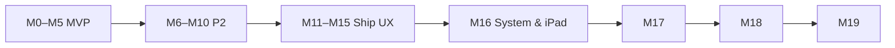

# Roadmap

**Where we are (2026-11-24):** autonomous work across **M0–M16** (including ADR-0022 and Tech Debt A–D/TD-12) is complete. Next up: **M17–M19** (polish, messaging completeness, power-user depth). External (`👤`) and physical-device (`📱`) items live in `HANDOFF.md` §5. Evidence: [design/UX_AUDIT.md](design/UX_AUDIT.md); bar: "Ship-ready definition" below.

Capacity: solo, part-time (D24); estimates are **[ASSUMPTION]**s. Each milestone exits with its ACs **verified by tests** (AGENTS.md §0, §12).

## Remaining work (the loop's queue)
Ordered queue for the autonomous loop ([development/AUTONOMOUS_LOOP.md](development/AUTONOMOUS_LOOP.md), D70). Take the first unchecked autonomous item; `👤` (founder), `📱` (device), and `📤` (upstream) items don't block the queue. Completed M0–M16 history is in "Done (M0–M16)" below.

**M17 Ship-readiness polish & hardening** (Autonomous refinement loop; raises quality to 1.0 ship bar)
- [ ] **Room-open smoothness & thumbnail cache (HANDOFF §5):** minimize the ~150 ms push delay without regressing D95 (newest message, zero flash of top, no spinner); avoid redundant own-thumbnail re-downloads after restart.
- [ ] **Crash safety & Honest UI audit:** replace `preconditionFailure` in `HaloPlatform/WebAuthSessionPresenter.swift` with typed `HaloError` + test; audit all `try? await` sites across `HaloCore`, `HaloApple`, `ios/App`, and extensions so zero user-initiated or state-changing actions fail silently (`HaloLog` + `HaloErrorCopy`).
- [ ] **System accessibility & motion polish (D84):** respect `accessibilityReduceMotion`, `colorSchemeContrast`, Reduce Transparency, and Bold Text across timeline transitions, composer panel swaps, jump pills, banners, and animated stickers; verify Light/Dark/AX5 on iPhone + iPad simulators.
- [ ] **Complete state coverage (AC-UX-6):** audit every screen for `LoadingState`, `EmptyState`, `ErrorState`, and `ActionState` double-tap protection.
- [ ] **Code health & file-size discipline:** split oversized files (`FeatureSettings/SettingsView.swift`, `ios/App/HaloApp.swift`, `FeatureTimeline/TimelineMessageRowView.swift`) below ~500 lines; expand `HaloUITests` accessibility audits and offline/reconnect coverage.
- [ ] **Copy & localization readiness (`Q-L10N` prep):** Apple-native copy pass and extract remaining user-facing strings into `ios/App/Resources/Localizable.xcstrings`.

**M18 Everyday messaging completeness** (Standard Matrix/SDK APIs)
- [ ] **Forward messages & media:** forward text, images, files, audio, and stickers to one or more chats via `ShareTargetPickerView`, preserving captions/formatting and E2EE boundaries.
- [ ] **In-room search & jump-to-message:** room-scoped `SearchPort` search jumping to events via `TimelineFocus.Event`, with match navigation and highlight-on-jump.
- [ ] **Rich message rendering polish:** monospace code blocks with one-tap "Copy code", inline spoilers (`data-mx-spoiler`) with tap-to-reveal, and opt-in link previews (off by default in E2EE rooms, D57).
- [ ] **Voice & media playback polish:** audio scrubbing bar, `1×`/`1.5×`/`2×` speed toggle, sequential voice playback, inline video (`AVPlayerViewController`), and Save-to-Photos with permission priming.
- [ ] **Multi-select messages in timeline:** bulk forward, copy, or redact/delete (respecting power levels).
- [ ] **Message details & read-receipt inspector:** sheet showing delivery state, encryption status, and readers with timestamps.

**M19 Power-user organization, trust & ecosystem** (Apple-native Matrix depth)
- [ ] **Matrix Spaces & room-list organization:** read-only `m.space` hierarchy as room-list filters (keeping D85 single-stack shell, no tab bar), plus Low Priority filtering.
- [ ] **Room moderation & management:** kick, ban/unban, banned list, power levels (Admin/Moderator/Default), edit topic/avatar/canonical alias, join rules (Invite/Knock/Public), and history visibility — gated by live power levels.
- [ ] **Join by alias / `matrix.to` & QR codes:** join rooms or start DMs from `#alias:server`, `!roomId`, or `matrix.to` links; shareable profile/room QR codes and QR scanner.
- [ ] **App Lock (Face ID / Touch ID / Passcode):** opt-in biometric lock in Settings → Privacy with configurable timeout, integrated with D61 privacy blur.
- [ ] **Storage & cache management:** Settings → Storage showing SDK media cache, database, and log footprint, with "Clear media cache" and retention controls (D55).
- [ ] **Notification keywords & push rules:** manage Matrix keyword push rules in Settings → Notifications for `ReadStatePolicy` mention/keyword mode.

**External, device & upstream leftovers (M4–M16; details in `HANDOFF.md` §5)**
- [ ] 👤 Push gateway deploy (`infra/sygnal/`), APNs keys, `Q-KLIPY-PROD`, Beta 1 → Beta 2 → 1.0 TestFlight/App Store, `Q-BRAND` Beta 2 artwork, `Q-APPSTORE` live URLs/screenshots, legal/export review (`D38`, `V-LEGAL`).
- [ ] 📱 Device checks: 7-day AC-U8 soak, interactive NFR-2 scroll hitch / 300-room / MetricKit run, `V-SHARE-1` + Share extension, iPad split/inspector/drag-and-drop, Focus filter, widgets, Siri/Spotlight, composer panels, voice/location/poll/article sends.
- [ ] 📤 TD-15: upstream SDK `SyncSettingsV2` filter (R-18) and queued `sendRaw`/`sendSticker` (R-21).
- [ ] (deferred, D71, not blocking) CI: always-on macOS job (`Q-CI-MAC`; manual workflow in place).

## Ship-ready definition (D84)
Halo is ready for external testers when **all** of these hold:

| Area | Bar | Check |
|---|---|---|
| Correctness | AC-U1–U7 green; AC-U8 soak with zero unexplained auditor findings | Scenario suite, auditor |
| Native feel | No raw colours or fixed font sizes outside `HaloDesignSystem`; system nav/bars/sheets | AC-UX-1, `check-design-tokens.sh` |
| First five minutes | Install → signed in → verified → first message sent in ≤ 3 min, no dead ends | AC-UX-5, moderated test (3 people) |
| States | Every screen has loading, empty and error states (DESIGN_SYSTEM §8) | AC-UX-6 |
| Accessibility | Zero `performAccessibilityAudit()` issues on root screens; AX5 + VoiceOver golden path | AC-UX-8, AC-UX-9 |
| Performance | NFR-1, NFR-2 met on an iPhone 15-class device | AC-UX-11 |
| Stability | Crash-free sessions ≥ 99.5 % in internal beta; no hang > 2 s in MetricKit | TestFlight + MetricKit |
| Compliance | Privacy manifest, privacy labels, export compliance, licence gate, legal review | AC-UX-12, BUILD_AND_RELEASE §4 |

## Release plan
| Release | Contents | Audience | Entry |
|---|---|---|---|
| **Beta 1** (internal TestFlight) | M0–M16 + push gateway (R-24) | Founder + 1–3 people | Push gateway live |
| **Beta 2** (external TestFlight) | + M17 polish, M15 compliance items | ≤ 25 trusted testers | Ship-ready definition met except 1.0-only lines |
| **1.0** (App Store) | + M18–M19, Beta 2 fixes, final icon/screenshots, legal sign-off | Public (Matrix power users) | 2 weeks of Beta 2 with no P0/P1 bug open |

## Milestones
| # | Milestone | Scope | Exit criteria | Gates |
|---|---|---|---|---|
| M0–M5 | MVP (done) | Foundation, read-only client, messaging, read-state engine, stickers v1, MAS/hardening | AC-U1–U7, AC-M*, AC-S*, AC-U8 (soak 📱) | G-NSE, G-UNREAD, G-FFI (PASS, D109) |
| M6–M10 | P2 (done) | Bot cards, Bot Activity, Search + Saved, Gallery + Export, Threads | AC-B*, AC-A*, V-SEARCH-1, thread unread | — |
| M11–M15 | Ship UX (done except 👤/📱) | Design system, single-stack nav (D85), core-flow polish, AX/L10n, ship readiness | AC-UX-1–AC-UX-12, Ship-ready definition | Q-BRAND, Q-APPSTORE, V-LEGAL |
| M16 | System & iPad (done except 📱) | Share extension, Siri/Spotlight, widgets, Focus filter, iPad 3-col, composer panels, drag & drop | Unit/UI tests green (calls dropped, D94) | V-SHARE-1, Q-KLIPY-PROD |
| M17 | Ship-readiness polish | Room-open smoothness, crash/silent-error sweep, Reduce Motion/Contrast, AC-UX-6, file splits, L10n | Zero silent mutation failures, AX/motion green | — |
| M18 | Messaging completeness | Forward, in-room search & jump, code/spoilers/previews, voice/video polish, multi-select, message info | Unit/contract/UI tests green; E2EE/Honest UI intact | — |
| M19 | Power-user depth | Spaces filter, moderation/room settings, `matrix.to`/QR, biometric App Lock, Storage UI, keywords | D85 shell & security invariants intact | — |

## Gates
| Gate | When | Status | Summary |
|---|---|---|---|
| **G-FFI** | M3 | **PASS (D109)** | Stay on upstream `MatrixRustSDK` binary (ADR-0003). |
| **G-NSE** | M1 | **PASS (D109)** | 100/100 live iPhone 16 soak (`F-DEV-1`/`F-DEV-2`, 6.2 MB peak; ADR-0016). |
| **G-UNREAD** | M3 | **PASS (D109)** | `ReadStatePolicy` over classic sync passes AC-U1–U7 (S01–S29); 7-day AC-U8 soak in Beta 1. |

## Dependencies

## Technical risks per milestone
See [RISK_REGISTER.md](RISK_REGISTER.md). Highest: T-NSE, T-RECEIPTS, T-STATE, PROJ-1.

## Done (M0–M16)
Detailed history in `git log`, [CODEBASE_REVIEW.md](CODEBASE_REVIEW.md), [development/TECH_DEBT.md](development/TECH_DEBT.md), and [testing/GATE_EVALUATION_M3.md](testing/GATE_EVALUATION_M3.md).

- **M0 Foundation:** `infra/dev` Synapse, Swift packages, `project.yml`, pinned `MatrixRustSDK`, Keychain, CI/licence/boundary gates, login & restore.
- **M1 Read-only client:** classic sync, room list, timeline, recovery/SAS verification, media/Quick Look, iPhone 16 G-NSE 100/100 pass.
- **M2 Messaging:** composer, offline send queue, replies, edits, deletes, reactions, mentions, typing, receipts, drafts, media/file/audio/video send.
- **M3 Read-state engine:** `ReadStatePolicy` + `BadgeCalculator` (D82), classic sync evidence (D73/D74), GRDB outbox & auditor, P1–P11 & S01–S29 green.
- **M4 Stickers v1:** pack discovery + legacy `im.ponies.*`, animated preview/autoplay, favourites/recents/search, pack creation & editing.
- **M5 MVP hardening:** MAS/OIDC login, Settings, acknowledgements, privacy blur (D61), profiles, room details/invites, Sygnal pushkin (`infra/sygnal/`, D112).
- **M6–M7 Bots:** Layer 2 bot cards, allowlist sync, `bot_task` index, Bot Activity view & task ticking.
- **M8–M10 P2 features:** E2EE `SearchService`, Saved Messages, per-room & Global Media Gallery (D83), encrypted export (D32), Threads.
- **M11 Design system:** `HaloDesignSystem` tokens/components/haptics, WCAG AA contrast tests, `check-design-tokens.sh`.
- **M12 Navigation (D85):** single `NavigationStack`, `ChatsRouter` + `@SceneStorage`, `.searchable` messages, unified routing.
- **M13 Core-flow polish:** first-run priming/checklist, skeleton rows, swipe-to-reply, double-tap 👍, `HaloErrorCopy`, `ActionState`.
- **M14–M15 AX, L10n & ship prep:** VoiceOver/AX5, `HaloUITests`, `Localizable.xcstrings`, `PrivacyInfo.xcprivacy`, feedback/What's New, `docs/release/` drafts (D115).
- **M16 System & iPad:** Share extension + direct send (D87/D92), Siri/Spotlight + Send-by-Siri (D88), unread widgets (D89/D93), Focus filter (D90), iPad 3-column layout + shortcuts + drag & drop (D91), composer panels + KLIPY + voice/location/poll/article (D97–D106).
- **Architecture & Tech Debt (ADR-0022, Phases A–D, TD-12):** two-manifest consolidation (`HaloCore` + `HaloApple`), swift-format/SwiftLint, `PreferencesPort`, `bot_action` table, AES-256-GCM `halo.sqlite` field encryption (D108).
