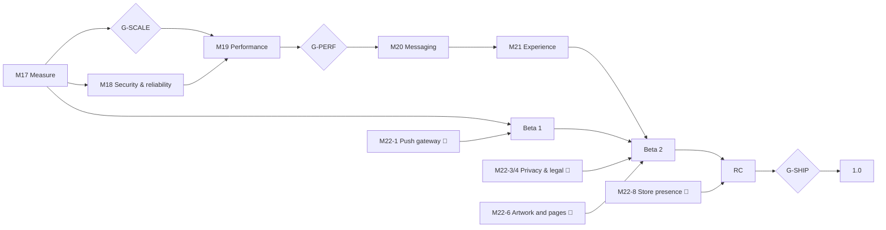

# Roadmap

**Where we are (2026-11-25):** M0–M16 are built and merged (PRs #1–#88). Halo is a working client, **not yet a release candidate**: an audit of
the code against the documents (§2) found promised behaviour that doesn't exist, two App Store blockers, and no evidence yet for the
scale and performance targets. **M17–M22 below take it from here to the App Store** (re-planned 2026-11-25, D121). Decisions the plan is
waiting for are in [OPEN_QUESTIONS.md](OPEN_QUESTIONS.md); device and founder items in `HANDOFF.md` §5.

Capacity: solo, part-time (D24). Sizes **[ASSUMPTION]**: S ≤ 1 day · M 2–4 days · L 1–2 weeks of focused work. No calendar dates are promised.

## 1. How to read this plan
| Mark | Meaning |
|---|---|
| **R** | Release requirement: 1.0 doesn't ship without it |
| **C** | Candidate: ships in 1.0 only if finished before the Beta 2 cut; never delays it (D122) |
| **P** | Post-launch (§10) |
| 👤 / 📱 / 📤 | Needs the founder / a physical device / an upstream SDK change. Doesn't block the rest of the queue |

**Order and why.** M17 measures first, because its result (G-SCALE) can change the sync engine and everything built on it. M18 fixes what can lose
data, leak or lie. M19 makes it fast before M20 adds media features on the same image and timeline code. M21 polishes once, after the features
exist. M22 proves it with people and ships it. Within a milestone, take tasks top to bottom.

**A task is done** when its "Done when" holds *by a test that failed before*, the owning spec is updated, `scripts/prepush.sh` and the touched
contract tests pass, and it's merged. Implementing the feature isn't enough: it must also have loading, empty, error and offline states, VoiceOver
labels, Dynamic Type up to AX5, strings in the catalog, and no regression in the M19 budgets once they exist.

**A milestone is done** when every R task is done (or listed in HANDOFF §5 as waiting for 👤/📱 with the exact check) and its exit gate is recorded in §7.

## 2. Gap audit (2026-11-25, commit `155f745`)
What the documents claimed and the code doesn't have. Evidence is a search or file at that commit. Remove a row when its task is merged.

| ID | Gap | Evidence | Task |
|---|---|---|---|
| GA-05 | Contacts' identity changes are never shown (security) | no `IdentityStatus` use | M18-1 |
| GA-10 | OIDC checked only up to the authorization URL | `AdapterContractTests.oidcDiscovery` | M18-6 |
| GA-13 | Double-tap protection exists but only message and room-list changes use it (`ActionGuard`); other screens keep their own flags, with no test per action | `ActionGuard` callers | M18-8 (rest) |
| GA-15 | Photos are decoded on the main thread, some on every redraw; no decoded cache or memory-warning handling (MEDIA §1) | `UIImage(data:)` in view bodies | M19-1 |
| GA-16 | Every timeline change rebuilds every row on the main actor (rows are cached since M19-2; the passes over all items and the main actor remain) | `TimelineViewModel+Mapping.apply` | M19-2 |
| GA-17 | The room list is replaced as a whole on every change (ROOM_LIST §4 forbids it; the adapter sends only changes since M19-3) | `.diff(.reset(list))` | M19-3 |
| GA-18 | Video and voice play only in Quick Look | no `AVPlayer` | M20-2, M20-3 |
| GA-19 | Polls can be created but not voted in or ended | no `sendPollResponse` | M20-4 |
| GA-20 | No camera: only existing photos can be sent | no capture code or usage string | M20-5 |
| GA-22 | No way to report a message or room (App Review 1.2) | no `reportContent` | M20-7 |
| GA-23 | Upgraded rooms: no link to the successor | only the share extension checks it | M20-8 |
| GA-24 | Localisation isn't ready: 12 catalog keys, about 376 literals in views (AC-UX-10 was ticked) | `Localizable.xcstrings` | M21-6 |
| GA-25 | Shared loading/error states used on 2 screens; system motion and contrast settings barely read | `ErrorState`, `accessibilityReduceMotion` ×2, `HaloMotion` ×2 | M21-1, M21-3 |
| GA-26 | Release builds have no push gateway; the privacy manifests and labels don't mention KLIPY search | `Base`/Release config, `PrivacyInfo.xcprivacy` | M22-1, M22-3 |
| GA-28 | Every launch asks the server for one event per unread room (344 requests at 1,000 rooms) to find the read position's time | scale measurement; `MatrixRoomListPort.ownReadThrough` | M19-3 |
| GA-29 | A half-open connection hides new messages for 39 s (now 24 s: request timeout 15 s, M18-11) | `FaultTests.halfOpenSync` | M18-11 |
| GA-30 | The plain text of a message with a mention is the Markdown source, so other clients' notifications show a link | `InteropTests.outgoing` | M20-10 |
| GA-31 | Messages of a type Halo doesn't know are missing from the timeline instead of showing their fallback text | `InteropTests.incoming` | M20-19 |

## 3. Queue

### M17 — Measure and prove
**Goal:** know, with numbers, whether the foundation holds for real accounts. **Depends on:** nothing. **Risk:** T-SCALE, PERF-1.

| Task | Class · size | Done when |
|---|---|---|
| [x] **M17-1 Signposts** for cold start → list, room open → first frame, sync round trip, image decode, NSE | R · S | XCTest reads each interval; LOGGING §5 lists them |
| [x] **M17-2 MetricKit** payloads (crash, hang, CPU, memory, disk) kept on the device and included in the diagnostics export | R · S | Unit test round-trips a payload; export reviewed: no content or raw IDs; limited in size and age |
| [x] **M17-3 Scale fixture**: own accounts with 300 and 1,000 rooms, one 10,000-member room, one 20,000-event media room | R · M | Script in `infra/dev`, idempotent, never touches the shared contract accounts, removable |
| [ ] **M17-4 Measure classic sync at scale** (V-SCALE-1; *fixtures measured 2026-11-25, TEST_STRATEGY §7; open: iPhone and energy 📱, a real public-server account 👤; G-SCALE accepted, D125*): first sync time, bytes, memory, store size; incremental sync; idle energy | R · M · 📱👤 | Table in TEST_STRATEGY §7 for both fixtures and one real public-server account; **G-SCALE** decided (Q-SYNC-SCALE) |
| [ ] **M17-5 Repeatable performance suite** with the budgets of TEST_STRATEGY §7 (*`scripts/perf.py` built, simulator baseline recorded; open: the device baseline 📱*) | R · M · 📱 | One command prints budget / measured / pass; same device, Release build; over 20 % worse fails |
| [x] **M17-6 Fault injection and scenarios in CI**: `infra/test` with a proxy (drop, latency, 5xx, 429, half-open) and `scenarios.yml` | R · M | The scenario driver runs on Linux CI; offline, reconnect and rate-limit cases red/green on demand |
| [ ] **M17-7 Interoperability matrix** (V-INTEROP-1; *wire level automated and green but for GA-30/GA-31; open: the signed checklist in Element Web and Element X 👤, INTEGRATION_TESTS §4*): every message kind, both directions, Element Web + Element X | R · M | Second-client checks automated where possible, the rest a signed checklist; gaps become tasks |
| [x] **M17-8 Search index spike** (V-SEARCH-2, V-SEARCH-3; *passed on the simulator 2026-11-25, design corrected in ADR-0024; the iPhone run belongs to M19-11*): what Halo's own index costs at 1,000 rooms, and whether encrypted history decrypts while paging | R · M | Numbers in TEST_STRATEGY §7; pass or fail against MESSAGE_SEARCH §4 recorded in OPEN_QUESTIONS; feeds G-SCALE |

**Exit:** G-SCALE recorded; every NFR has a measured baseline.

### M18 — Security, data safety and reliability
**Goal:** nothing is lost, leaked, sent to the wrong device, or shown as true when it isn't. **Depends on:** M17-6. **Risk:** T-IDENTITY, T-RECOVER, T-XPROC.

| Task | Class · size | Done when |
|---|---|---|
| [x] **M18-1 Identity changes** (*built 2026-11-26; open: VoiceOver, an iPhone look; verifying a contact has no flow yet*): composer banner when a contact's identity changes; accept (ENCRYPTION FR-7) | R · M | Contract test: a second account resets its identity, the notice appears; VoiceOver; AC-SEC-1 |
| [x] **M18-2 Honest send failures** (*built 2026-11-26; no real-server refusal under the default strategy, so unit-tested per reason; "Review devices" is the text's advice, not a button*): carry the SDK's reason; "Send anyway" / Retry where the SDK allows it | R · M | Unit per reason; no encryption refusal shown as offline; AC-SEC-2 |
| [x] **M18-3 Lost recovery key** (*built 2026-11-26; open: the OIDC approval on the MAS stack (M18-6), VoiceOver, an iPhone look*): reset the identity with a plain warning; show key-backup state | R · M | Contract test on a throwaway account; AC-SEC-3 |
| [x] **M18-4 Backups and sign-out** (*built 2026-11-26; open: the restore-to-new-device check, Spotlight and pusher on an iPhone 📱*): exclude stores and caches; detect stores restored without their keys; sign-out leaves nothing | R · M | Test lists App Group, Keychain, Spotlight, widget and pusher after sign-out (AC-AUTH-4); restore-to-new-device check 📱; AC-SEC-4 |
| [x] **M18-5 Store recovery** (*built 2026-11-26; open: the screens on an iPhone, a locked-phone launch 📱*): damaged or unopenable `halo.sqlite` or SDK store → keep a copy, rebuild, or a clear reset path; migration fixtures | R · M | Corruption tests for both stores; upgrade test from every released schema; AC-REL-5 |
| [ ] **M18-6 OIDC end to end** (V-OIDC-1): sign-in, rotation in app and NSE, soft logout, sign-out | R · M · 👤 | Contract on the MAS stack incl. forced token expiry during a push; one public server by hand; AC-REL-6 |
| [x] **M18-7 Notification actions** (*built 2026-11-26; open: V-PUSH-4, Reply and Mark as read from a terminated app on an iPhone 📱, and re-running G-NSE since the NSE changed*): Reply and Mark as read from the lock screen (V-PUSH-4) | R · M · 📱 | Reply reaches the server from a terminated app or says it didn't; nothing sent twice; AC-REL-7 |
| [x] **M18-8 No silent failures** (*built 2026-11-26 as far as the lint rule goes; open: `ActionGuard` is on message and room-list changes only (other screens keep their own `isWorking` flags), a double-tap test per remaining action, and `try?` without `await`*): review every `try?` on a state change, route through `HaloErrorCopy`; `ActionState` on every mutating control; remove the `preconditionFailure` | R · L | Custom lint rule with a written allow-list, 0 findings; a failure and a double-tap test per action; AC-REL-4 |
| [x] **M18-9 Matrix links** (*built 2026-11-26; open: a UI test with a link in a message, a device look 📱*): handle `matrix.to` taps in messages and the `matrix:` scheme; always ask before joining or starting a chat | R · S | UI test: no join without confirmation, errors are said; NAVIGATION §3 |
| [ ] **M18-10 Read-state and push matrix**: foreground, suspended, terminated, rebooted-locked, airplane, clock change, two devices | R · M · 📱 | Table in UNREAD_REGRESSION_TESTS green on a device; widgets and icon agree; AC-REL-1, AC-REL-2 |
| [x] **M18-11 Delivery under faults** (*built 2026-11-26: every kind exactly once under lost answer, 429 and drop; kill with messages waiting, token refused mid-send; half-open sync 39 s → 24 s; open: a sticker is not queued so a failure is shown, not retried; a real token refresh (needs a Synapse with short token lifetimes, M18-6)*): no lost, duplicated or reordered own messages across kill, reconnect, 429 and token expiry | R · M | M17-6 cases green for text, photo, file, sticker, reply, edit, reaction; AC-REL-3 |
| [ ] **M18-12 Security review**: threat model walk-through, log scan of a full session, lint for sensitive logging, build check for TLS bypass, advisory check, disclosure policy | R · M · 👤 | Report with zero open high findings; SECURITY §6/§9 true; legal parts stay with M22-4 |
| [x] **M18-13 Sign out other sessions** (*built 2026-11-26; open: the OIDC account page link (M18-6), VoiceOver, an iPhone look*; password UIA; OIDC uses the account page, D117) | C · S | Contract test on a throwaway account |

**Exit:** AC-SEC-1–5 and AC-REL-1–7 met; `G-UNREAD` re-run green.

### M19 — Performance and seamless rendering
**Goal:** immediate and still: no freeze, flash or jump. **Depends on:** M17 baselines, G-SCALE. **Risk:** T-PERF, T-SCALE.

| Task | Class · size | Done when |
|---|---|---|
| [x] **M19-1 One image pipeline** (*built 2026-11-26; open: NFR-12/13 numbers on a device 📱, a frame-by-frame check that cached pictures paint on the first frame (M19-9)*): decode and downsample off the main thread to display size, decoded cache with a cap, eviction on memory warnings; used by every image view | R · L | No `UIImage(data:)` in a view (lint); NFR-12/13; pictures paint on the first frame when cached |
| [x] **M19-2 Incremental timeline** (*part built 2026-11-26: rows are cached per item, so one new message maps one row; open: the grouping, state-run and profile passes still walk every item, and none of it runs off the main actor; timings on a device 📱*): map only changed rows, off the main actor | R · M | Counter test: one new message maps ≤ 2 rows at 2,000 loaded; randomised diffs equal a full rebuild |
| [x] **M19-3 Incremental room list** (*built 2026-11-26; open: the adapter against a server with 1,000 rooms (`ScaleMeasurements`), timings on a device 📱; the coordinator still recomputes its summaries and read inputs from the whole list on each change*): real insert/move/update diffs | R · M | 1,000 rooms: one room's change updates one row; order still matches the SDK (AC-RL-2) |
| [x] **M19-4 Room opening** (*built 2026-11-26: the landing waits 80 + 60 ms → 16 + 32 ms; simulator p95 0.339 s → 0.238 s, scale300; open: the same check on the iPhone 📱 (UI automation timed out: phone locked or automation off)*): shorten the ~150 ms after the push without losing D95 | R · M | NFR-11; `testRoomOpeningLandsAtNewestTenTimes` green |
| [~] **M19-5 Media by file, not memory** (*part built 2026-11-26: opening or dragging out a file or video writes it to disk (`MediaPort.file`, the SDK's file API) and the limit is 300 MB instead of 50; open: own thumbnails after a restart, gallery pages, progress and cancel while opening, a 100 MB memory measurement 📱, an encrypted room's file*): full-size photos, videos and files stream to disk; no repeat download of own thumbnails after a restart; gallery pages | R · M | Opening a 100 MB video stays under NFR-12; network test: cached media makes no request |
| [ ] **M19-6 Launch at scale** | R · M · 📱 | NFR-1 with 300 and 1,000 rooms, Release build, after an update and after a reboot |
| [ ] **M19-7 Sync and energy**: apply the G-SCALE outcome; fewer wake-ups; respect Low Power Mode and thermal state | R · L · 📤? | NFR-14/15 met; no regression in S01–S29 |
| [ ] **M19-8 Scrolling**: mixed media, animated stickers, long formatted messages | R · M · 📱 | NFR-2 measured interactively, hitch ratio recorded |
| [~] **M19-9 Zero flash and jump audit** (*tool and first pass built 2026-11-26, [MOTION_AUDIT](testing/MOTION_AUDIT.md): D-MOT-1/D-MOT-2 fixed for every room (D126: the tapped room starts before its push and the screen slides in with its rows; tap → first rows 35–46 ms median on the simulator, 236 ms for the first room of a launch (was 77–312 ms); 0 empty frames on the films; the top-three view models are retired); keyboard and return from background are clean; open: the iPhone 📱, the other transitions, UI tests*): launch, room open/close, keyboard, send → confirm, edit, reaction, reconnect, history prepend, appearance change, return from background | R · M | Frame-by-frame capture of each; every defect fixed or filed; UI tests for the ones that can be measured; AC-MOT-1 |
| [ ] **M19-10 Leaks and soak**: 50 room open/close cycles, 30 min scroll, background/foreground | R · S · 📱 | No growth over 10 %; no task or subscription left after close |
| [ ] **M19-11 Message search on Halo's own index** (*built 2026-11-25; open: iPhone checks 📱*) (D123, D124, ADR-0024): encrypted rooms, full history, CJK, files and links; SDK index off and its folder deleted. Slices: correctness of today's search (stale results, load-more guard) · tokeniser and store · live lane · history lane · switch-over · interface | R · L · 📱 | AC-SRCH-1…9; `infra/test/run.sh search` and S01–S29 green. Needs M17-8 and **M20-1** |

**Exit:** **G-PERF** — all budgets of TEST_STRATEGY §7 met on the reference device with a Release build.

### M20 — Messaging completeness
**Goal:** everyday use without reaching for another client. **Depends on:** M19-1, M19-2, M19-5. **Risk:** scope (D122, PROJ-8).

| Task | Class · size | Done when |
|---|---|---|
| [x] **M20-1 Jump to any message** (*built with M19-11, 2026-11-25; a message 1,300 back opens in 0.04 s on the simulator*): event-focused timeline for replies, search, links, pins and notifications; back to newest | R · L | Event 5,000 messages back opens in ≤ 2 s online; offline or gone says so; read state unaffected |
| [ ] **M20-2 Voice and audio in the bubble**: waveform, scrub, 1×/1.5×/2×, route and interruption handling, keeps playing while scrolling | R · M | Unit on the player; interop with Element voice notes; VoiceOver adjustable |
| [ ] **M20-3 Video**: poster inline, full-screen player, captions on send, save and share | R · M | Streams from file (M19-5); portrait and landscape |
| [ ] **M20-4 Polls**: vote, change vote, end own poll, live results | R · M | Contract test with two accounts; pending vote looks pending |
| [ ] **M20-5 Camera**: take a photo or short video from the composer | R · M · 📱 | Permission asked in context; denied state; location stripped (D56) |
| [ ] **M20-6 Forward** text, media, files, stickers, locations | R · M | Re-encrypted for the target; warns when leaving an encrypted room; several targets |
| [ ] **M20-7 Report and block**: report a message or room to the homeserver, ignore from the same place | R · M | Contract test; confirms and says who receives it (Q-REPORT); App Review 1.2 |
| [ ] **M20-8 Room lifecycle**: successor of an upgraded room, knock/invite-only/banned previews, left and forgotten rooms | R · M | Each state has a screen and an action; no stuck row |
| [ ] **M20-9 Who read it, what happened**: receipts under others' messages (TIMELINE FR-6), message info sheet | R · M | Same readers as Element Web; no layout jump when receipts move |
| [ ] **M20-10 Text rendering**: code blocks with copy, spoilers, tables and lists safe | R · M | Interop fixtures; hostile HTML can't break layout or fetch anything |
| [ ] **M20-11 Search inside a room** with next/previous | R · M | Uses `SearchPort` with its room filter (MESSAGE_SEARCH FR-8); jumps via M20-1; empty and indexing states |
| [ ] **M20-12 Basic moderation**: remove, ban, unban, roles shown, gated by live power levels | R · M | Contract test; refused actions explained |
| [ ] **M20-13 Storage**: sizes, clear media cache, retention (D55) | R · S | Frees what it says; never touches keys or unsent messages |
| [ ] **M20-14 Notification keywords** | C · S | Round-trip push-rule contract test |
| [ ] **M20-15 App Lock** (Face ID/passcode, delay) | C · M | Covers app switcher, Share, widgets; extension behaviour decided first |
| [ ] **M20-16 Multi-select** (copy, forward, delete) | C · M | Power levels respected; partial failure reported |
| [ ] **M20-17 Link previews**, off by default, never in encrypted rooms by default (D57) | C · M | No request before opt-in |
| [ ] **M20-18 Unread tools**: mark all read, low-priority section | C · S | Goes through `ReadStatePolicy`; badge test |
| [ ] **M20-19 Unknown message types** show the sender's fallback text (GA-31) | R · S · 📤? | `InteropTests.incoming` without the known issue |

**Exit:** R tasks done; interop matrix (M17-7) re-run green.

### M21 — Experience, accessibility and language
**Goal:** feels like one finished Apple-native app (D84). **Depends on:** M20. **Risk:** PROJ-5.

| Task | Class · size | Done when |
|---|---|---|
| [ ] **M21-1 State matrix**: every screen × loading, empty, error, offline, no-permission, recovering | R · M | Matrix in SCREEN_SPECIFICATIONS, each cell a `#Preview` or test; AC-UX-6 |
| [ ] **M21-2 Flow walk-through**: install → first message; notification → reply; send photo; find an old message; recover from offline; new device | R · M | Steps counted and reduced; no dead end; AC-UX-5 with three people 👤 |
| [ ] **M21-3 Motion and system settings**: all animation through `HaloMotion`; Reduce Motion, Reduce Transparency, Increase Contrast, Bold Text | R · M | Lint for raw `withAnimation`; AC-MOT-2; screenshots per setting |
| [ ] **M21-4 Visual regression tests** for components and key screens (light, dark, contrast, AX5, RTL, iPad) | R · M | Run in `prepush.sh`; approach without a new dependency or justified (AGENTS §11) |
| [ ] **M21-5 VoiceOver, Voice Control, full keyboard** on the golden path; audit every root screen | R · M · 📱 | AC-UX-8, AC-UX-9 |
| [ ] **M21-6 Localisation**: a catalog per package, all strings, plurals; pseudo-language UI run; Beta 2 languages (Q-L10N) | R · L | AC-UX-10; lint: no new literal outside a catalog |
| [ ] **M21-7 Copy**: one voice; one error map instead of the three private ones | R · S | DESIGN_SYSTEM §12 review; `HaloErrorCopy` the only source |
| [ ] **M21-8 iPad and large screens**: split, inspector, drag and drop, keyboard; landscape media on iPhone | R · M · 📱 | HANDOFF §5 iPad checks passed |
| [ ] **M21-9 First run without an account**: explain, and where to get one (Q-SIGNUP) | R · S | No dead end on the sign-in screen |
| [ ] **M21-10 Structure**: the nine source files over 500 lines split; TECH_DEBT re-scored | C · M | No feature file over 500 lines |

**Exit:** AC-UX-1–11 and AC-MOT-1–2 met; UX_AUDIT has no open High.

### M22 — Beta, compliance and launch
**Goal:** proven by people, accepted by Apple, launched calmly. **Depends on:** see §5 entry conditions.

| Task | Class · size | Done when |
|---|---|---|
| [ ] **M22-1 Production push** 👤: `infra/sygnal` deployed with monitoring, APNs keys, capacity and an on-call rule | R · M | V-PUSH-5 on the Beta build; restart and key-rotation drill; PUSH_NOTIFICATIONS §6 checked |
| [ ] **M22-2 Build pipeline**: versions, signing, dSYMs, reproducible archive, macOS workflow on the release commit | R · M · 👤 | A second person could cut a build from BUILD_AND_RELEASE alone |
| [ ] **M22-3 Privacy**: manifests for every target, labels, policy text equal to behaviour (KLIPY, MetricKit, APNs, the message search index if built) | R · S · 👤 | Archive privacy report clean (AC-UX-12); policy reviewed against PRIVACY §2 |
| [ ] **M22-4 Legal** 👤: licences, export compliance, trademark, notices (D38, V-LEGAL) | R | Written sign-off |
| [ ] **M22-5 Beta 1** (§5) and fixes | R · 👤📱 | AC-U8 7-day soak clean; exit bar met |
| [ ] **M22-6 Final icon, sign-in artwork and published support and privacy pages** 👤 (Q-BRAND, Q-APPSTORE; before Beta 2, D115) | R | Links in Settings and the metadata agree and load |
| [ ] **M22-7 Beta 2** (§5), feedback triage weekly | R · 👤 | Exit bar met |
| [ ] **M22-8 Store presence** 👤: screenshots, metadata, review server and account (Q-REVIEW) | R | App Store Connect complete; a fresh reviewer can sign in and see messages |
| [ ] **M22-9 Release candidate**: feature freeze, full device checklist, upgrade from every Beta build, App Review submission | R · 👤 | **G-SHIP** |
| [ ] **M22-10 Launch**: phased release, daily watch for 14 days, stop rule, hotfix rehearsed | R · 👤 | 100 % rollout with no P0/P1 open |

## 4. Ship-ready definition (D84)
Halo is ready for external testers (Beta 2) when all rows hold except those marked 1.0; 1.0 needs all.

| Area | Bar | Check | Today |
|---|---|---|---|
| Correctness | AC-U1–U7 green; AC-U8 soak with zero unexplained findings | Scenario suite, auditor | U1–U7 ✅ · soak open |
| Reliability | AC-REL-1–7 | M18, M17-6 | open |
| Security | AC-SEC-1–5; no high finding open | M18-12 | open |
| Performance | All budgets (NFR-1, 2, 11–15) on an iPhone 15-class device, Release build | G-PERF | 2 of 7 measured, on a small account and a Debug build |
| Scale | G-SCALE decided and met | V-SCALE-1 | accepted (D125), conditions open |
| Seamless | AC-MOT-1, AC-MOT-2 | M19-9, M21-3 | open |
| Messaging | Every R task of M20; interop matrix green | M17-7 | open |
| Native feel | No raw colours or fixed font sizes outside `HaloDesignSystem` | AC-UX-1 | ✅ |
| First five minutes | First message in ≤ 3 min, no dead ends | AC-UX-5 (3 people) | open |
| States | Every screen × every state | AC-UX-6 | open (GA-25) |
| Accessibility | Zero audit issues on root screens; VoiceOver + AX5 golden path | AC-UX-8, AC-UX-9 | partly |
| Language | AC-UX-10 | M21-6 | open (GA-24) |
| Stability | Beta: crash-free sessions ≥ 99.5 %, no hang > 2 s. **1.0: ≥ 99.8 %, no hang > 1 s in the last 14 days** | TestFlight + MetricKit | not measured (no build in the field yet) |
| Compliance | Manifests, labels, export, licences, legal, report/block | AC-UX-12, M22 | open |

## 5. Release plan
| Release | Contents | Audience | Entry | Exit |
|---|---|---|---|---|
| **Beta 1** (internal TestFlight) | M0–M16 + M17; M18 lands during it | Founder + 1–3 people | Push gateway live (M22-1); MetricKit in the build (M17-2); KLIPY production key or GIF search off (Q-KLIPY-PROD) | AC-U8 clean; no P0; M18 done |
| **Beta 2** (external TestFlight) | + M18–M21 R tasks; finished C tasks | ≤ 25 trusted testers | Ship-ready rows met except 1.0-only; legal and privacy done (M22-3, M22-4); final artwork and pages (M22-6) | 14 days with no P0/P1; ≥ 10 active testers; stability bar |
| **1.0** (App Store) | + Beta 2 fixes, store listing | Public (Matrix power users) | G-SHIP | Phased release complete |
| **1.x** | §10 | — | Re-plan after 30 days of real feedback | — |

**Severity.** P0: data loss, wrong recipient, key or token exposure, wrong unread that doesn't heal, crash loop. P1: a core flow fails or a visible state is
wrong. P2: workaround exists. P3: polish. A P0 stops a rollout; fixed forward (BUILD_AND_RELEASE §6).

## 6. Milestones
| # | Milestone | Exit criteria | Gates |
|---|---|---|---|
| M0–M16 | Built (§11) | Device/founder leftovers in HANDOFF §5 | G-NSE, G-UNREAD, G-FFI (PASS, D109) |
| M17 | Measure and prove | Baselines for every NFR | **G-SCALE** |
| M18 | Security, data safety, reliability | AC-SEC-1–5, AC-REL-1–7 | G-UNREAD re-run |
| M19 | Performance and seamless rendering | NFR-1, 2, 11–15; AC-MOT-1 | **G-PERF** |
| M20 | Messaging completeness | R tasks; interop matrix | — |
| M21 | Experience, accessibility, language | AC-UX-1–11; AC-MOT-2 | — |
| M22 | Beta, compliance, launch | Release plan exits | **G-SHIP** |

## 7. Gates
| Gate | When | Status | Summary |
|---|---|---|---|
| **G-FFI** | M3 | **PASS (D109)** | Stay on upstream `MatrixRustSDK` binary (ADR-0003). |
| **G-NSE** | M1 | **PASS (D109)** | 100/100 live iPhone 16 soak (ADR-0016). Re-run after M18-6/M18-7 change the NSE. |
| **G-UNREAD** | M3 | **PASS (D109)** | S01–S29 over classic sync; 7-day AC-U8 soak in Beta 1. |
| **G-SCALE** | M17 | **PASS with conditions (D125, founder, 2026-11-25)** | Accepted on the simulator numbers: classic sync meets NFR-14 at 1,000 rooms without the SDK's search index (TEST_STRATEGY §7, M17-8). Still to show, before G-PERF: ~~M19-11 in the app~~ (done on the simulator, 2026-11-25), an iPhone, one real account; a failure reopens Q-SYNC-SCALE. |
| **G-PERF** | M19 | open | All budgets on the reference device, Release build, two runs on different days. |
| **G-SHIP** | M22 | open | §4 complete, zero P0/P1, upgrade path tested, rollback rehearsed, founder sign-off. |

## 8. Dependencies

Founder items with long lead times, worth starting now: legal review, push gateway, KLIPY production key (Q-KLIPY-PROD), filtering entitlement (R-14), final artwork.

## 9. Risks
[RISK_REGISTER.md](RISK_REGISTER.md). Highest for the release: T-SCALE (classic sync on large accounts), T-IDENTITY, PROJ-1 (capacity), PROJ-6 (App Review).
If capacity runs short, cut C tasks first, then move M20-9/10/11 to 1.1 by a founder decision — never M17–M19.

## 10. Post-launch (P)
Not scheduled; each needs a spec and, where noted, a decision.
- **Spaces** as room-list filters (D85 shell kept); **room settings** (roles editor, aliases, join rules, history visibility); **QR codes** for people and rooms.
- **QR sign-in and verifying contacts** (Q-VERIFY); **several accounts** (no decision; touches every store and the NSE).
- **Sticker v2** (STICKERS §14), custom emoticons, sticker packs in spaces; **sequential voice playback**; live location; threads list.
- **More languages**, accent colours, Live Activity for uploads, Apple Watch. Calls stay out (D94).
- 📤 TD-15: filter in `SyncSettingsV2` (R-18, may become R through G-SCALE) and queued `sendRaw`/`sendSticker` (R-21). Always-on macOS CI (Q-CI-MAC, D71).

**Where the previous M17–M19 items went:** room-open and thumbnails → M19-4, M19-5 · crash safety and silent errors → M18-8 · accessibility and motion → M21-3, M21-5 ·
state coverage → M21-1 · file sizes → M21-10 · localisation → M21-6 · forward → M20-6 · in-room search and jump → M20-1, M20-11 · rendering and previews → M20-10, M20-17 ·
voice and video → M20-2, M20-3 · multi-select → M20-16 · message details → M20-9 · Spaces, roles editor, QR → §10 · moderation → M20-12 · links → M18-9 · App Lock → M20-15 ·
storage → M20-13 · keywords → M20-14. The 1.0/post-launch split is D122.

## 11. Done (M0–M16)
Detailed history in `git log`, [CODEBASE_REVIEW.md](CODEBASE_REVIEW.md), [development/TECH_DEBT.md](development/TECH_DEBT.md), and [testing/GATE_EVALUATION_M3.md](testing/GATE_EVALUATION_M3.md).

- **M0 Foundation:** `infra/dev` Synapse, Swift packages, `project.yml`, pinned `MatrixRustSDK`, Keychain, CI/licence/boundary gates, login & restore.
- **M1 Read-only client:** classic sync, room list, timeline, recovery/SAS verification, media/Quick Look, iPhone 16 G-NSE 100/100 pass.
- **M2 Messaging:** composer, offline send queue, replies, edits, deletes, reactions, mentions, typing, receipts, drafts, media/file/audio/video send.
- **M3 Read-state engine:** `ReadStatePolicy` + `BadgeCalculator` (D82), classic sync evidence (D73/D74), GRDB outbox & auditor, P1–P11 & S01–S29 green.
- **M4 Stickers v1:** pack discovery + legacy `im.ponies.*`, animated preview/autoplay, favourites/recents/search, pack creation & editing.
- **M5 MVP hardening:** MAS/OIDC login, Settings, acknowledgements, privacy blur (D61), profiles, room details/invites, Sygnal pushkin (`infra/sygnal/`, D112).
- **M6–M7 Bots:** Layer 2 bot cards, allowlist sync, `bot_task` index, Bot Activity view & task ticking.
- **M8–M10 P2 features:** E2EE `SearchService`, Saved Messages, per-room & Global Media Gallery (D83), encrypted export (D32), Threads.
- **M11 Design system:** `HaloDesignSystem` tokens/components/haptics, WCAG AA contrast tests, `check-design-tokens.sh`.
- **M12 Navigation (D85):** single `NavigationStack`, `ChatsRouter` + `@SceneStorage`, `.searchable` messages, unified routing.
- **M13 Core-flow polish:** first-run priming/checklist, skeleton rows, swipe-to-reply, double-tap 👍, `HaloErrorCopy`; `ActionState` was added but isn't used (GA-13).
- **M14–M15 AX, L10n & ship prep (partly: GA-24, GA-25, GA-26):** VoiceOver/AX5, `HaloUITests`, first `Localizable.xcstrings` keys, `PrivacyInfo.xcprivacy`, feedback/What's New, `docs/release/` drafts (D115).
- **M16 System & iPad:** Share extension + direct send (D87/D92), Siri/Spotlight + Send-by-Siri (D88), unread widgets (D89/D93), Focus filter (D90), iPad 3-column layout + shortcuts + drag & drop (D91), composer panels + KLIPY + voice/location/poll/article (D97–D106).
- **Architecture & Tech Debt (ADR-0022, Phases A–D, TD-12):** two-manifest consolidation (`HaloCore` + `HaloApple`), swift-format/SwiftLint, `PreferencesPort`, `bot_action` table, AES-256-GCM `halo.sqlite` field encryption (D108).
- **After M16:** one unread count for icon, widgets and list, background refresh, offline reads, account data changed from the server's copy, clean contract runs (D118–D120, PR #88).
