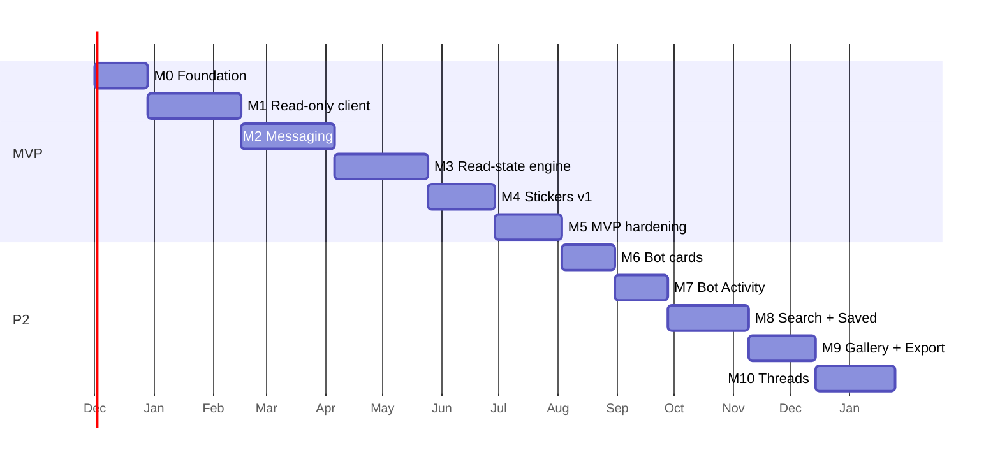
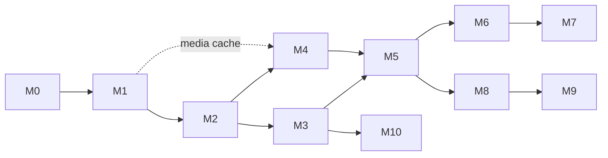

# Roadmap

Capacity: solo, part-time (D24). Estimates are calendar weeks at ~15 h/week and are **[ASSUMPTION]**s,
to be re-planned after M0. Each milestone ends with its exit criteria **verified by tests** (see AGENTS.md §0 and §12).

## Implementation entry criteria (before M0 starts)

- [ ] Phase 0 documentation approved by the founder.
- [ ] Apple Developer Program membership active; bundle ID prefix and App Group ID chosen.
- [ ] Domain for the homeserver available; DNS control.
- [ ] Mac with Xcode supporting iOS 26 SDK; Rust toolchain installable (only needed from gate G-FFI onwards).
- [ ] Open questions marked "blocks M0" in [OPEN_QUESTIONS.md](OPEN_QUESTIONS.md) resolved.

## Milestones

| # | Milestone | Scope | Exit criteria | Gates |
|---|---|---|---|---|
| M0 | Foundation | Repo layout, Xcode project + local packages, `infra/dev` Synapse/Sygnal (+ MAS per Q-DEV-AUTH), prebuilt SDK pinned, adapter skeleton behind ports, licence gate, CI (docs + Linux Swift domain tests), logging | Password login against the dev Synapse shows the room count via ports; CI green | V-SDK-1, V-SQL-1, V-CI-1, V-APPLE-1, Q-DEV-AUTH |
| M1 | Read-only client | Session restore, `SyncService`, room list, timeline (text, notices, images, UTD), verification + recovery, NSE spike | All rooms readable; encrypted push shown | V-NSE-1, V-NSE-2 |
| M2 | Messaging | Composer, replies, edits, deletes, reactions, typing, receipts display, send queue, media display, image send | Daily use alongside Element X; AC-M* | — |
| M3 | Read-state engine | `ReadState` policy, receipt outbox, visibility tracking, badge, clearing, marked-unread, modes, auditor, Synapse scenario suite | AC-U1–U7 automated green | **G-UNREAD, G-FFI** |
| M4 | Stickers v1 | Image-pack discovery, panel, favourites/recents, search, send/render, personal pack creation | AC-S* | V-ST-1 |
| M5 | MVP hardening | OIDC/MAS login, settings, acknowledgements, generic bot rendering, performance, 7-day soak | **MVP: daily-driver switch**, AC-U8 | — |
| M6 | Bot cards | Template parsers v1, task→event index, reaction protocol | AC-B* | — |
| M7 | Bot Activity tab | Task aggregation, filters, jump to source | AC-A* | — |
| M8 | Search + Saved | Evaluate `SearchService` → decide; Saved room | Known message found in an E2EE room | V-SEARCH-1 |
| M9 | Gallery + Export | Media index, gallery, encrypted export | — | — |
| M10 | Threads | Thread UI + per-thread read state | Unread scenarios with threads green | — |

## Gates

| Gate | When | Question | Pass → | Fail → |
|---|---|---|---|---|
| **G-FFI** | End of M3 | Are the upstream FFI APIs enough for unread correctness, stickers (custom room state) and NSE performance? | Stay on the upstream binary framework | Build Halo-owned UniFFI bindings over `matrix-sdk`/`matrix-sdk-ui` in `core/` behind the same ports (ADR-0003); budget 6–10 weeks |
| **G-NSE** *(proposed, ADR-0016)* | End of M1 | Does the NSE decrypt and compute the badge within its memory/time budget (V-NSE-1/2)? | Keep the NSE pipeline | Lightweight runtime, cached badge, SDK built without unneeded features (Q-SDK-BUILD moves to M2); Halo-owned bindings only if the binding layer is the measured cost |
| **G-UNREAD** | End of M3 | Does the reconciliation policy over SDK + server signals meet AC-U1–U7 in scenario tests? | Keep the policy layer | Add an independent recount (needs G-FFI fail path, or upstream fixes) |

## Dependencies

## Technical risks per milestone
See [RISK_REGISTER.md](RISK_REGISTER.md). Highest: T-NSE (M1), T-RECEIPTS (M3), T-STATE (M4), and the capacity risk PROJ-1 across all milestones.
