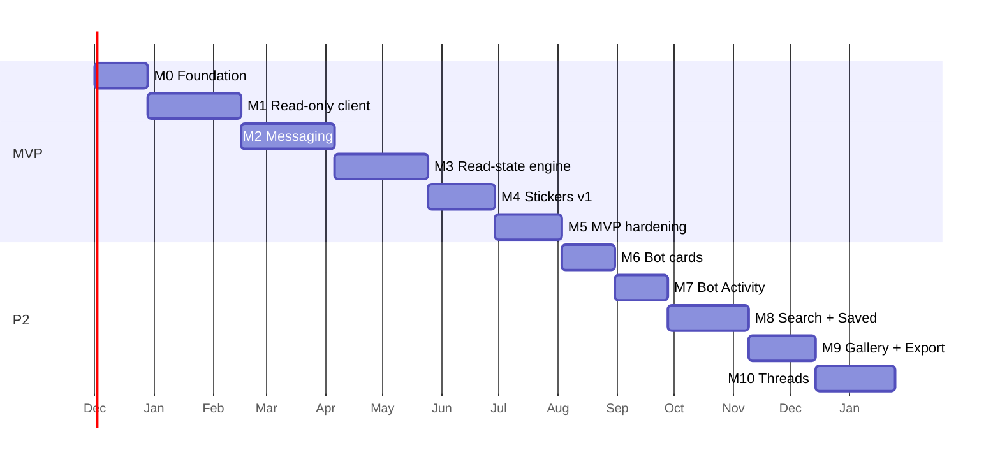
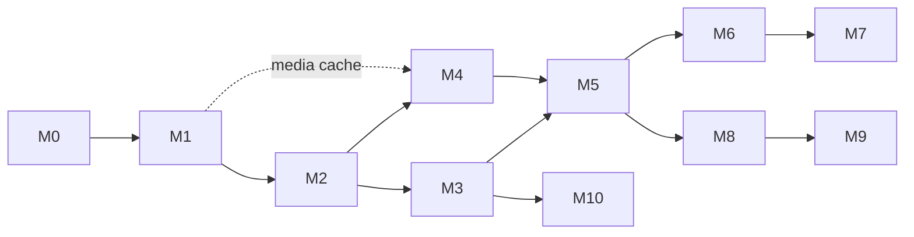

# Roadmap

Capacity: solo, part-time (D24). Estimates are calendar weeks at ~15 h/week and are **[ASSUMPTION]**s,
to be re-planned after M0. Each milestone ends with its exit criteria **verified by tests** (see AGENTS.md §0 and §12).

## Implementation entry criteria (before M0 starts)

- [x] Phase 0 documentation approved by the founder (2026-11-19).
- [x] Apple Developer Program membership active; namespace root `one.mbm.halo` recorded (D63, DEVELOPMENT_SETUP §3).
- [x] Domain for the homeserver available; DNS control.
- [x] Mac with Xcode supporting iOS 26 SDK — available from 2026-11-19 (Xcode 27.2, iOS 26+ simulators); M0 proceeds with its Linux part, see below; Rust toolchain installable (only needed on the G-FFI or G-NSE fail paths, or for Q-SDK-BUILD).
- [x] Open questions marked "blocks M0" in [OPEN_QUESTIONS.md](OPEN_QUESTIONS.md) resolved (all M0 blockers — `V-SDK-1`, `V-SQL-1`, `V-CI-1`, `V-CI-2`, `V-APPLE-1`, `Q-BUNDLE`, `Q-XCODEGEN`, `Q-DEV-AUTH`, `Q-NSE-GATE` — are resolved).

## M0 without a Mac (2026-11-19)
M0 started before the Mac is available. Work that runs on Linux is done first; the rest waits for the Mac and is the only thing
standing between M0 and its exit criterion.

| Part | Items | Needs |
|---|---|---|
| **M0a — Linux** | `infra/dev` (Synapse + Postgres, native password login, D64); Linux-buildable packages (`HaloFoundation`, `HaloDomain`, `HaloApplication`, `HaloTestSupport`) with the M0 ports `SessionPort` and `RoomListPort`, the session/room-count use case, fakes and contract tests; CI (`docs`, `swift-linux`, `boundaries`, `secrets`, `licenses`); V-CI-1; V-SDK-1 | This container / Linux CI |
| **M0b — Mac** | Xcode project (app + NSE targets, identifiers per DEVELOPMENT_SETUP §3); `HaloMatrixAdapter` implementing `SessionPort` + `RoomListPort` over the pinned `MatrixRustSDK`; `HaloPlatform` log sink; V-SQL-1; V-APPLE-1; V-CI-2; the exit criterion (password login against `infra/dev` shows the room count via ports) | Mac with Xcode for the iOS 26 SDK |

**Status (2026-11-19): M0a done.** `infra/dev` passes `smoke.sh`; the four Linux packages pass their tests on Swift 6.2.4;
`check-boundaries`, the licence gate (at SDK `b93751e`) and gitleaks pass locally; V-CI-1 and V-SDK-1 are resolved. The CI workflows
run once a pull request is open. **Remaining for M0 (all M0b, needs the Mac):** Xcode project, `HaloMatrixAdapter` for `SessionPort` +
`RoomListPort` passing `SessionPortContract` / `RoomListPortContract` against `infra/dev`, `HaloPlatform` Keychain and log sink,
V-SQL-1, V-APPLE-1, and the exit criterion.

**M1 started (2026-11-19):** read-only timeline slice — `TimelinePort` (domain, fake, contract, adapter), `TimelineCoordinator`, `FeatureTimeline`, tap a room to read it (text, notice, emote, media placeholders, deleted, undecryptable, membership, date dividers) — verified on the simulator against `infra/dev`. Also done: `SyncPort`/`SyncCoordinator`, `HaloPersistence` (V-SQL-1 resolved), `MediaPort`/`MediaLoader` with inline image thumbnails. Also done: recovery-key verification (`EncryptionPort`, banner + sheet). **M2 started:** plain-text/Markdown sending with local echo and honest send state, composer in the timeline (send queues enabled), reactions, edit and delete of own messages (long-press menu), replies with a quoted original, typing indicators, formatted-body rendering (HTML subset), an emoji picker for reactions. Also done: UTD reasons in the timeline. **M2 messaging (2026-11-20):** all of MESSAGING FR-1…FR-7 are implemented except video/audio/file sending and the offline-send test (image sending is done): mentions, failed-send retry/delete, per-room drafts, own message as read position. **M3 (2026-11-20):** property tests P1–P10 and scenarios S01–S22 (model-based, not yet against Synapse) are written. **M4 stickers (2026-11-20):** domain (parser, shortcodes, prefs, search), `StickerLibrary`, sending, the panel and incoming rendering exist; pack discovery (V-ST-1 resolved), pack creation (verified against Synapse) exist; preview/animation, hiding pack rooms and legacy packs do not. Remaining for M1: QR/emoji verification, NSE spike and G-NSE (needs a physical device), video/audio/file display.

**M0 exit criterion met on the simulator (2026-11-19):** the app signs in with a password against `infra/dev` and shows the room count and names; a relaunch restores the session without signing in (AC-AUTH-1/2 manually). Not yet: signed device build, shared Keychain access group, NSE pipeline (M1), V-SQL-1, V-APPLE-1. Earlier M0b notes:

**M0b started (2026-11-19):** V-CI-2 resolved; `ios/Packages/HaloMatrixAdapter` exists and builds against the pinned SDK 26.11.17 for the iOS Simulator. The prebuilt xcframework has no macOS slice, so the adapter builds and tests only through `xcodebuild` with an iOS destination (not `swift build`/`swift test`).

## Remaining work (the loop's queue)
Ordered work queue for the autonomous loop ([development/AUTONOMOUS_LOOP.md](development/AUTONOMOUS_LOOP.md), D70). Take the first
unchecked item the agent can do; items marked 📱 need a physical device and 👤 the founder (they go to HANDOFF §5 "Needs the
founder" and don't block the queue). Tick an item in the pull request that finishes it. Details of each item live in the owning spec.

**Now**
- [x] Merge PR #5 (M3 tests, M2 messaging, M4 stickers core) once CI is green on its last push.
- [x] `infra/dev` fixture script: create the throwaway accounts and the sticker, timeline and E2EE fixtures and write
      `~/.config/halo-dev/contract.env`, so all contract tests run (four skip today: Timeline, Media, ReadMarker, Encryption).
- [x] App build in `scripts/prepush.sh` ([development/CI_CD.md](development/CI_CD.md)).
- [ ] (deferred, D71, not blocking) CI: macOS job for the Mac-only packages and the app build; revisit when the build pipeline is
      stable and a hosted runner is confirmed to have the needed Xcode (Q-CI-MAC).

**M3 Read-state engine** (exit: AC-U1–U7 automated green; gates G-UNREAD, G-FFI)
- [x] V-RS-7 decided (D73): classic sync is the unread evidence; SDK evidence verified (`ClassicSyncEvidenceTests`); badge never loses a valid stored set to a partial or empty evaluation (P0, `BadgeCoordinator` carry-over).
- [x] **P0** Classic sync in the adapter (D74): `SyncPort` over an own `Client.syncOnceV2` loop, `RoomListPort` over `client.rooms()` + the changed rooms of each response; contract suite 13/13 on it; verified live in the simulator (unread `@1` and bold within seconds). Still open: measure the first-sync cost on a large account (no `SyncSettingsV2` filter), 📱 check on a device.
- [x] **P0** Resume S01–S22 on classic sync: the rest of the scenario driver (real server output into the Swift model, encrypted rooms), then re-evaluate G-UNREAD (GATE_EVALUATION_M3.md §1).
- [x] Scenario driver, remaining part (see the P0 items above): server half of S01, S02, S04–S10, S13–S15, S21, S22 is done (`tools/scenario-driver/run_scenarios.py`); encrypted rooms with real keys over classic sync are verified (`encryptedEvidence`, `encryptedNonMessageEvidence`); the adapter's real inputs through the policy are verified for S01/S02/S09 (`policyOverRealInputs`); the remaining client-side scenarios (S03, S07b, S08, S10–S20, S25–S29: restarts, GRDB outbox, NSE, push rules, redaction, threads, edits, clock skew / equal timestamps, left-room pruning) are verified end-to-end against `infra/dev` in `ServerReadStateScenarioTests.realServerScenarios` ([testing/UNREAD_REGRESSION_TESTS.md](testing/UNREAD_REGRESSION_TESTS.md)).
- [x] Read-state auditor core (`ReadStateAuditor`, `audit_event` store capped at 5,000, wired into `ReadStateCoordinator`, debug and TestFlight `sandboxReceipt` builds; 10-minute foreground re-run in `ReadStateCoordinator.setForeground`, manual `Reconcile now`, unexplained event counter, and `.zip` diagnostics export `DiagnosticsZipArchive` in Settings → Diagnostics).
- [x] Intent confirmation rules (a)–(c) for `read_intent` (a and b deliberately not built: D72), `attempts`/`last_error`, `HaloLog` in `ReadReceiptCoordinator`.
- [x] D6 check: `onScrollVisibilityChange` fires for `List` rows (checked in the iOS 26.0 simulator against `infra/dev`, 2026-11-20); no fallback needed. Not an automated UI test.
- [x] Unit test for the `latestEvent` mapping; contract test for `deletePusher`.
- [x] G-UNREAD and G-FFI evaluation written up ([testing/GATE_EVALUATION_M3.md](testing/GATE_EVALUATION_M3.md)); 👤 founder confirms the outcomes (HANDOFF §5).
- [x] 📱 V-RS-1, file-protection class on `halo.sqlite`, NSE access to the database (file protection `NSFileProtectionCompleteUntilFirstUserAuthentication` on `halo.sqlite`/`-wal`/`-shm`/dir and NSE 10/10 GRDB `notification_record` writes verified live on iPhone 16 `F-DEV-1`; other-device own-receipt clearing verified against `infra/dev` over classic sync in `ClassicSyncEvidenceTests.evidence` and `ServerReadStateScenarioTests.realServerScenarios` S02/S17).
- [x] **P0** Review R-01 (docs/CODEBASE_REVIEW.md, D78): server-only counts in encrypted rooms are no unread (E3c), SDK counts decide whenever any is non-zero (E3b); S23, `encryptedNonMessageEvidence`, server-rules checks.
- [x] **P0** Review R-07 (D79): E1/E1b give way to the SDK's counts once the SDK has applied the read position; S24, P11, `encryptedNonMessageEvidence`.
- [x] **P0** Review R-02/R-03/R-13 (docs/CODEBASE_REVIEW.md): GRDB `notification_record` (migration v7), raw event `origin_server_ts`, record superseding on sync, pruning on left/hidden/ignored/sign-out; S25–S27, PS33.
- [x] **P0** Review R-04 (docs/CODEBASE_REVIEW.md): carry-over ends at the first completed sync response (`RoomListPort.syncCompletions()`); S28.
- [x] **P0** Review R-05/R-08 (docs/CODEBASE_REVIEW.md): `ReadStateCoordinator` feeds room list, badge and auditor; `NotificationProcessor` in `HaloApplication` handles NSE mode-aware badge fallback and foreground suppression; PS31, PS32.
- [x] **P0** Review R-06 (docs/CODEBASE_REVIEW.md, D80, ADR-0020): `TimelineReadTracker` orders by timeline index and targets `Timeline.latestEventId()` at the tail (clearing R-01's trailing poll-vote count); `read_intent.timeline_order` (v8); E1 compares event IDs and yields (`INTENT_STALE`) once a sent receipt is confirmed; S18 inverted, S29.
- [x] **P0** Review Phase 0, the rest (docs/CODEBASE_REVIEW.md §14): R-10/R-12 session lifecycle, R-09 NSE runtime (all 22 executable findings FIXED; 5 founder decisions in HANDOFF §5).

**M4 Stickers v1** (exit: AC-S1–S5)
- [x] Hide pack rooms (`one.mbm.halo.sticker_rooms`) from the room list and the badge (`RoomListCoordinator(hiddenRooms:)`; not checked on screen).
- [x] Long-press preview (FR-5): context-menu preview 240 pt, loads the full file (`MediaLoader.content`), animated (GIF/APNG/WebP frames via ImageIO, max 60) unless Reduce Motion or Low Power Mode (FR-9; `StickerImageTests` on the simulator). Grid autoplay: a visible cell loads its full file (≤ 1 MB, only if multi-frame, only when motion is allowed) and animates, capped at 12 simultaneous animations per panel (`StickerPanelViewModel.maxSimultaneousAnimations`, unit-tested; slots freed on disappear/sticker change/panel close), freed when it scrolls off (`StickerPanelViewModel.animatedContent`); the grid still renders in the simulator, and the animation was seen on screen with the dev GIF `spin` added by `infra/dev/add-animated-sticker.py` (the yellow ball moved between two screenshots).
- [x] Privacy notice: permanent hint in the new-pack form (already there) and a one-time alert before the first sticker into an encrypted room (`StickerPanelViewModel.EncryptionNotice`, per-device flag in `UserDefaults`, recorded only after a successful send; unit-tested, not seen on screen).
- [x] "Unavailable pack" UI: packs of a room the user cannot read (403/404) are reported, not a failed load (unit-tested and verified against `infra/dev` by `unavailablePack`: enable a pack, leave and forget its room; the panel shows "N pack(s) you added are unavailable"; not seen on screen; a "Remove" button next to the notice takes such packs out of `m.image_pack.rooms` (`StickerPackPort.disable`, `StickerLibrary.removeUnavailablePacks`; unit-tested, contract `unavailablePack` removes it and reads the list back, seen in the simulator: notice → Remove → notice gone, the server list no longer held the pack).
- [x] Legacy `im.ponies.*` packs (V-ST-3): `im.ponies.emote_rooms` account data → `im.ponies.room_emotes` state of those rooms and of the current room, read-only, `PackSource.legacy`, listed after current-format packs (which win on the same room/key); rooms the user has left are skipped silently. Verified against `infra/dev` (`legacyPacks`). Not built: `im.ponies.user_emotes` (a pack without a room: `PackRef` needs one), the empty-key legacy pack of rooms over 1,000 members.
- [ ] Simulator UI check of the panel and pack creation; real sticker images loaded from media.
- [x] V-ST-2: token refresh on 401 for the pack GET (verified in `AdapterContractTests.stickers` and `RefreshDelegateTests`).

**M2 / M1 leftovers**
- [x] Timeline opens at the first unread message (top of screen), or at the newest row when all is read or the read position is unknown (TIMELINE.md §1): `TimelineViewModel.landingRow`/`firstUnreadItemID`, read position = `RoomSummary.ownReadThrough` at open; history now loads only while the "load earlier" row is on screen (opening no longer paginates the whole room). Unit-tested; bottom landing checked in the simulator (a long room opens at its newest message; history loads only after the opening scroll); the first-unread landing was not seen live. "Jump to unread" pill (FR-4): shown when the first message that was unread at open is above the viewport and the newest row is on screen; tap scrolls back to it (`TimelineViewModel.unreadMarkerID`, unit-tested; seen in the simulator with 14 unread messages). The read-marker line is the SDK's own "New messages" row (it moves with the fully-read marker). The first-unread landing was seen live for the first time: a single `scrollTo` fell short in a long unread run (lazy-list height estimates), so the landing jumps again after each layout. Not built: landing when the first unread is older than the loaded page.
- [x] Offline send test (MESSAGING FR-3): contract test `offlineSend` via `scripts/contract-offline-test.sh` (stops/starts the dev Synapse on cue): messages sent while the server is unreachable show `failed(recoverable: true)`, go out exactly once after reconnect by themselves (sync restarted, as `SyncCoordinator` does) or through `retrySend` (sync stopped); an echo removed with `abortSend` never reaches the server (checked with a plain HTTP read of the room). Adapter fixes found by it: a recoverable failure disables the room's send queue (SDK) and nothing re-enabled it; now the first successful sync after a send-queue error or an offline sync re-enables all queues, and `retrySend` re-enables the room's queue.
- [x] Kill-and-relaunch resend (V-SYNC-2), checked by hand in the simulator on 2026-11-20: dev Synapse stopped, a message sent in the app (echo "Not sent yet — will retry"), app killed with `simctl terminate`, Synapse started, app relaunched: the message reached the server about 6 s after Synapse came back, exactly once (one row in `events`), the old process being dead. Not automated (a contract test can't kill its own process); the other half (retry after a network loss in one process) is the `offlineSend` contract.
- [x] Video, audio and file display (MEDIA_ATTACHMENTS FR-2…4): attachments map size, MIME type and duration (`MediaAttachment`), the timeline shows a tile (icon, name, "PDF · 1.2 MB" / "0:42"), tapping downloads the file (whole, ≤ 50 MB: `MediaPort.content`) into a temp folder and opens Quick Look (plays audio/video, share/save); the copy is deleted on close, the sender's file name is reduced to its last path component. Unit-tested and seen in the simulator (tiles "notes.txt · TXT · 3 KB" and "tone.wav · 0:01 · 16 KB"; the text file previews, audio opens with title and share button). Not built: inline video thumbnails and a custom player, waveform, a file-based (streaming) download for big files, (media preview policy FR-7 is now built, see next item).
- [x] Media preview policy (MEDIA_ATTACHMENTS FR-7): the account's `m.media_preview_config` (SDK `getMediaPreviewDisplayPolicy`: on / private rooms only / off) decides whether photos load at once; when hidden a tile "Tap to show photo" downloads nothing until tapped (`MediaPreviewPolicyPort`, `MatrixMediaPreviewPolicyPort` with `Room.isPublic` for the private case, `TimelineViewModel.previewsHidden/showsPreview/revealPreview`). Unit-tested; seen in the simulator with the policy set to off on `infra/dev` (placeholder, tap loads the photo). Settings → Media → "Show photos" (Always / In private rooms only / Never) changes it (`MediaPreviewPolicyPort.setting/setSetting`; contract `mediaPreviewSetting` round-trips and restores it; the picker itself not seen on screen). Found: the SDK's `setMediaPreviewDisplayPolicy` writes only `io.element.msc4278.media_preview_config` but reads `m.media_preview_config`, so the adapter reads and writes both account-data types itself. Not covered: stickers (always shown), "private" mode on a real public room, the policy changing while a room is open, invite avatars.
- [x] Video thumbnails in the file tile: an incoming video's `info.thumbnail_url` (`MediaAttachment.thumbnail`, adapter `thumbnailSource`) is shown above the tile with a play button, through the same thumbnail path as photos (so the media preview policy applies); tapping still opens Quick Look. Unit-tested; seen in the simulator (a video sent from the peer account with a green still). Not built: generating a thumbnail for videos Halo sends (the SDK's `sendVideo` is called without one), a custom player, a blurhash placeholder.
- [x] Photo captions (MEDIA_ATTACHMENTS FR-1): picking a photo now holds it in the composer (`TimelineViewModel.pendingPhoto`, a strip with its thumbnail and a remove button); the composer text becomes the caption when it is sent, and a photo alone can be sent; a failed send keeps both. Unit-tested (`photoCaption`), contract `sendImage` checks that the caption becomes the message body, seen in the simulator (waterfall + "Waterfall at dawn"). Not built: captions for files, audio and video; editing a caption; multi-photo selection. The timeline now repeats the scroll to a new last row after each layout, so a tall new photo stays in view (change made; not re-checked on screen).
- [x] File, audio and video sending (MEDIA_ATTACHMENTS FR-5 for non-image media): paperclip in the composer → system file picker → bytes sent unchanged (`OutgoingFile`, ≤ 50 MiB, read only after the size check) as `m.file`/`m.audio`/`m.video` by MIME type; local echo while uploading, honest errors. Verified against `infra/dev` (`sendFiles`: all three kinds arrive with MIME type and size, bytes read back); unit-tested; the picker opens in the simulator, an actual pick wasn't done (no files on the simulator). Not built: camera/voice recording, video thumbnails and duration, captions, upload progress and cancel, multi-select, streaming upload of big files.
- [x] QR and emoji device verification (ENCRYPTION_AND_DEVICES FR-2: interactive SAS emoji/decimal verification via `SessionVerificationController` in `MatrixEncryptionPort`, `EncryptionCoordinator`, `RecoveryViewModel` and `RecoveryView`, plus `RecoveryBanner` mounted above the room list).
- [x] 📱 G-NSE: AC-NSE-1…6 on a physical iPhone 16 (`F-DEV-1`, `F-DEV-2`): 100/100 background pushes `outcome = "display"` (peak `phys_footprint` **7.40 MB**, `totalMs` p50 **60 ms** / p95 **144 ms** / max **495 ms**, 0 timeouts, 0 Jetsam), fault-injection nonexistent-event fallback (`2.17–2.21 s`, `7.40 MB`), and post-kill cold-start recovery (`restoreMs = 162 ms`, `totalMs = 277 ms`, `6.8 MB`, zero `0xdead10cc`). Release/TestFlight build check waits for TestFlight distribution.

**M5 MVP hardening** (exit: daily-driver switch, AC-U8)
- [x] MAS in `infra/dev` and OIDC login (`V-AUTH-1` resolved): client-side OIDC / OAuth 2.0 flow (`SessionPort.oauthURL`/`completeOAuth`/`abortOAuth`, `MatrixSessionPort` over `urlForOauth`/`loginWithOauthCallback`/`abortOauthAuth`, `SessionCoordinator`, `AuthViewModel`, `SignInView`, `WebAuthSessionPresenter` over `ASWebAuthenticationSession`; unit-tested) plus isolated Synapse + MAS `v1.29.0` dev stack (`infra/dev/docker-compose.mas.yml`, `infra/dev/smoke-mas.sh`) verified live in `AdapterContractTests.oidcDiscovery`. Open product decision: `Q-MAS-ACCOUNT` (device management web URL vs native list, defaults to web page in MVP).
- [x] Settings v1 and acknowledgements (SETTINGS): `FeatureSettings` package, gear button in the room list → Account (sign out, with confirmation), About (version/build), Acknowledgements (Halo's direct Swift packages `GRDB.swift` and `matrix-rust-components-swift` plus the SDK build's Rust licence inventory bundled as `acknowledgements.csv`, searchable; AC-SET-1 tests compare both the bundled CSV with `docs/security/inventory` and the Swift package entries with `ios/SDKVERSION.md` and `HaloPersistence/Package.swift`). Seen in the simulator. Not listed: full licence texts.
- [x] Settings → Privacy → "Private read receipts" (D7, AC-SET-2) and "Typing notices" (SETTINGS §3): `AppPreferences.privateReceipts` (UserDefaults, device-level, default public), applied at launch (`ReadReceiptCoordinator(privateReceipts:)`) and live (`setPrivateReceipts`); unit-tested (preference round trip; later receipts only) and seen in the simulator (toggle, kept after relaunch). The adapter's `m.read.private` call is exercised by the `readMarkers` contract; the receipt type as stored on the server was not read back. `AppPreferences.sendTypingNotices` (default on) wired live into `TimelineViewModel.sendsTypingNotices` (suppresses outgoing typing notices when off while clearing an active one on draft clear; unit-tested, not tapped on screen).
- [x] Settings sections still open: Security → recovery-key change/disable and key backup state (done: setup with a once-shown key and a confirmed "Replace backup" when a backup already exists; seen in the simulator against infra/dev; the section shows device verification and recovery state: "Not verified" / "Not set up" on the dev account, seen in the simulator; SAS emoji verification + recovery key entry sheet), Notifications → per-category toggles (the section shows iOS's permission state and opens iOS Settings; checked in the simulator; tap-to-open room routing via `PushDelegate` `UNUserNotificationCenterDelegate`), Stickers, Bots, Storage → clear cache (sizes shown, "Clear media cache" clears `MediaLoader` thumbnails and per-session `caches/` directories without forcing an SDK store resync), and the Diagnostics zip export (`DiagnosticsZipArchive` exports `report.txt`, `app-logs.txt` from `RingLogSink`, `audit-events.jsonl` and `room-snapshots.jsonl`; Appearance theme System/Light/Dark done, checked in the simulator; the Diagnostics screen exists: versions, iOS, audit counts, share, `.zip` export); generic bot-message rendering (Layer 2 cards done: `HaloDomain/Bots/BotTemplates` with `TodoListV1`, `TaskAddedV1`, `ReminderSetV1`, `TaskDoneV1`, `TaskDeletedV1`, fuzzed; `TimelineRow.card` for senders in Settings → Bots, local list; seen in the simulator with a todo list and an added-task message from the dev peer. Interaction FR-3 done: `BotTaskTracker` (pure: creating message per task, completion from a newer list or `Marked task as done`) and `TimelineViewModel.tickBotTask` (one 👍 on the creating message, pending, 2-minute "No response from bot", read-only without a creating message), seen in the simulator against scripted bot messages from the dev peer. Allowlist sync as account data `one.mbm.halo.bot_allowlist` via `BotAllowlist` / `MatrixBotAllowlistPort`, loaded on sign-in, saved from Settings → Bots with local `AppPreferences` cache and cleared on sign-out; unit-tested and contract `botAllowlist` verified against `infra/dev`; Settings → Diagnostics counts, per launch, a known bot's messages that matched no template: `UnrecognisedBotMessages`, distinct events only; FR-1 "View source" on text, notice, media, sticker and emote rows).
- [x] User profiles (USER_PROFILES): done, `ProfilePort` (`MatrixProfilePort`: own display name, `getProfile`, ignore/unignore, `ignoredUsers`); Settings → Account → Profile (display name with Save, ignored users with Unignore; `ProfileSettingsModel`); tapping a member in the room info sheet opens their profile (name or "No display name", user ID always shown under it, copy ID, Message = existing or new DM, Ignore/Unignore; `UserProfileViewModel`). Unit-tested; contract `profiles` (name round-trip restored, peer profile, ignore/unignore restored); both screens seen in the simulator (display name loaded from the dev account; the member profile of the peer); the buttons themselves not tapped. Found: right after `ignoreUser` the SDK's `unignoreUser` leaves the server list unchanged, so the adapter reads the list back and repeats (up to 4 times, 2 s apart). Own avatar (FR-1): `ProfilePort.ownAvatar/setOwnAvatar/removeOwnAvatar` (`Client.avatarUrl/uploadAvatar/removeAvatar`), Settings → Account → Profile "Photo" section with a photo picker (shrunk to 512 px by `ImagePreparer`, metadata dropped), Remove; unit-tested, contract `profiles` uploads a PNG, reads the bytes back through media and removes it (only when the account has no avatar); the picker not used on screen. Not built: `subscribe_to_own_profile`, verify identity, room-specific names beyond the room's display name. Share link (`matrix.to`) is offered on member profiles (`UserProfileViewModel.shareURL`, unit-tested). Invitations from ignored users are hidden from the room list and badge (`RoomSummary.inviterID`, `RoomListCoordinator(profiles:)`; unit-tested and contract-tested in `AdapterContractTests.invitations`). Room photo (FR-7): `RoomPort.setAvatar/removeAvatar` (`Room.uploadAvatar/removeAvatar`), "Change photo" / "Remove photo" in the room info sheet for users who can edit details (image shrunk to 512 px by `ImagePreparer`); unit-tested, contract `roomManagement` uploads and removes one; not seen on screen, and the sheet doesn't show the current photo. Still open from ROOM_MANAGEMENT: nothing big (member paging and invite preview are done). Done (room info sheet, FR-1…FR-4): `RoomPort` (`details`, `members`, `setNotificationMode`, `leave`), `MatrixRoomPort`, `FeatureRoomDetails` (info button in the timeline toolbar → sheet with name, topic, encryption, member count, notification-mode picker, members with Admin/Moderator badges, Leave with confirmation and a last-administrator warning; leaving closes the room screen). Unit-tested (fake port) and verified against `infra/dev` (contract `roomManagement`: details, members, all three modes read back after a sync, leave); the sheet was seen in the simulator (Leave itself not tapped on a fixture room). Found: the SDK's `joinedMembersCount` stays 0 under classic sync, so the sheet counts the loaded members. Invitations (FR-6 accept/decline): invited rooms (already listed first) show Invitation with Accept and Decline in the room list (`RoomPort.acceptInvite/declineInvite` = `joinRoomById` / leave; `RoomListViewModel.acceptInvite/declineInvite`; unit-tested, contract `invitations` with a peer account: invited → accept → joined, decline → gone). Not seen in the simulator; the row says "Invitation from <name>" (`RoomSummary.inviter`, `Room.inviter()`, looked up for invited rooms only; unit-tested, not seen on screen); invite preview: `RoomPort.invitePreview` (`Client.getRoomPreviewFromRoomId` → `RoomInvitePreview` name, topic, member count, avatar), "Show details" on the invite row shows topic and member count (count hidden when the SDK reports 0, as it does for invited rooms under classic sync); unit-tested, contract `invitations` calls it; not seen on screen. New chat (FR-5): compose button in the room list → sheet with directory search (`Client.searchUsers`; a fully typed Matrix ID is always offered), tap a person to open the existing DM (`getDmRoom`) or create an encrypted one with an invitation, "Add to room" + a name creates a private encrypted room that invites them (`ChatCreationPort`, `MatrixChatCreationPort`, `NewChatViewModel/View` in FeatureRoomList; unit-tested; contract `newChats` against infra/dev; search seen in the simulator, creating a chat not tapped on screen). Not built: inviting people to an existing room from the info sheet, user suggestions, public rooms, join by alias. Edit and invite from the info sheet (FR-7, FR-5): `RoomDetails.canEditDetails/canInvite` (power levels via `RoomPowerLevels.canUserSendState/canUserInvite`; unknown means no), `RoomPort.setDetails/invite`, "Edit name and topic" and "Invite someone" (full Matrix ID) alerts; unit-tested, contract `roomManagement` reads the edit back and sees the invited member; not seen on screen. Member paging (FR-2): the sheet loads 200 members and offers "Show more members" (`RoomDetailsViewModel.loadMoreMembers`, 200 per page); the adapter now sorts all members before cutting the page so administrators always come first; unit-tested with 450 members, not seen on screen. Room list avatars: `RoomSummary.avatar` (the SDK's `Room.avatarUrl`, the other person's for a direct chat → `MediaRef`), `RoomListViewModel.avatarData` (96 px thumbnail via `MediaLoader`), a round `AvatarView` with the first letter as fallback; unit-tested; not seen with a real avatar (dev accounts have none). Open speed: `TimelinePort.warm` prepares the top 6 rooms' timelines (first page loaded, taken on open, dropped on sign-out; contract `warmTimelines`); unmeasured on a device. Timeline avatars: `TimelineEvent.senderAvatar` (from `senderProfile`), `TimelineRow.avatar` for others' messages, a 28 pt `AvatarCircle` beside the bubble (`TimelineViewModel.avatarData`, 64 px thumbnail); unit-tested, not seen with a real avatar. Room details from the room list: long-press context menu on joined rows offers Room info (sheet wired in `HaloApp`), Mark as read/unread, Favourite and Mute (not tapped interactively on screen).
- [x] Room list v2 (ROOM_LIST FR-2, FR-3, FR-6, FR-7): filter bar All / Unread / People / Rooms / Favourites / Invites (applied in `RoomListViewModel.includes` over the rooms the coordinator holds, since classic sync delivers every room; the port's `.unread` stays unsupported), rows show a favourite star, a muted bell and the time of the newest event (time today, date otherwise), swipe Favourite/Unfavourite (`RoomPort.setFavourite`, `Room.setIsFavourite`) and Mute/Unmute (`setNotificationMode`). `RoomSummary.isFavourite`; `RoomListCoordinator.summaryChanges()` re-renders rows on any summary change (renames and favourites didn't change the read inputs before). Unit-tested; contract `roomManagement` sets and clears the favourite tag and reads it back; seen in the simulator (filter bar, times, favourite star on and off). Latest-message preview (FR-3): `RoomSummary.preview` (`LatestMessagePreview`: text or a label such as Photo/Sticker/Message deleted, sender name, own flag, optional `senderID`/`formattedBody`, `isReply`/`mentionsMe`; mapped from `LatestEventValue` by `MatrixRoomListPort.preview`), the row shows "You: …" / "You replied: …", the bare text (or "Replied: …" / "Mentioned you: …") in a direct chat or "Name: …" / "Name replied: …" / "Name mentioned you: …" in a group, one line; allowlisted bot messages matching a template card render a concise card summary (`BotCard.previewSummary`, refreshed on appear when Settings → Bots changes); unit-tested (adapter mapping incl. SDK-built `TimelineItemContent` with HTML on text/notice/emote, replies and mentions, domain line rules, view model) and seen in the simulator against infra/dev. Sync indicator (FR-7): `RoomListViewModel.syncNotice` follows `SyncCoordinator.statuses()` and shows a quiet strip above the filter bar while `.offline` or `.failed`, hidden when healthy; unit-tested.
- [x] Performance pass (large accounts, room-list paging, `Room.members()` cost): `RoomListViewModel` pages large accounts in slices of `pageSize = 50` (expanding via `showMore()` / `onAppear`, resetting on filter change; unit-tested in `RoomListWarmTests.roomListPaging`); `MatrixRoomPort.members` caps scanned members at `maxScannedMembers = 2,000` and `MatrixTimelineSession.members` caps `@`-mention autocomplete candidates at `maxMentionCandidates = 1,000`; `MatrixRoomListPort` rebuilds changed rooms with bounded concurrency (8, R-19) and bounded `EventTimeCache` (2,000, R-27).
- [ ] 👤 Push gateway (Sygnal + pushkin) for Beta/Release, APNs keys, TestFlight build.
- [ ] 👤📱 AC-U8: 7-day soak with zero unexplained auditor findings.

**P2**
- [x] M8 Search + Saved (`V-SEARCH-1` resolved): `SearchPort` (`MessageSearchHit`, `SearchSnapshot`), `FakeSearchPort`, `MatrixSearchPort` over SDK `Client.searchService()` (contract-verified against `infra/dev` in `AdapterContractTests.messageSearch`), `SearchCoordinator`, `MessageSearchViewModel` / `MessageSearchView` (magnifying glass toolbar button in `HaloApp`, tap a result to jump straight to the event). Saved room: `ChatCreationPort.openOrCreateSavedRoom()` backed by `one.mbm.halo.saved_room` account data in `MatrixChatCreationPort`, wired into "New chat" → "Saved Messages" (`NewChatViewModel.openSavedMessages`, unit-tested).
- [x] M9 Gallery + Export (per-room): `RoomMediaItem`, `RoomPort.mediaGallery(in:limit:)` backed by filtered `Room.timelineWithConfiguration` (`.onlyMessage([.image, .video, .audio, .file])`) in `MatrixRoomPort`, `RoomDetailsViewModel.loadGallery` & `exportMediaFile`, and `RoomMediaGalleryView` (All / Photos & Videos / Files & Audio filter + ShareLink export; unit-tested in `RoomDetailsViewModelTests.roomMediaGalleryAndExport`).
- [x] M9 Global Media Gallery preset room entry (D34, D83): `GlobalMediaItem`, `GlobalMediaGalleryViewModel` (bounded-concurrency aggregation across joined rooms, All / Photos / Videos / Files & Audio + per-room filters, calendar-month sections, full-screen detail sheet with Jump to message & Share/Export), `GlobalMediaGalleryView`, and the preset non-Matrix "Media Gallery" virtual room row in `RoomListView` wired via `HomeRoute.globalMediaGallery` in `HaloApp` (no server room ID, excluded from read state and badge; unit-tested in `GlobalMediaGalleryViewModelTests`).
- [x] M9 Encrypted room export (D32, R-P2-EXPORT): `RoomExportMessage`, `RoomExportDocument`, `RoomExportEncryptor` (`HaloDomain`), `CryptoKitRoomExportEncryptor` (PBKDF2-HMAC-SHA256 100k iterations + AES-256-GCM JSON envelope `one.mbm.halo.room_export.v1` in `HaloPlatform`, unit-tested in `CryptoKitRoomExportEncryptorTests`), `MatrixRoomPort.exportMessages`, `RoomDetailsViewModel.exportEncryptedRoom`, and `RoomEncryptedExportView` in `RoomDetailsView` (unit-tested in `RoomDetailsViewModelTests.encryptedRoomExport`).
- [x] M10 Threads: `TimelinePort.openThread(room:rootEvent:)` over SDK `TimelineFocus.thread(rootEventId:)` in `MatrixTimelinePort`, `TimelineCoordinator(threadRoot:)`, "Reply in thread" context-menu action in `TimelineView`, and `ThreadSheet` in `HaloApp` (unit-tested in `TimelineCoordinatorTests.opensThread`; thread unread scenarios S15 already verified against `infra/dev` in `ServerReadStateScenarioTests`).

**M7 Bot Activity** (exit: AC-A1–A3)
- [x] Slice 1 (branch `feat/m7-bot-activity`): `BotTaskDerivation`, `bot_task` store (migration v5), `BotActivityCoordinator` fed by open timelines, `FeatureBotActivity` sheet with sections and room/bot filters, Rebuild list; unit-tested in every layer, seen in the simulator with the peer account as a bot (`infra/dev/send-sample-events.py`).
- [x] Slice 2 (on `main`): 90-day pruning when an account is attached (`BotTaskPort.prune`), open at the source message (`TimelineViewModel.initialEvent`/`jump(toEvent:)`: back-paginates up to 10 pages, then scrolls and tints; seen in the simulator: Activity → "Pay rent" → the `Task #7 added` card), confirmations by title prefer the task created in the room (found on screen: two tasks named alike made `Marked task as done` ambiguous).
- [x] Slice 4 (on `main`): a deleted source message — `BotTaskEntry.sourceRedacted` (migration v6, sticky until the bot creates a new task under the number), set by `BotActivityCoordinator` when the open timeline shows the creating event as redacted; Activity says "Its message was deleted", offers no tick and no jump. Seen in the simulator. Edits need no work (the index reads the current body).
- [x] Slice 5 (on `main`): rooms that aren't open — `BotActivityCoordinator.scan` (room list changes → `AppRoot.scanBotRooms`): for joined rooms whose newest message is from an allowlisted bot and that changed since the last scan, a timeline is opened just long enough to take its first non-empty snapshot (newest first, at most 8 per scan, one at a time). Seen in the simulator: index emptied, app relaunched, Activity filled without opening the room. Limit: only the first snapshot (the newest page) of such rooms is read, so older tasks appear when the room is opened.
- [x] Slice 3 (on `main`): tick from the tab — `TimelineSession.addReaction` (idempotent 👍, contract-checked against the fake and `infra/dev`), `BotActionCoordinator` (short-lived timeline, confirmation through the index, 2-minute timeout, honest failed/no-response states), tick circle in Activity; seen in the simulator with a scripted bot (👍 on the server, spinner, completed only after the bot's `Marked task as done`). Not built: `bot_action` table (pending survives no restart), other reactions (👎 😝 🎉).

## Milestones

| # | Milestone | Scope | Exit criteria | Gates |
|---|---|---|---|---|
| M0 | Foundation | Repo layout, Xcode project + local packages, `infra/dev` Synapse (native password login, D64)/Sygnal, prebuilt SDK pinned, adapter skeleton behind ports, licence gate, CI (docs + Linux Swift domain tests), logging | Password login against the dev Synapse shows the room count via ports; CI green | V-SDK-1, V-SQL-1, V-CI-1, V-APPLE-1 |
| M1 | Read-only client | Session restore, `SyncService`, room list, timeline (text, notices, images, UTD), verification + recovery, NSE spike | All rooms readable; encrypted push shown | **G-NSE** (AC-NSE-1…6) |
| M2 | Messaging | Composer, replies, edits, deletes, reactions, typing, receipts display, send queue, media display, image send | Daily use alongside Element X; AC-M* | — |
| M3 | Read-state engine | `ReadState` policy, receipt outbox, visibility tracking, badge, clearing, marked-unread, modes, auditor, Synapse scenario suite | AC-U1–U7 automated green | **G-UNREAD, G-FFI** |
| M4 | Stickers v1 | Image-pack discovery, panel, favourites/recents, search, send/render, personal pack creation | AC-S* | V-ST-1 |
| M5 | MVP hardening | OIDC/MAS login (MAS added to `infra/dev`, V-AUTH-1), settings, acknowledgements, generic bot rendering, performance, 7-day soak | **MVP: daily-driver switch**, AC-U8 | — |
| M6 | Bot cards | Template parsers v1, task→event index, reaction protocol | AC-B* | — |
| M7 | Bot Activity tab | Task aggregation, filters, jump to source | AC-A* | — |
| M8 | Search + Saved | Evaluate `SearchService` → decide; Saved room | Known message found in an E2EE room | V-SEARCH-1 |
| M9 | Gallery + Export | Media index, gallery, encrypted export | — | — |
| M10 | Threads | Thread UI + per-thread read state | Unread scenarios with threads green | — |

## Gates

| Gate | When | Question | Pass → | Fail → |
|---|---|---|---|---|
| **G-FFI** | End of M3 | Are the upstream FFI APIs enough for unread correctness, stickers (custom room state)? (NSE budget: G-NSE.) | Stay on the upstream binary framework | Build Halo-owned UniFFI bindings over `matrix-sdk`/`matrix-sdk-ui` in `core/` behind the same ports (ADR-0003); budget 6–10 weeks |
| **G-NSE** (ADR-0016) | End of M1, independent of G-FFI | Does the NSE meet AC-NSE-1…6 — memory, execution time, timeout handling, extension termination, network failures and fallback behaviour ([features/NOTIFICATIONS.md](features/NOTIFICATIONS.md) §11)? | Keep the NSE pipeline | Lightweight runtime, cached badge, SDK built without unneeded features (Q-SDK-BUILD moves to M2); Halo-owned bindings only if the binding layer is the measured cost |
| **G-UNREAD** | End of M3 | Does the reconciliation policy over SDK + server signals meet AC-U1–U7 in scenario tests? | Keep the policy layer | Add an independent recount (needs G-FFI fail path, or upstream fixes) |

## Dependencies

## Technical risks per milestone
See [RISK_REGISTER.md](RISK_REGISTER.md). Highest: T-NSE (M1), T-RECEIPTS (M3), T-STATE (M4), and the capacity risk PROJ-1 across all milestones.
