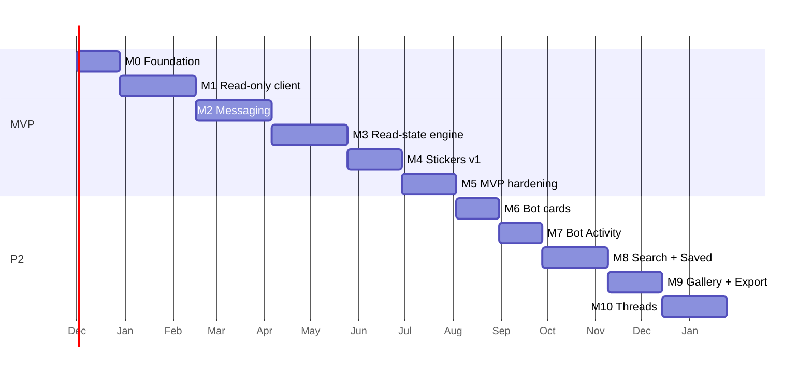
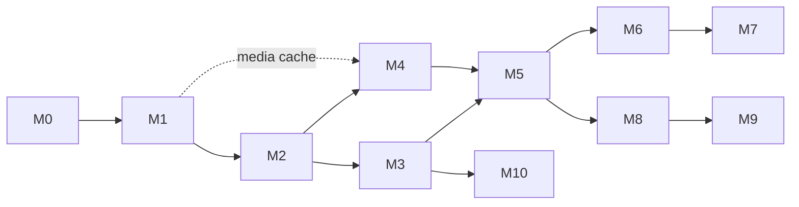

# Roadmap

Capacity: solo, part-time (D24). Estimates are calendar weeks at ~15 h/week and are **[ASSUMPTION]**s,
to be re-planned after M0. Each milestone ends with its exit criteria **verified by tests** (see AGENTS.md §0 and §12).

## Implementation entry criteria (before M0 starts)

- [x] Phase 0 documentation approved by the founder (2026-11-19).
- [x] Apple Developer Program membership active; namespace root `one.mbm.halo` recorded (D63, DEVELOPMENT_SETUP §3).
- [x] Domain for the homeserver available; DNS control.
- [x] Mac with Xcode supporting iOS 26 SDK — available from 2026-11-19 (Xcode 27.2, iOS 26+ simulators); M0 proceeds with its Linux part, see below; Rust toolchain installable (only needed on the G-FFI or G-NSE fail paths, or for Q-SDK-BUILD).
- [ ] Open questions marked "blocks M0" in [OPEN_QUESTIONS.md](OPEN_QUESTIONS.md) resolved (the remaining ones are M0 validation items, done during M0).

## M0 without a Mac (2026-11-19)
M0 started before the Mac is available. Work that runs on Linux is done first; the rest waits for the Mac and is the only thing
standing between M0 and its exit criterion.

| Part | Items | Needs |
|---|---|---|
| **M0a — Linux** | `infra/dev` (Synapse + Postgres, native password login, D64); Linux-buildable packages (`HaloFoundation`, `HaloDomain`, `HaloApplication`, `HaloTestSupport`) with the M0 ports `SessionPort` and `RoomListPort`, the session/room-count use case, fakes and contract tests; CI (`docs`, `swift-linux`, `boundaries`, `secrets`, `licenses`); V-CI-1; V-SDK-1 | This container / Linux CI |
| **M0b — Mac** | Xcode project (app + NSE targets, identifiers per DEVELOPMENT_SETUP §3); `HaloMatrixAdapter` implementing `SessionPort` + `RoomListPort` over the pinned `MatrixRustSDK`; `HaloPlatform` log sink; V-SQL-1; V-APPLE-1; V-CI-2; the exit criterion (password login against `infra/dev` shows the room count via ports) | Mac with Xcode for the iOS 26 SDK |

**Status (2026-11-19): M0a done.** `infra/dev` passes `smoke.sh`; the four Linux packages pass their tests on Swift 6.2.4;
`check-boundaries`, the licence gate (at SDK `b93751e`) and gitleaks pass locally; V-CI-1 and V-SDK-1 are resolved. The CI workflows
run once a pull request is open. **Remaining for M0 (all M0b, needs the Mac):** Xcode project, `HaloMatrixAdapter` for `SessionPort` +
`RoomListPort` passing `SessionPortContract` / `RoomListPortContract` against `infra/dev`, `HaloPlatform` Keychain and log sink,
V-SQL-1, V-APPLE-1, and the exit criterion.

**M1 started (2026-11-19):** read-only timeline slice — `TimelinePort` (domain, fake, contract, adapter), `TimelineCoordinator`, `FeatureTimeline`, tap a room to read it (text, notice, emote, media placeholders, deleted, undecryptable, membership, date dividers) — verified on the simulator against `infra/dev`. Also done: `SyncPort`/`SyncCoordinator`, `HaloPersistence` (V-SQL-1 resolved), `MediaPort`/`MediaLoader` with inline image thumbnails. Also done: recovery-key verification (`EncryptionPort`, banner + sheet). **M2 started:** plain-text/Markdown sending with local echo and honest send state, composer in the timeline (send queues enabled), reactions, edit and delete of own messages (long-press menu), replies with a quoted original, typing indicators, formatted-body rendering (HTML subset), an emoji picker for reactions. Also done: UTD reasons in the timeline. **M2 messaging (2026-11-20):** all of MESSAGING FR-1…FR-7 are implemented except video/audio/file sending and the offline-send test (image sending is done): mentions, failed-send retry/delete, per-room drafts, own message as read position. **M3 (2026-11-20):** property tests P1–P10 and scenarios S01–S22 (model-based, not yet against Synapse) are written. **M4 stickers (2026-11-20):** domain (parser, shortcodes, prefs, search), `StickerLibrary`, sending, the panel and incoming rendering exist; pack discovery (V-ST-1 resolved), pack creation (verified against Synapse) exist; preview/animation, hiding pack rooms and legacy packs do not. Remaining for M1: QR/emoji verification, NSE spike and G-NSE (needs a physical device), video/audio/file display.

**M0 exit criterion met on the simulator (2026-11-19):** the app signs in with a password against `infra/dev` and shows the room count and names; a relaunch restores the session without signing in (AC-AUTH-1/2 manually). Not yet: signed device build, shared Keychain access group, NSE pipeline (M1), V-SQL-1, V-APPLE-1. Earlier M0b notes:

**M0b started (2026-11-19):** V-CI-2 resolved; `ios/Packages/HaloMatrixAdapter` exists and builds against the pinned SDK 26.11.17 for the iOS Simulator. The prebuilt xcframework has no macOS slice, so the adapter builds and tests only through `xcodebuild` with an iOS destination (not `swift build`/`swift test`).

## Remaining work (the loop's queue)
Ordered work queue for the autonomous loop ([development/AUTONOMOUS_LOOP.md](development/AUTONOMOUS_LOOP.md), D70). Take the first
unchecked item the agent can do; items marked 📱 need a physical device and 👤 the founder (they go to HANDOFF §5 "Needs the
founder" and don't block the queue). Tick an item in the pull request that finishes it. Details of each item live in the owning spec.

**Now**
- [x] Merge PR #5 (M3 tests, M2 messaging, M4 stickers core) once CI is green on its last push.
- [x] `infra/dev` fixture script: create the throwaway accounts and the sticker, timeline and E2EE fixtures and write
      `~/.config/halo-dev/contract.env`, so all contract tests run (four skip today: Timeline, Media, ReadMarker, Encryption).
- [x] App build in `scripts/prepush.sh` ([development/CI_CD.md](development/CI_CD.md)).
- [ ] (deferred, D71, not blocking) CI: macOS job for the Mac-only packages and the app build; revisit when the build pipeline is
      stable and a hosted runner is confirmed to have the needed Xcode (Q-CI-MAC).

**M3 Read-state engine** (exit: AC-U1–U7 automated green; gates G-UNREAD, G-FFI)
- [x] V-RS-7 decided (D73): classic sync is the unread evidence; SDK evidence verified (`ClassicSyncEvidenceTests`); badge never loses a valid stored set to a partial or empty evaluation (P0, `BadgeCoordinator` carry-over).
- [ ] **P0** Classic sync in the adapter: `SyncPort` over `Client.syncV2` (sliding sync off), `RoomListPort` over `client.rooms()` + room-info updates with the sync listener's changed rooms, room ordering by latest event; mark server counts untrusted when a source can't count; contract tests (Sync, RoomList, Timeline) green on it; measure first-sync cost (no `SyncSettingsV2` filter).
- [ ] **P0** Resume S01–S22 on classic sync: the rest of the scenario driver (real server output into the Swift model, encrypted rooms), then re-evaluate G-UNREAD (GATE_EVALUATION_M3.md §1).
- [ ] Scenario driver, remaining part (see the P0 items above): server half of S01/02/04/05/09/10/14/15/22 is done (`tools/scenario-driver/run_scenarios.py`); still to do: feed the real server output into the Swift model, sliding sync, encrypted rooms  ([testing/UNREAD_REGRESSION_TESTS.md](testing/UNREAD_REGRESSION_TESTS.md)).
- [x] Read-state auditor core (`ReadStateAuditor`, `audit_event` store capped at 5,000, wired into `BadgeCoordinator`, debug builds). Still open: re-run every 10 minutes in the foreground, TestFlight enablement, diagnostics export and a Settings counter of unexplained events (AC-U8; SETTINGS / M5).
- [x] Intent confirmation rules (a)–(c) for `read_intent` (a and b deliberately not built: D72), `attempts`/`last_error`, `HaloLog` in `ReadReceiptCoordinator`.
- [x] D6 check: `onScrollVisibilityChange` fires for `List` rows (checked in the iOS 26.0 simulator against `infra/dev`, 2026-11-20); no fallback needed. Not an automated UI test.
- [x] Unit test for the `latestEvent` mapping; contract test for `deletePusher`.
- [x] G-UNREAD and G-FFI evaluation written up ([testing/GATE_EVALUATION_M3.md](testing/GATE_EVALUATION_M3.md)); 👤 founder confirms the outcomes (HANDOFF §5).
- [ ] 📱 V-RS-1, file-protection class on `halo.sqlite`, NSE access to the database.

**M4 Stickers v1** (exit: AC-S1–S5)
- [x] Hide pack rooms (`one.mbm.halo.sticker_rooms`) from the room list and the badge (`RoomListCoordinator(hiddenRooms:)`; not checked on screen).
- [ ] Long-press preview and animation (FR-5, FR-9); "unavailable pack" UI; privacy notice.
- [ ] Legacy `im.ponies.*` packs (V-ST-3).
- [ ] Simulator UI check of the panel and pack creation; real sticker images loaded from media.
- [ ] V-ST-2: token refresh on 401 for the pack GET.

**M2 / M1 leftovers**
- [ ] Timeline opens at the first unread message, or the bottom when all is read (TIMELINE.md §1); today a room opens at its oldest events (seen in the D6 check).
- [ ] Offline send test (MESSAGING); kill-and-relaunch resend.
- [ ] Video, audio and file display and sending (MEDIA_ATTACHMENTS).
- [ ] QR and emoji device verification (ENCRYPTION_AND_DEVICES).
- [ ] 📱 G-NSE: AC-NSE-1…6 on a device (peak memory, encrypted room, timeout injection, 100 pushes, Release build).

**M5 MVP hardening** (exit: daily-driver switch, AC-U8)
- [ ] MAS in `infra/dev` and OIDC login (V-AUTH-1, Q-MAS-ACCOUNT).
- [ ] Settings (SETTINGS), acknowledgements screen, generic bot-message rendering.
- [ ] Room management and user profiles left for the MVP (ROOM_MANAGEMENT, USER_PROFILES).
- [ ] Performance pass (large accounts, room-list paging, `Room.members()` cost).
- [ ] 👤 Push gateway (Sygnal + pushkin) for Beta/Release, APNs keys, TestFlight build.
- [ ] 👤📱 AC-U8: 7-day soak with zero unexplained auditor findings.

**P2** — M6 Bot cards (AC-B*), M7 Bot Activity (AC-A*), M8 Search + Saved (V-SEARCH-1), M9 Gallery + Export, M10 Threads: break
each into items here when M5 is done.

## Milestones

| # | Milestone | Scope | Exit criteria | Gates |
|---|---|---|---|---|
| M0 | Foundation | Repo layout, Xcode project + local packages, `infra/dev` Synapse (native password login, D64)/Sygnal, prebuilt SDK pinned, adapter skeleton behind ports, licence gate, CI (docs + Linux Swift domain tests), logging | Password login against the dev Synapse shows the room count via ports; CI green | V-SDK-1, V-SQL-1, V-CI-1, V-APPLE-1 |
| M1 | Read-only client | Session restore, `SyncService`, room list, timeline (text, notices, images, UTD), verification + recovery, NSE spike | All rooms readable; encrypted push shown | **G-NSE** (AC-NSE-1…6) |
| M2 | Messaging | Composer, replies, edits, deletes, reactions, typing, receipts display, send queue, media display, image send | Daily use alongside Element X; AC-M* | — |
| M3 | Read-state engine | `ReadState` policy, receipt outbox, visibility tracking, badge, clearing, marked-unread, modes, auditor, Synapse scenario suite | AC-U1–U7 automated green | **G-UNREAD, G-FFI** |
| M4 | Stickers v1 | Image-pack discovery, panel, favourites/recents, search, send/render, personal pack creation | AC-S* | V-ST-1 |
| M5 | MVP hardening | OIDC/MAS login (MAS added to `infra/dev`, V-AUTH-1), settings, acknowledgements, generic bot rendering, performance, 7-day soak | **MVP: daily-driver switch**, AC-U8 | — |
| M6 | Bot cards | Template parsers v1, task→event index, reaction protocol | AC-B* | — |
| M7 | Bot Activity tab | Task aggregation, filters, jump to source | AC-A* | — |
| M8 | Search + Saved | Evaluate `SearchService` → decide; Saved room | Known message found in an E2EE room | V-SEARCH-1 |
| M9 | Gallery + Export | Media index, gallery, encrypted export | — | — |
| M10 | Threads | Thread UI + per-thread read state | Unread scenarios with threads green | — |

## Gates

| Gate | When | Question | Pass → | Fail → |
|---|---|---|---|---|
| **G-FFI** | End of M3 | Are the upstream FFI APIs enough for unread correctness, stickers (custom room state)? (NSE budget: G-NSE.) | Stay on the upstream binary framework | Build Halo-owned UniFFI bindings over `matrix-sdk`/`matrix-sdk-ui` in `core/` behind the same ports (ADR-0003); budget 6–10 weeks |
| **G-NSE** (ADR-0016) | End of M1, independent of G-FFI | Does the NSE meet AC-NSE-1…6 — memory, execution time, timeout handling, extension termination, network failures and fallback behaviour ([features/NOTIFICATIONS.md](features/NOTIFICATIONS.md) §11)? | Keep the NSE pipeline | Lightweight runtime, cached badge, SDK built without unneeded features (Q-SDK-BUILD moves to M2); Halo-owned bindings only if the binding layer is the measured cost |
| **G-UNREAD** | End of M3 | Does the reconciliation policy over SDK + server signals meet AC-U1–U7 in scenario tests? | Keep the policy layer | Add an independent recount (needs G-FFI fail path, or upstream fixes) |

## Dependencies

## Technical risks per milestone
See [RISK_REGISTER.md](RISK_REGISTER.md). Highest: T-NSE (M1), T-RECEIPTS (M3), T-STATE (M4), and the capacity risk PROJ-1 across all milestones.
