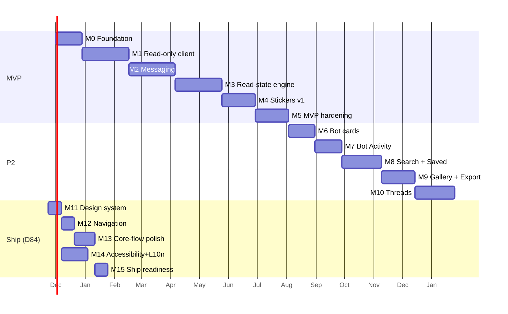
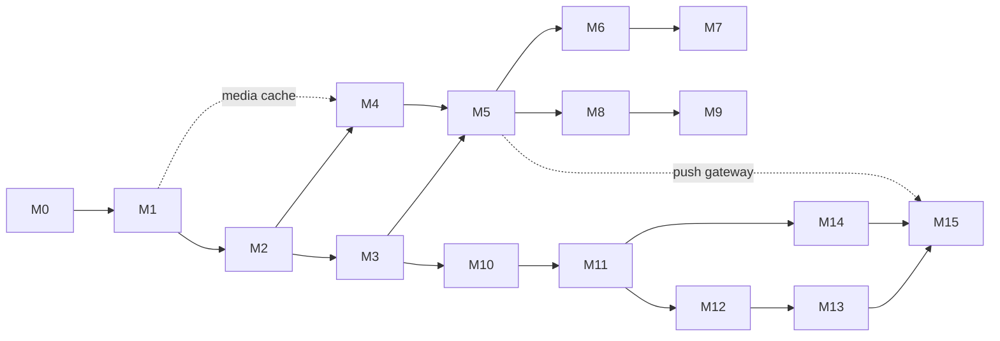

# Roadmap

**Where we are (2026-11-22):** functional roadmap M0–M10, **M11 (Design-system foundation + Phase A)**, and **M12 (Navigation & IA, D85 + Phase B)** are done (founder-blocked items: HANDOFF §5). Next: **M13 Core-flow polish (ADR-0022 step 3 + TD-11 split + Phase C)** → ADR-0022 step 4 → M14 Accessibility & localisation → M15 Ship readiness. Evidence: [design/UX_AUDIT.md](design/UX_AUDIT.md); bar: "Ship-ready definition" below.

Capacity: solo, part-time (D24). Estimates are calendar weeks at ~15 h/week and are **[ASSUMPTION]**s. Each milestone ends with its exit criteria **verified by tests** (AGENTS.md §0, §12).

## Remaining work (the loop's queue)
Ordered work queue for the autonomous loop ([development/AUTONOMOUS_LOOP.md](development/AUTONOMOUS_LOOP.md), D70). Take the first unchecked item the agent can do; items marked 📱 need a physical device and 👤 the founder (they go to HANDOFF §5 and don't block the queue). Completed M0–M10 history lives in the "Done (M0–M10)" appendix below (TD-09).

**M4 / M5 leftovers**
- [ ] Simulator UI check of the sticker panel and pack creation; real sticker images loaded from media.
- [ ] (deferred, D71, not blocking) CI: macOS job for Mac-only packages and app build (Q-CI-MAC).
- [ ] 👤 Push gateway (Sygnal + pushkin) for Beta/Release, APNs keys, TestFlight build.
- [ ] 👤📱 AC-U8: 7-day soak with zero unexplained auditor findings.

**M11 Design-system foundation** (D84; exit: AC-UX-1, AC-UX-2; done except 👤 Q-BRAND)
- [x] ADR-0022 step 1 (layout, D86): stale paths fixed in `AGENTS.md`; `TimelineReadTracker` + pure tests moved to `HaloDomain/ReadState/`; `HaloDesignSystem/{Tokens,Components,Media}/`; `ios/App/{Resources,Support}/` + `project.yml`.
- [x] Naming gate (MODULE_BOUNDARIES §1): `scripts/check_boundaries.py` enforces `Feature<Area>`, `Halo<Layer>`, and no module/type name collision, unit-tested in `scripts/test_check_boundaries.py`.
- [x] Asset catalogues: `HaloDesignSystem` `Colors.xcassets` (Light/Dark/Increase Contrast) and `ios/App/Resources/Assets.xcassets` (`AccentColor` + placeholder 1024 pt `AppIcon` light/dark/tinted until Q-BRAND).
- [x] `HaloDesignSystem` tokens (`HaloColor`, `HaloSpacing`, `HaloRadius`, `HaloMotion`, `HaloTypography`) and WCAG AA contrast test (`ColorContrastTests`, AC-UX-2).
- [x] Shared components (`RoomRow`, `UnreadIndicator`, `HaloBanner`, `LoadingState`, `ErrorState`, `EmptyState`) with Light/Dark/AX5 `#Preview`s.
- [x] `HaloFeedback` mapping app events to `.sensoryFeedback`.
- [x] Replaced raw system colours and fixed font sizes across `Features/` and `ios/App/`; added `scripts/check-design-tokens.sh` to `scripts/prepush.sh` (AC-UX-1).
- [ ] 👤 Q-BRAND: final app icon and the sign-in illustration (original artwork, DESIGN_SYSTEM §5).

**M12 Navigation and information architecture** (exit: AC-UX-3, AC-UX-4; fixes UX-01, UX-02, UX-08; **done**)
- [x] ADR-0022 step 2 (D86): `ChatsRoute` + `ChatsRouter` in `HaloApplication/Navigation/` (unit-tested); `AppRoot` split into `App/Composition/{Session,Chats,Settings,Notifications,Bots}Assembly.swift`; extracted `FeatureSearch` and `FeatureProfile` with moved tests and `check-boundaries` green.
- [x] Q-NAV-SHELL decided by the founder (2026-11-22): single `NavigationStack`, Messages-style, no tab bar (D85, supersedes D50); NAVIGATION.md §1 rewritten.
- [x] Compose button (`square.and.pencil`, top-trailing) on the Chats root opens New chat as a sheet; the Settings "Find a person" row is removed (UX-01). Large title "Chats" on the root.
- [x] Shell per D85: one typed path `ChatsRoute` (`.room`, `.thread`, `.settings`, `.stickerLibrary`, `.activity`, `.globalMediaGallery`); Settings pushed from the avatar (`SettingsConfiguration` model factory replaces the 25-closure init); more menu (`ellipsis.circle`) with filters, Stickers and Activity; Activity and Sticker library pushed instead of sheets.
- [x] Search per D85: `.searchable` on the room list (room names while typing + `"Messages"` section from `SearchPort` via `MessageSearchResultsSection`), replacing the magnifying-glass sheet.
- [x] State restoration (NAVIGATION §4): navigation path persisted via `@SceneStorage`, dropping rooms no longer joined (`ChatsRouter.pruneInvalidRooms`).
- [x] Notification tap, `matrix:` links, search hits and Activity items route through `ChatsRouter` (no duplicated pushes); unit-tested in `HaloApplicationTests/ChatsRouterTests.swift`.

**M13 Core-flow polish — the first five minutes and the daily loop** (exit: AC-UX-5, AC-UX-6, AC-UX-7; fixes UX-06, UX-07, UX-09, UX-12, UX-14, UX-15)
- [ ] ADR-0022 step 3 (D86, together with the TD-11 split, before any other M13 timeline item): new `HaloBotRendering` (`BotCardView`, `HTMLText`), `FeatureComposer` (composer, attachments, mentions), `FeatureMedia` (global gallery + **one** shared photo viewer replacing the two `TabView` copies + Quick Look); rename `FeatureAuth` → `FeatureOnboarding`; no behaviour change, tests moved with the code.
- [ ] First run (S1, S14): welcome screen with the value statement and Halo artwork, homeserver field with inline help ("What's a homeserver?") and the suggestion of Q-ONBOARD-SERVER, friendly discovery errors; after sign-in a short setup checklist: verify this device (S2) → notifications priming (S14, system prompt only after "Turn on") → done.
- [ ] Room list: skeleton rows on the first-ever load, `.refreshable` triggering a sync round trip, swipe actions with SF Symbols + labels and semantic tints (Mail pattern), unread/mention indicators from `UnreadIndicator`, empty and filter-empty states per S3, invite rows as a compact card with Accept/Decline.
- [ ] Timeline: bubble grouping and tails per DESIGN_SYSTEM §7, swipe-to-reply gesture with haptic, double-tap quick reaction (👍) and a reaction bar on long-press (Messages pattern), "↓ N new" / "Jump to unread" pills on system material, typing indicator animation (Reduce Motion: static), date separators as sticky headers, send button states (sending/failed) with haptics.
- [ ] Composer: multi-line growth to 6 lines, attachment menu (Photos, Camera, Files) using `PhotosPicker` and the document picker, paste-image support, upload progress on the bubble, draft kept per room.
- [ ] Room details and profiles: header in the style of Contacts (large avatar, name, quick actions Message · Mute · Search · Media), grouped rows, destructive actions last with confirmation.
- [ ] Copy pass (UX-15): a voice-and-tone section in DESIGN_SYSTEM; every user-facing error mapped from `HaloError` to a short sentence plus an action; no adapter text in alerts.
- [ ] Simulator walk-through of every screen in light/dark with screenshots attached to the pull request (AUTONOMOUS_LOOP §2 step 4).

**ADR-0022 step 4 — two-manifest consolidation** (D86; at a quiet point right after M13 merges, nothing else in flight; one pull request, no behaviour change)
- [ ] `ios/Packages/HaloCore` (HaloFoundation, HaloDomain, HaloApplication, HaloTestSupport — Linux) and `ios/Packages/HaloApple` (adapter, persistence, platform, design system, bot rendering, every feature as a target) replace the 15 manifests; module and target names unchanged (MODULE_BOUNDARIES §1).
- [ ] Same area folders in `HaloMatrixAdapter` and `HaloTestSupport` as in `HaloDomain`/`HaloApplication` (`Session`, `Sync`, `RoomList`, `Timeline`, `Media`, `Stickers`, `Encryption`, `Notifications`, `Bots`, `Search`, `Account`, `Support`).
- [ ] Tooling and docs follow: `ios/project.yml`, `scripts/prepush.sh`, `scripts/check_boundaries.py` (target-level rules, same `Feature` prefix), `.github/workflows/swift-linux.yml`, MODULE_BOUNDARIES §1–2, AGENTS.md §5/§13, DEVELOPMENT_SETUP, ADR-0008 status note. Exit: `prepush.sh`, app build, contract tests and Linux CI green; `.build` size before/after recorded in the pull request.

**M14 Accessibility and localisation** (exit: AC-UX-8, AC-UX-9, AC-UX-10; fixes UX-10, UX-11, SR-07)
- [ ] VoiceOver pass per DESIGN_SYSTEM §9: rows read as one element ("Alice, 3 unread messages, last message …, 10:42"), custom actions (Reply, React, Mark read) through `.accessibilityActions`, bot-card states announced, focus moves sensibly after sheets close.
- [ ] Dynamic Type up to AX5 on every screen (no truncated essential text, rows reflow to vertical), Bold Text, Increase Contrast, Reduce Transparency, Reduce Motion, Voice Control labels.
- [ ] XCUITest target `HaloUITests`: golden path (sign in against `infra/dev` → open room → send → react → read clears the badge) plus `XCUIApplication.performAccessibilityAudit()` on each root screen; run by `scripts/prepush.sh` when the simulator is available.
- [ ] String Catalog `Localizable.xcstrings` for the app and every feature package; view-model strings through `String(localized:)`; plurals via the catalogue; dates/numbers via `FormatStyle`; a pseudo-language run (double-length strings, RTL) checked on screen.
- [ ] 👤 Q-L10N: languages for the external beta (recommendation: English only for Beta 1, then the founder's languages).

**M15 Ship readiness — external TestFlight and App Store** (exit: AC-UX-11, AC-UX-12 and the "Ship-ready definition" below; fixes SR-01, SR-03…SR-06)
- [ ] `PrivacyInfo.xcprivacy` for the app and the NSE (required-reason APIs actually used, no tracking, no collected data beyond the account on the user's homeserver); checked against the archive's privacy report.
- [ ] In-app feedback: Settings → "Send feedback" opens a mail/share sheet with an optional diagnostics `.zip` (never automatic; PRIVACY §1); TestFlight screenshot feedback mentioned in What's New.
- [ ] "What's New" sheet once per marketing version (local flag), and an About screen with privacy policy and support links.
- [ ] Performance budgets on a physical device with XCTest metrics: cold start to an interactive room list ≤ 1 s for 300 rooms (NFR-1), timeline scroll hitch ratio < 5 ms/s (NFR-2), memory under 200 MB in a media-heavy room; MetricKit hang and launch reports reviewed.
- [ ] 👤 Q-APPSTORE: name, subtitle, category, age rating, keywords; screenshots (6.9" and 6.3", light and dark) generated from the M14 UI test with fixture data; support and privacy-policy pages.
- [ ] 👤 Legal review (D38), export compliance (V-LEGAL), privacy nutrition labels (PRIVACY §5), Q-SDK-BUILD and Q-CRASH decided before external testers.
- [ ] 👤📱 Beta 1 (internal TestFlight) → Beta 2 (external TestFlight, ≤ 25 trusted testers) → 1.0 App Store, per the release plan below.

**Tech debt (paid down alongside M11–M15; scores and evidence in [development/TECH_DEBT.md](development/TECH_DEBT.md))**
- [x] Phase A with M11: `.swift-format` + `.swiftlint.yml` enforced by `prepush.sh` (TD-06, D62); `@unchecked Sendable` justifications added (TD-14); roadmap queue slimmed to one-line items with M0–M10 history in the appendix below (TD-09).
- [x] Phase B with M11–M12: `PreferencesPort` + observable `PreferencesStore`, no `AppPreferences()` in `ios/App/` (TD-02); `AppRoot` split into `ios/App/Composition/*Assembly.swift` (≤ 300 lines) and `SettingsView` built from `SettingsConfiguration` model factory (TD-10).
- [ ] Phase C with M13: no `try?` on state-changing port calls — errors logged once and shown with M13 copy (TD-01); `ActionState` helper against double taps and orphaned tasks (TD-07); split `TimelineViewModel`/`TimelineView` below 600 lines per file (TD-11); replace the 1.5 s re-check in room details (TD-13).
- [ ] Phase D with M14–M15: `HaloUITests` (TD-03); manual-dispatch macOS build workflow before TestFlight uploads, revisiting D71 (TD-04); `bot_action` table for pending ticks (TD-08).
- [x] ADR-0022 (module layout v2, TD-16) accepted by the founder (2026-11-22, D86); its four steps are queued in M11, M12, M13 and "ADR-0022 step 4" above.
- [ ] 👤 TD-12 (R-16 field encryption) and 📤 TD-15 (upstream SDK filter / queued raw sends).

## Ship-ready definition (D84)
Halo is ready for external testers when **all** of these hold; each line names how it's checked.

| Area | Bar | Check |
|---|---|---|
| Correctness | AC-U1–U7 green; AC-U8 soak with zero unexplained auditor findings | Scenario suite, auditor |
| Native feel | No raw colours or fixed font sizes outside `HaloDesignSystem`; every screen uses system navigation, bars and sheets | AC-UX-1, `check-design-tokens.sh` |
| First five minutes | Install → signed in → verified → first message sent in ≤ 3 minutes for a tester with an account, no dead ends | AC-UX-5, moderated test with 3 people |
| States | Every screen has loading, empty and error states from DESIGN_SYSTEM §8; no blank screen, no spinner for lists | AC-UX-6 |
| Accessibility | Zero issues from `performAccessibilityAudit()` on root screens; AX5 usable; VoiceOver golden path | AC-UX-8, AC-UX-9 |
| Performance | NFR-1, NFR-2 met on an iPhone 15-class device | AC-UX-11 |
| Stability | Crash-free sessions ≥ 99.5 % over the internal beta; no hang > 2 s in MetricKit | TestFlight + MetricKit |
| Compliance | Privacy manifest, privacy labels, export compliance, licence gate, legal review | AC-UX-12, BUILD_AND_RELEASE §4 |

## Release plan
| Release | Contents | Audience | Entry |
|---|---|---|---|
| **Beta 1** (internal TestFlight) | M0–M10 + M11 + M12 + push gateway (R-24) | Founder + 1–3 people | M12 merged, Beta push gateway live |
| **Beta 2** (external TestFlight) | + M13, M14, M15 compliance items | ≤ 25 trusted testers | Ship-ready definition met except the 1.0-only lines |
| **1.0** (App Store) | + fixes from Beta 2, final icon/screenshots, legal sign-off | Public (Matrix power users) | Two weeks of Beta 2 with no P0/P1 bug open |
| **Post-1.0 backlog (M16)** | Share extension, App Intents / Siri and Spotlight, Focus filter, widgets, iPad layout, calls (D43) | — | Re-plan after 1.0 |

## Milestones

| # | Milestone | Scope | Exit criteria | Gates |
|---|---|---|---|---|
| M0 | Foundation | Repo layout, Xcode project + local packages, `infra/dev` Synapse (native password login, D64)/Sygnal, prebuilt SDK pinned, adapter skeleton behind ports, licence gate, CI (docs + Linux Swift domain tests), logging | Password login against the dev Synapse shows the room count via ports; CI green | V-SDK-1, V-SQL-1, V-CI-1, V-APPLE-1 |
| M1 | Read-only client | Session restore, `SyncService`, room list, timeline (text, notices, images, UTD), verification + recovery, NSE spike | All rooms readable; encrypted push shown | **G-NSE** (AC-NSE-1…6) |
| M2 | Messaging | Composer, replies, edits, deletes, reactions, typing, receipts display, send queue, media display, image send | Daily use alongside Element X; AC-M* | — |
| M3 | Read-state engine | `ReadState` policy, receipt outbox, visibility tracking, badge, clearing, marked-unread, modes, auditor, Synapse scenario suite | AC-U1–U7 automated green | **G-UNREAD, G-FFI** |
| M4 | Stickers v1 | Image-pack discovery, panel, favourites/recents, search, send/render, personal pack creation | AC-S* | V-ST-1 |
| M5 | MVP hardening | OIDC/MAS login (MAS added to `infra/dev`, V-AUTH-1), settings, acknowledgements, generic bot rendering, performance, 7-day soak | **MVP: daily-driver switch**, AC-U8 | — |
| M6 | Bot cards | Template parsers v1, task→event index, reaction protocol | AC-B* | — |
| M7 | Bot Activity tab | Task aggregation, filters, jump to source | AC-A* | — |
| M8 | Search + Saved | Evaluate `SearchService` → decide; Saved room | Known message found in an E2EE room | V-SEARCH-1 |
| M9 | Gallery + Export | Media index, gallery, encrypted export | — | — |
| M10 | Threads | Thread UI + per-thread read state | Unread scenarios with threads green | — |
| M11 | Design-system foundation | Asset catalogue, tokens, shared components, haptics, token gate | AC-UX-1, AC-UX-2 | Q-BRAND (icon only) |
| M12 | Navigation & IA | Single-stack shell (D85), compose button, more menu, searchable list, state restoration, unified routing | AC-UX-3, AC-UX-4 | — |
| M13 | Core-flow polish | First run, permission priming, room list/timeline/composer/details polish, copy pass | AC-UX-5–AC-UX-7 | Q-ONBOARD-SERVER |
| M14 | Accessibility & localisation | VoiceOver/AX5 pass, UI tests + accessibility audit, String Catalog | AC-UX-8–AC-UX-10 | Q-L10N |
| M15 | Ship readiness | Privacy manifest, feedback, What's New, perf budgets, App Store metadata, legal | AC-UX-11, AC-UX-12, Ship-ready definition | Q-APPSTORE, V-LEGAL |

## Gates

| Gate | When | Question | Pass → | Fail → |
|---|---|---|---|---|
| **G-FFI** | End of M3 | Are the upstream FFI APIs enough for unread correctness, stickers (custom room state)? (NSE budget: G-NSE.) | Stay on the upstream binary framework | Build Halo-owned UniFFI bindings over `matrix-sdk`/`matrix-sdk-ui` in `core/` behind the same ports (ADR-0003); budget 6–10 weeks |
| **G-NSE** (ADR-0016) | End of M1, independent of G-FFI | Does the NSE meet AC-NSE-1…6 — memory, execution time, timeout handling, extension termination, network failures and fallback behaviour ([features/NOTIFICATIONS.md](features/NOTIFICATIONS.md) §11)? | Keep the NSE pipeline | Lightweight runtime, cached badge, SDK built without unneeded features (Q-SDK-BUILD moves to M2); Halo-owned bindings only if the binding layer is the measured cost |
| **G-UNREAD** | End of M3 | Does the reconciliation policy over SDK + server signals meet AC-U1–U7 in scenario tests? | Keep the policy layer | Add an independent recount (needs G-FFI fail path, or upstream fixes) |

## Dependencies

## Technical risks per milestone
See [RISK_REGISTER.md](RISK_REGISTER.md). Highest: T-NSE (M1), T-RECEIPTS (M3), T-STATE (M4), and the capacity risk PROJ-1 across all milestones.

## Done (M0–M10)
Concise record of completed functional milestones (detailed history in `git log`, [CODEBASE_REVIEW.md](CODEBASE_REVIEW.md) and [testing/GATE_EVALUATION_M3.md](testing/GATE_EVALUATION_M3.md); TD-09).

- **M0 Foundation:** `infra/dev` Synapse + Postgres, local Swift packages, Xcode project (`project.yml`), pinned `MatrixRustSDK`, Keychain + log sink, licence/boundary/secret CI gates, password login + session restore.
- **M1 Read-only client:** classic sync + room list + timeline, recovery-key & SAS emoji/decimal verification, media thumbnails/Quick Look/preview policy, physical iPhone 16 **G-NSE** 100/100 soak pass (`F-DEV-1`/`F-DEV-2`).
- **M2 Messaging:** Markdown/HTML composer, send queue + offline/kill-relaunch resend, replies, edits, deletes, reactions, mentions, typing notices, drafts, photo captions, file/audio/video sending.
- **M3 Read-state engine:** `ReadStatePolicy` + `BadgeCalculator` (D82), classic sync unread evidence (D73/D74), identity/timeline-order read intents (D80/ADR-0020), GRDB outbox & `notification_record`, auditor + `.zip` diagnostics, P1–P11 & S01–S29 green against `infra/dev`; G-UNREAD/G-FFI recommended pass.
- **M4 Stickers v1:** pack discovery + legacy `im.ponies.*`, animated preview/autoplay (12-slot cap), favourites/recents/search, pack creation, unavailable-pack removal, encryption notice, hidden pack rooms.
- **M5 MVP hardening:** MAS/OIDC login (`infra/dev/smoke-mas.sh`), Settings v1 + acknowledgements + privacy toggles + app-switcher blur (D61), user profiles, room details/invites/new chat/paging, room list v2 filters & previews.
- **M6–M7 Bot cards & Activity:** Layer 2 template cards (`TodoListV1`, `TaskAddedV1`, `ReminderSetV1`, `TaskDoneV1`, `TaskDeletedV1`), allowlist sync, `bot_task` index + background scan, tick-from-Activity & source-redaction handling.
- **M8 Search + Saved:** `SearchPort` over SDK `SearchService`, message search sheet, Saved Messages room (`one.mbm.halo.saved_room`).
- **M9 Gallery + Export:** per-room gallery, Global Media Gallery preset virtual room (D83), passphrase-encrypted AES-256-GCM room export (D32).
- **M10 Threads:** `TimelinePort.openThread` over `TimelineFocus.thread`, "Reply in thread" action and thread sheet.
