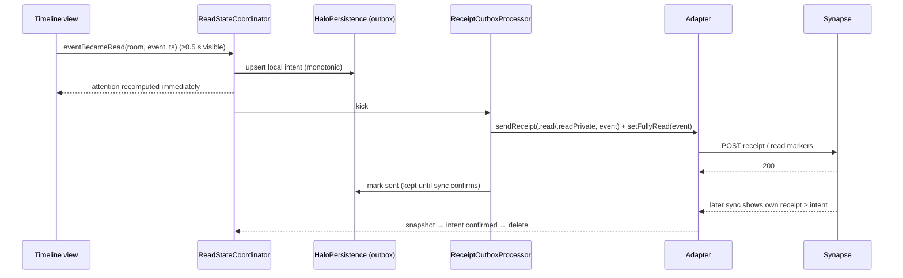

# Data Flow and Sources of Truth

## 1. Source-of-truth hierarchy

**[DECISION ADR-0007, ADR-0006]** Every fact has exactly one owner. Everything else is a replica, a derivation or an intent.

| Fact | Truth | Replica | Halo derived / intent |
|---|---|---|---|
| Events, room state, membership | Homeserver | SDK state store + event cache | Timeline view models (projection only) |
| Own read receipts, `m.fully_read`, `m.marked_unread` | Homeserver | SDK (`RoomInfo`, `load_user_receipt`) | **Local read intent** (outbox, until the server confirms) |
| Server notification/highlight counts | Homeserver | SDK `RoomInfo` | — |
| Client-side unread counts | Derived by the SDK | `RoomInfo.num_unread_*` | Inputs to `ReadStatePolicy` |
| Room attention, display count, confidence, badge | — | — | **Derived** by `ReadStatePolicy` / `BadgeCalculator`; recomputable at any time |
| Delivered notifications | iOS Notification Center | — | `notification_record` (what Halo delivered, for de-duplication and clearing) |
| Crypto keys, sessions | SDK crypto store + Keychain passphrase | — | — |
| Image packs | Room state `m.room.image_pack` + account data `m.image_pack.rooms` | SDK | Parsed pack view model (cache) |
| Sticker favourites / recents | Account data `one.mbm.halo.sticker_prefs` (synced) | SDK | — |
| Bot task state | **Bot backend** (D18) | Bot messages in rooms | `bot_task` index (derived, P2) |
| UI preferences | `UserDefaults` (App Group) | — | — |

Rules:
1. **Derived data must be rebuildable** from truth + replicas. Losing `halo.sqlite` loses only *unsent intents* (receipt outbox entries) and local logs.
2. **Intents are explicit**, carry the time they were created, and are deleted once the truth reflects them.
3. **No second counter.** Halo doesn't increment or store counts as truth anywhere.

## 2. Inbound sync flow

```mermaid
sequenceDiagram
  participant HS as Synapse
  participant SDK as matrix-rust-sdk (SyncService)
  participant AD as HaloMatrixAdapter
  participant RS as ReadStateCoordinator
  participant P as ReadStatePolicy
  participant UI as RoomList / Timeline VMs
  participant NC as NotificationCoordinator
  HS->>SDK: sliding sync response
  SDK->>SDK: persist, decrypt, update RoomInfo counts
  SDK-->>AD: RoomInfo / room list diffs
  AD-->>RS: RoomSnapshot (value) via AsyncStream
  RS->>P: evaluate(snapshot, localIntent, notified)
  P-->>RS: RoomReadState
  RS-->>UI: attention + display count
  RS->>NC: badge = BadgeCalculator(all states); clear covered notifications
```

## 3. Outbound read flow



## 4. Push flow
See [../matrix/PUSH_NOTIFICATIONS.md](../matrix/PUSH_NOTIFICATIONS.md) §3.

## 5. Reconciliation triggers
`SyncService` reaching running; a scene becoming active; a background refresh; a background push; the outbox
being confirmed; an account-data change (`m.push_rules`, `m.marked_unread`, `m.fully_read`). Each triggers
`ReadStateCoordinator.reconcile(rooms:)` — deterministic and idempotent.
