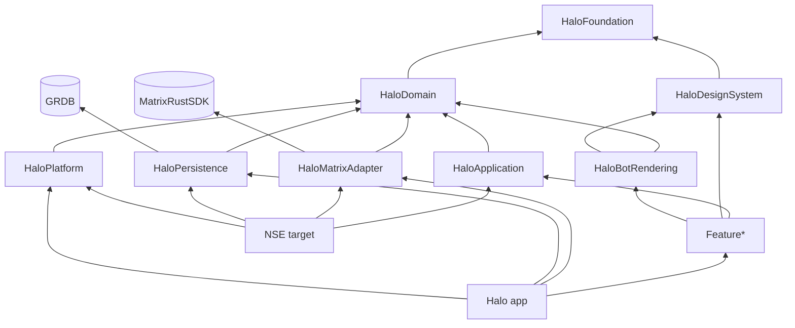

# Module Boundaries

**[DECISION ADR-0008]** Code lives in local Swift packages under `ios/Packages/`. The Xcode project
contains only the two composition roots. Boundaries are enforced by package manifests (a module can't
import what it doesn't declare) and by `scripts/check-boundaries.sh` (planned for M0, see
[../development/CI_CD.md](../development/CI_CD.md)).

## 1. Modules

| Module | Layer | Responsibility | May depend on | Builds on Linux |
|---|---|---|---|---|
| `HaloFoundation` | 6 | Logging facade, redaction, `HaloError` base, clocks, IDs | — | ✅ |
| `HaloDomain` | 3 | Value models, **ports** (protocols), pure policies: `ReadStatePolicy`, `BadgeCalculator`, `ImagePackParser`, `BotTemplateParser` registry | HaloFoundation | ✅ |
| `HaloApplication` | 2 | Use cases and coordinators (session, sync, read state, outbox, notifications, stickers, bot index) | HaloDomain, HaloFoundation | ✅ (no UIKit/UserNotifications) |
| `HaloMatrixAdapter` | 4 | Implements Matrix ports using `MatrixRustSDK`; maps upstream types ⇄ domain values | HaloDomain, HaloFoundation, **MatrixRustSDK** | ❌ |
| `HaloPersistence` | 5 | GRDB database, migrations, repositories implementing persistence ports | HaloDomain, HaloFoundation, GRDB | ✅ (tests use in-memory DB) |
| `HaloPlatform` | 6 | UserNotifications, BackgroundTasks, Keychain, file protection, ImageIO decoding, haptics | HaloDomain, HaloFoundation | ❌ |
| `HaloDesignSystem` | 1 | Tokens, components, HTML-subset → `AttributedString` renderer | HaloFoundation | ❌ |
| `HaloBotRendering` | 1 | `BotMessageRenderer`: cards for parsed templates, generic fallback | HaloDomain, HaloDesignSystem | ❌ |
| `Feature*` (Auth, RoomList, Timeline, Composer, RoomDetails, Profile, Settings, Stickers, BotActivity) | 1–2 | Screens + `@Observable` view models | HaloApplication, HaloDomain, HaloDesignSystem, HaloBotRendering (Timeline, BotActivity only), HaloFoundation | ❌ |
| `HaloTestSupport` | test | Fakes of every port, fixture loaders, scenario builders | HaloDomain, HaloApplication, HaloFoundation | ✅ |
| `Halo` (app target) | root | `AppContainer`, scene setup, deep links | all | ❌ |
| `HaloNotificationService` (NSE target) | root | NSE entry point; the notification pipeline | HaloApplication, HaloDomain, HaloMatrixAdapter, HaloPersistence, HaloPlatform, HaloFoundation | ❌ |



## 2. Forbidden dependencies

| Rule | Reason |
|---|---|
| ❌ Anything except `HaloMatrixAdapter` imports `MatrixRustSDK` | Keeps the FFI replaceable (D44) |
| ❌ `HaloDomain` imports any other Halo module, SwiftUI, UIKit, GRDB, UserNotifications | Pure, portable, testable on Linux |
| ❌ `Feature*` imports `HaloMatrixAdapter`, `HaloPersistence`, `HaloPlatform` | Features talk to use cases, not infrastructure |
| ❌ `Feature*` imports another `Feature*` | Independent development; navigation goes through routes in `HaloApplication` |
| ❌ `HaloApplication` imports SwiftUI/UIKit | Keeps use cases UI-independent |
| ❌ Upstream FFI types in a port signature or a domain model | Same as the first rule |
| ❌ `HaloPersistence` stores Matrix events, receipts or room state as truth | Single source of truth (DATA_FLOW §1) |
| ❌ Badge or attention computed outside `BadgeCalculator` / `ReadStatePolicy` | D9 |

## 3. The Rust/Swift boundary

```mermaid
flowchart LR
  subgraph Swift
    Ports["HaloDomain ports<br/>(Halo-owned, versioned)"]
    Adapter["HaloMatrixAdapter"]
  end
  subgraph Binary["MatrixRustSDK (binary, upstream)"]
    FFI["UniFFI-generated Swift"]
    Rust["matrix-sdk-ffi → matrix-sdk-ui → matrix-sdk"]
  end
  Ports <-. implemented by .- Adapter
  Adapter --> FFI --> Rust
  subgraph Future["If G-FFI fails"]
    HaloFFI["core/halo-ffi (Halo-owned UniFFI)"]
  end
  Adapter -. swap .-> HaloFFI
```

The **ports** are the stable contract ([../matrix/PORTS_CONTRACT.md](../matrix/PORTS_CONTRACT.md)). The FFI
under the adapter can change (SDK bumps, or a switch to Halo-owned bindings) without touching anything above the adapter.

## 4. Module ownership

Solo phase: the founder owns everything. For future collaboration, ownership is recorded in
`.github/CODEOWNERS` (planned for M0) by path: `ios/Packages/HaloMatrixAdapter/` and `HaloDomain/ReadState/` need
review from the "core" owner; feature packages need review from the "app" owner.
