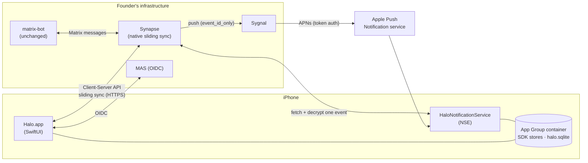
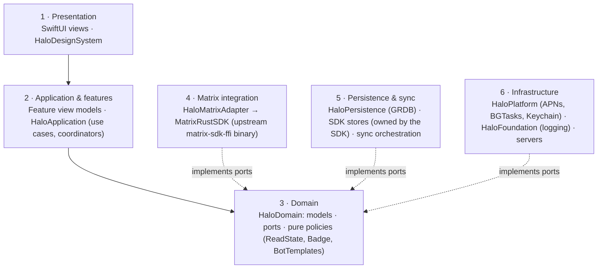

# Architecture Overview

## 1. System context

## 2. Layers

Arrows point in the direction of dependency. Layers 4–6 **implement** protocols (ports) defined in the
domain; the domain depends on none of them. Layer 2 uses ports and never imports layers 4–6 directly. Only
the composition roots (app target, NSE target) see every layer. Details:
[MODULE_BOUNDARIES.md](MODULE_BOUNDARIES.md).

## 3. What lives in Rust and what lives in Swift

**[DECISION D44]** For the MVP, Halo writes **no Rust**. Rust is present only as the upstream, unmodified
`matrix-sdk-ffi` binary.

| Concern | Owner | Why |
|---|---|---|
| Matrix protocol, sync, E2EE, crypto store, event cache, media encryption | **Rust — matrix-rust-sdk (upstream)** | The hardest code to get right and to secure; maintained upstream |
| Sync service, room list, timeline diffing, send queue, notification client | **Rust — matrix-sdk-ui (upstream)** | Already solved upstream |
| Read-state reconciliation policy, badge, attention | **Swift — HaloDomain** | Pure logic on values; must run identically in the app and the NSE; testable on Linux (D47) |
| Receipt outbox, sticker favourites/recents, bot task index, auditor log | **Swift — HaloPersistence** | App-owned data (D46) |
| Sticker pack model and parsing (image packs), bot template parsing | **Swift — HaloDomain** | Pure parsing of JSON / HTML from the adapter |
| UI, navigation, OS integration | **Swift** | Native |
| Future Halo-owned FFI (if gate G-FFI fails) | **Rust — `core/halo-ffi`** | Direct access to SDK internals behind the *same* ports (ADR-0003) |

## 4. Key architectural rules (summary)

1. One source of truth per fact ([DATA_FLOW.md](DATA_FLOW.md) §1). Halo never stores its own copy of
   Matrix events, receipts or room state; it reads them through ports.
2. Only `HaloMatrixAdapter` imports `MatrixRustSDK`. Upstream types never cross the port boundary.
3. The domain is pure, synchronous where possible, free of side effects and builds on Linux.
4. The badge and attention come from **one** function in `HaloDomain` (D9).
5. The NSE and the app share code and the database; neither keeps state the other can't see.

## 5. Document map

| Topic | Document |
|---|---|
| Processes, components, lifecycle | [SYSTEM_DESIGN.md](SYSTEM_DESIGN.md) |
| Packages and allowed dependencies | [MODULE_BOUNDARIES.md](MODULE_BOUNDARIES.md) |
| Sources of truth and flows | [DATA_FLOW.md](DATA_FLOW.md) |
| Threads, actors, cancellation | [CONCURRENCY.md](CONCURRENCY.md) |
| Errors and recovery | [ERROR_HANDLING.md](ERROR_HANDLING.md) |
| Background work | [BACKGROUND_EXECUTION.md](BACKGROUND_EXECUTION.md) |
| Logs, auditor, diagnostics | [LOGGING_AND_DIAGNOSTICS.md](LOGGING_AND_DIAGNOSTICS.md) |
| SDK and FFI | [../matrix/SDK_INTEGRATION.md](../matrix/SDK_INTEGRATION.md), [../matrix/RUST_FFI.md](../matrix/RUST_FFI.md), [../matrix/PORTS_CONTRACT.md](../matrix/PORTS_CONTRACT.md) |
