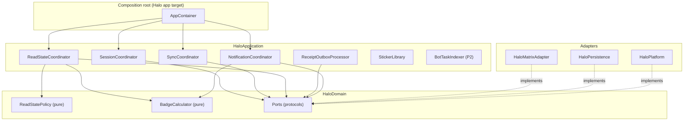

# System Design

## 1. Processes

| Process | Runs | Owns | Never does |
|---|---|---|---|
| `Halo` app | Foreground, short background windows | The `SyncService`, UI, receipt sending, outbox flush, reconciliation | Run sync while suspended |
| `HaloNotificationService` (NSE) | One process per push (iOS may reuse it), short-lived | Fetch + decrypt one event via `NotificationClient`, update notification records, compute the badge | Start `SyncService`, load timelines, send receipts |
| Share extension (P2) | On demand | Compose and enqueue | — |

Both processes open the **same** SDK session (same `session_paths`) with
`CrossProcessLockConfig.MultiProcess { holderName }` **[VERIFIED F-FFI-10]**, and the same `halo.sqlite`
(GRDB `DatabasePool`, WAL) — see [../data/PERSISTENCE.md](../data/PERSISTENCE.md) §4.

## 2. Runtime components (app process)



| Component | Responsibility |
|---|---|
| `AppContainer` | Builds adapters and coordinators once per signed-in account; injects them into feature view models |
| `SessionCoordinator` | Login, restore, logout, soft logout; owns the adapter's client lifecycle |
| `SyncCoordinator` | Starts/stops `SyncService` on scene-phase changes, exposes `SyncStatus`, triggers reconciliation on (re)connect |
| `ReadStateCoordinator` | Combines room snapshots + local read intents → `RoomReadState` via `ReadStatePolicy`; publishes attention; triggers badge updates and notification clearing |
| `ReceiptOutboxProcessor` | Durable, ordered, retrying sending of receipts and fully-read markers |
| `NotificationCoordinator` | Pusher registration, clearing delivered notifications, setting the badge |
| `StickerLibrary` | Pack discovery, favourites, recents, sending |
| `BotTaskIndexer` (P2) | Derives the task→event index and activity items from bot messages |

## 3. Lifecycle

```mermaid
stateDiagram-v2
  [*] --> Launching
  Launching --> SignedOut: no session
  Launching --> Restoring: session in Keychain
  SignedOut --> Authenticating --> Restoring
  Restoring --> Ready: client built, stores open
  Restoring --> SignedOut: session invalid
  Ready --> Syncing: scenePhase active
  Syncing --> Suspending: scenePhase background
  Suspending --> Suspended: outbox flushed or 25 s budget used
  Suspended --> Syncing: foreground (then reconcile)
  Syncing --> SoftLoggedOut: token rejected
  SoftLoggedOut --> Restoring: re-authenticated
  Ready --> SignedOut: logout
```

- **Foreground (`Syncing`)**: `SyncService.start()`; on its state reaching running → `ReadStateCoordinator.reconcileAll()` and `ReceiptOutboxProcessor.flush()`.
- **Background (`Suspending`)**: begin a background task; flush the outbox; `SyncService.stop()`; persist the badge.
- **NSE**: build a client with `NotificationProcessSetup.MultipleProcesses` **[VERIFIED F-FFI-10]**, call `get_notification(room_id, event_id)`, then run the notification pipeline ([../matrix/PUSH_NOTIFICATIONS.md](../matrix/PUSH_NOTIFICATIONS.md)).

## 4. Multi-account readiness
Everything above is created **per account** (`AccountScope`). The MVP supports one account, but the store and
the paths are keyed by user id from day one: adding a second account later shouldn't need a migration.

## 5. External services

| Service | Purpose | Configured in |
|---|---|---|
| Synapse | Homeserver (native sliding sync) | `infra/` ([../development/DEVELOPMENT_SETUP.md](../development/DEVELOPMENT_SETUP.md)) |
| MAS | OIDC login | `infra/` |
| Sygnal | Push gateway → APNs | `infra/`, APNs key in a secret store (never in the repo) |
| APNs | Delivery to the device | Apple Developer account |
