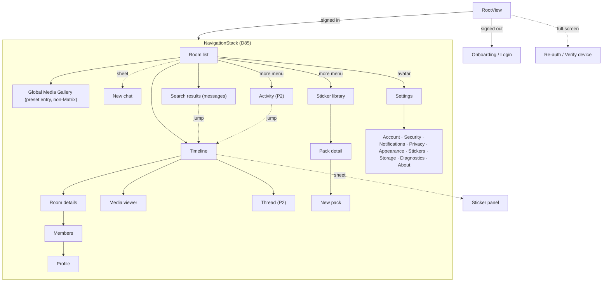

# Navigation

## 1. Structure
**[DECISION D85]** (founder, 2026-11-22, supersedes D50; resolves Q-NAV-SHELL) **One `NavigationStack`, no tab bar**, in the
style of Messages. The room list is the only root; everything else is pushed onto it or shown as a sheet.

| Element | Placement | Opens |
|---|---|---|
| Room list | Root, large title "Chats" | — |
| Account avatar | Top-leading toolbar (shows a dot when this device needs verification) | Settings, pushed |
| Compose (`square.and.pencil`) | Top-trailing toolbar | New chat, sheet |
| More menu (`ellipsis.circle`) | Top-trailing toolbar, left of compose | Filters (All · Unread · People · Rooms · Favourites · Invites), Stickers, Activity (only when bot senders are set), pushed |
| Search | `.searchable` field in the room list (pull down to reveal) | Filters rooms by name while typing; a "Messages" section shows `SearchPort` hits; with kind filters and a coverage notice (D123, [../features/MESSAGE_SEARCH.md](../features/MESSAGE_SEARCH.md)); tapping one opens the room, or the thread, at the message |
| Media Gallery | Preset row in the room list (D83) | Global Media Gallery, pushed |

Rules: the app badge is the only unread count outside the list (no tab badge); Activity and the sticker library are pushed screens,
not sheets; Settings → Stickers links to the same sticker library screen. Search, Activity and the sticker library stop being
sheets (ROADMAP M12).

**[DECISION D83]** Do **not** add a Photos/Media tab. The **Global Media Gallery** (D34, R-P2-GALLERY) is surfaced as a **preset virtual room entry** inside the Room list. It is a local navigation entry only—**not** a Matrix room (no server room ID, no Matrix sync state, no unread count, no read receipts, never contributes to the app badge). Tapping it pushes the Global Media Gallery screen on the `NavigationStack`.

## 2. Routing
- Routes are Halo enums in `HaloApplication/Navigation` (e.g. `ChatsRoute.room(RoomID, focus: EventID?)`, `.roomDetails`, `.profile(UserID)`). Features push routes; they don't import each other (MODULE_BOUNDARIES §2).
- One `Router` holds the typed path (`ChatsRoute`: `.room`, `.thread`, `.settings`, `.stickerLibrary`, `.activity`, `.globalMediaGallery`, …); notification taps, `matrix:` links, search hits and Activity items all go through it (no duplicated pushes). The app target maps routes to feature views (composition root).

## 3. Deep links
| Source | Target |
|---|---|
| Notification tap | Room at event (pushed on the stack) |
| `matrix.to` / `matrix:` links | Room (join preview if not joined) / profile. **Not reachable yet:** the scheme isn't registered, links in messages open Safari, and `resolveMatrixLink` joins or starts a chat without asking, which must be fixed first (ROADMAP M18-9) |
| Activity item | Room at source event |
| Share extension | Room picker → sends from the share sheet (D92) |

## 4. Presentation rules
Sheets for short tasks (new chat, member profile, sticker panel), full-screen covers only for blocking flows (re-auth, verification). Room info is pushed as a page on the `NavigationStack` on iPhone and compact iPad, and docks as a trailing inspector column on regular-width iPad. State restoration: the navigation path (open room, room info, and Settings or Activity if they were open) is restored on relaunch (`@SceneStorage`), dropping a room that is no longer joined.
