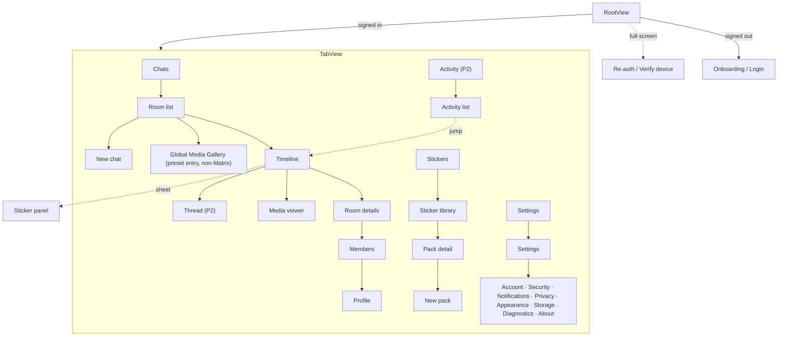

# Navigation

## 1. Structure
**[DECISION D50]** A `TabView` with three tabs in the MVP and a fourth in P2. Each tab owns a `NavigationStack` with a typed path.

| Tab | Root screen | MVP? |
|---|---|---|
| Chats | Room list | ✅ |
| Stickers | Sticker library (packs, favourites, create) | ✅ (D45) |
| Settings | Settings | ✅ |
| Activity | Bot Activity | P2 (M7) — inserted between Chats and Stickers |

The tab badge on Chats equals the app badge (same `BadgeCalculator` result).

**[DECISION D83]** Do **not** add a Photos/Media tab. The **Global Media Gallery** (D34, R-P2-GALLERY) is surfaced as a **preset virtual room entry** inside the Room list. It is a local navigation entry only—**not** a Matrix room (no server room ID, no Matrix sync state, no unread count, no read receipts, never contributes to the app badge). Tapping it pushes the Global Media Gallery screen on the Chats `NavigationStack`.

## 2. Routing
- Routes are Halo enums in `HaloApplication/Navigation` (e.g. `ChatsRoute.room(RoomID, focus: EventID?)`, `.roomDetails`, `.profile(UserID)`). Features push routes; they don't import each other (MODULE_BOUNDARIES §2).
- A `Router` per tab holds the `NavigationPath`; the app target maps routes to feature views (composition root).

## 3. Deep links
| Source | Target |
|---|---|
| Notification tap | Chats → room at event |
| `matrix.to` / `matrix:` links | Room (join preview if not joined) / profile |
| Activity item | Chats → room at source event |
| Share extension (P2) | Room picker → composer |

## 4. Presentation rules
Sheets for short tasks (new chat, room details on iPhone, sticker panel), full-screen covers only for blocking flows (re-auth, verification). State restoration: the selected tab + the open room are restored on relaunch (`@SceneStorage`).
