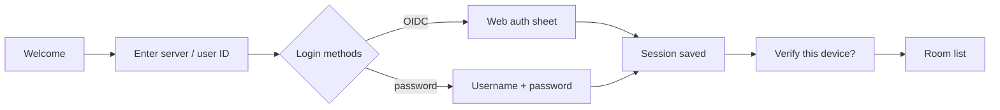

# Feature: Authentication and Session

> Priority: P1 · Milestone: M0 (password), M5 (OIDC) · Modules: FeatureAuth, HaloApplication.SessionCoordinator, adapter `SessionPort`, HaloPlatform `KeychainPort` · Requirements: R-P1-AUTH

## 1. Purpose
Sign in to a Matrix homeserver, keep the session safe and restore it silently.

## 2. User stories
- As a user I enter my server (or user ID) and sign in with my server's preferred method (OIDC or password).
- As a user I stay signed in across launches and the NSE can read my messages while the phone is locked (after the first unlock).
- As a user, when my session expires, I re-authenticate without losing my local data.

## 3. Functional requirements
- FR-1 Server discovery from a server name, a URL or a user ID (`server_name_or_homeserver_url`, `server_name_from_user_id`) **[VERIFIED F-FFI-4, F-FFI-22]**.
- FR-2 Show the login methods the server offers (`homeserver_login_details`).
- FR-3 OIDC via `url_for_oauth` + `ASWebAuthenticationSession` + `login_with_oauth_callback`; abort with `abort_oauth_auth` **[VERIFIED F-FFI-22]**.
- FR-4 Password login with `login(username, password, deviceName, deviceId)`.
- FR-5 ~~Reject servers without native sliding sync~~ — **removed by [DECISION D81]** (R-17): since Halo uses classic `/sync` (`D74`), homeservers without native sliding sync are accepted as long as they offer password or OIDC login.
- FR-6 Persist the session (`Client.session()`) in the Keychain, access group shared with the NSE, accessibility `afterFirstUnlockThisDeviceOnly`.
- FR-7 Persist token refreshes from the session delegate immediately.
- FR-8 Logout: `logout()`, delete the pusher, wipe the Keychain items, SDK stores and `halo.sqlite` for this account.
- FR-9 Soft logout (token invalid, data kept): re-auth sheet; after success, continue with the same stores.

## 4. Non-functional requirements
- Restore to an interactive room list ≤ 1 s (NFR-1). No secrets in logs. Device display name: "Halo (iPhone)".

## 5. User flows

## 6. State transitions
`SignedOut → Discovering → ChoosingMethod → Authenticating → Restoring → Ready`, `Ready → SoftLoggedOut → Authenticating`,
`Ready → SigningOut → SignedOut` (see [../architecture/SYSTEM_DESIGN.md](../architecture/SYSTEM_DESIGN.md) §3).

## 7. Data models
`ServerDetails { homeserverURL, supportsOIDC, supportsPassword, slidingSync: Bool }`;
`StoredSession` (opaque, serialised upstream session; only the adapter decodes it); `AccountID = UserID`.

## 8. API boundaries
`SessionPort` (adapter), `KeychainPort` (platform). FeatureAuth uses `SessionCoordinator` only.

## 9. Error scenarios
Unknown server · a server without password or OIDC sign-in (`unsupported`) · wrong password (`unauthorized`) · OIDC cancelled (`cancelled`) ·
network down (`network`) · Keychain unavailable before the first unlock (`storage`) → each with a specific message.

## 10. Edge cases
Server delegation (`.well-known`) · a user ID on a different server than the delegated homeserver · two quick taps on login ·
app killed during OIDC (the callback arrives on relaunch — discard it if there's no pending state).

## 11. Acceptance criteria
- AC-AUTH-1 Password login on the dev Synapse reaches the room list.
- AC-AUTH-2 Killing and relaunching the app restores without the network (D103: the stored homeserver URL is used as is; before 2026-11-23 the restore ran server discovery first, which needed the network). `HaloUITests.testSignedInLaunchOpensOnChats` times a cold launch to the first chat row.
- AC-AUTH-3 Revoking the token on the server → soft-logout sheet; after re-auth, cached rooms are still there.
- AC-AUTH-4 Logout removes every per-account file and Keychain item — and the Spotlight entries, widget data and pusher. `AccountDataEraser` removes the stores folder (SDK stores, `halo.sqlite`), the share inbox, the search folder, the chat-shortcuts file (and with it Spotlight and the widgets' chat names), the database key and the KLIPY shelf; the pusher is removed before sign-out and the badge reset by the read-state reset. `AccountDataEraserTests` list a container before and after. The same erase runs at launch when no session is stored but files are (a restore from a backup, an app killed while signing out). **Not tested:** the Spotlight index and the pusher on a device 📱, and a restore to a new device (ROADMAP M18-4).
- AC-AUTH-5 A complete OIDC sign-in, refresh in the app and the NSE, soft logout and sign-out work against MAS (V-OIDC-1; only discovery and the authorization URL are verified today, ROADMAP M18-6).

## 12. Test requirements
Unit: `SessionCoordinator` state machine with a fake `SessionPort`. Integration: S-AUTH-1..4 against the dev
Synapse + MAS ([../testing/INTEGRATION_TESTS.md](../testing/INTEGRATION_TESTS.md)). UI: the login smoke test.

## 13. Open questions
Q-SIGNUP. (Q-MAS-ACCOUNT decided: web account page, D117.)
