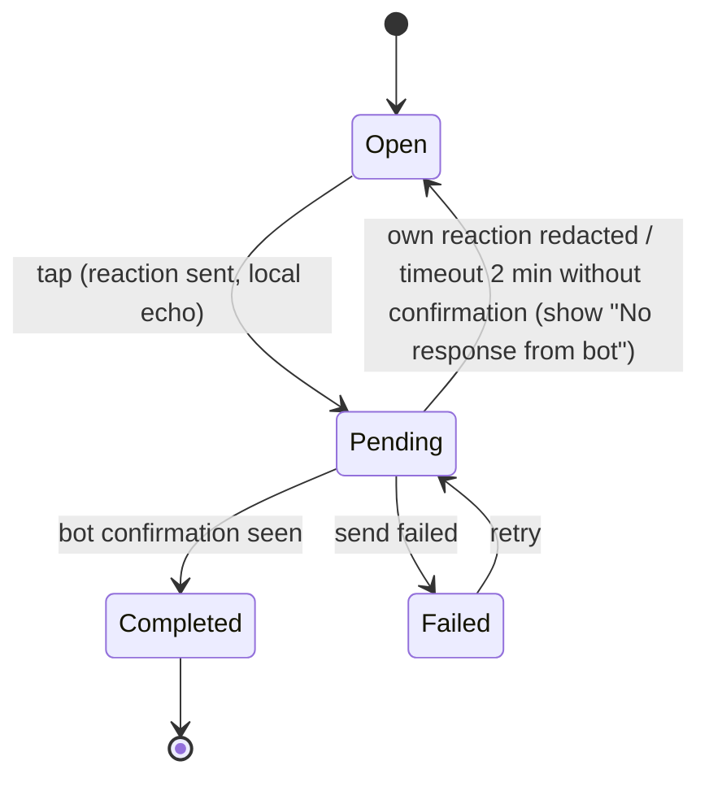

# Feature: Bot Message Rendering and Interaction

> Priority: P1 (Layer 1, D29), P2 (Layer 2 + interactions) · Milestone: M5 (Layer 1), M6 (Layer 2) · Modules: HaloBotRendering, `HaloDomain/Bots` (template parsers, task index model), `HaloApplication/BotTaskIndexer`, `BotActionCoordinator` · Decisions: D18–D23, ADR-0012 · Requirements: R-P1-BOTGEN, R-P2-BOT

## 1. Purpose
Render messages from known bots as native, structured UI and let users act on them, **with no change to the bot** (D18).

## 2. User stories
- Every formatted message (from anyone) renders cleanly: lists, code, quotes, links.
- My todo bot's lists look like a checklist; I tick an item and it shows "pending" until the bot confirms.
- I can always see the original message text.

## 3. Inputs and recognition
- Input: `BotMessageInput { roomId, eventId, sender, body, formattedBody?, timestamp, relations }` (domain values).
- **Layer 1 (all senders):** HTML subset → `AttributedString` (allowed tags per [F-BOT-1](../SOURCES.md) plus Matrix's recommended set; everything else as text).
- **Layer 2 (allowlisted senders only):** `BotTemplateRegistry` runs strict, **versioned** parsers in order; the first that returns a
  `ParsedCard` wins; any failure → Layer 1. The allowlist is a user setting (Settings → Bots: user IDs).
- MVP templates (from bot v-current, fixtures from the bot repo, F-BOT-2/3):

| Parser | Recognises | Card |
|---|---|---|
| `TodoListV1` | `📋 <b>{title}…:</b> ` followed by rows `• [<b>#{id}</b>] {text} … `; completed rows `<del>…</del> ✅` | Checklist with ids, priority marker, owner |
| `TaskAddedV1` | `Added Task <b>#{id}</b> for …: <i>"{title}"</i>` | Single task card with a checkbox |
| `ReminderSetV1` | `Reminder #{id} set!</b> … for: <i>"{title}"</i>` | Reminder card (time, title) |
| `TaskDoneV1` | `✅ Marked task as done: <i>"{title}"</i>` (F-BOT-4) | Compact "completed" card; also a confirmation signal |
| `TaskDeletedV1` | `🗑️ Deleted task: <i>"{title}"</i>` (F-BOT-4) | Compact "deleted" card |

- Parsers are pure functions over the HTML string; they fail closed (strict match, every row must parse or the whole message falls back).

## 4. Functional requirements
- FR-1 "View source" on every message: body, formatted body, event id, sender.
- FR-2 Cards show a subtle "Bot card" affordance and a "Show original" toggle.
- FR-3 **Interaction protocol (D22/D23)** — `BotActionCoordinator`:
  - Target event: for `TaskAddedV1` the message itself; for a `TodoListV1` row, the event found in the `bot_task` index by `(roomId, botSender, entityId)` (built from `TaskAddedV1` events). **Never** the list message; **never** a guess from text or number alone. Not found → read-only row with "Not available".
  - Action: send `👍` (exact emoji per F-BOT-2) as a reaction via `TimelinePort.toggleReaction`, only if no own 👍 already exists on that event.
  - State machine per (room, entity): see §6. "Completed" only when the bot confirms (§6).
- FR-4 Other bot reactions (👎 delete, 😝 +1 day, 🎉 celebrate) are offered from a long-press menu with confirmation for delete (P2).
- FR-5 Unknown or changed templates never break the timeline (Layer 1 fallback) and are counted in diagnostics.

## 5. Non-functional requirements
Parsing ≤ 1 ms per message; parsers have no I/O; zero crashes on fuzzed input.

## 5b. User flows
Open a room → a bot list renders as a checklist → tap a row → row shows "Waiting for bot…" → the bot's ✅ arrives → row completed. Long-press any message → "View source". A message that fails to parse simply renders as formatted text.

## 6. State transitions (checkbox)

**Bot confirmation** = any of **[VERIFIED F-BOT-4]**: (a) a `✅` reaction **from the bot sender** on the target event;
(b) a bot message `✅ Marked task as done: <i>"{title}"</i>` (`TaskDoneV1` parser) arriving after the tap; (c) a newer
`TodoListV1` from the bot showing the row as completed. Other outcomes: `🗑️` + `🗑️ Deleted task: …` (delete), `⏰` (delay),
`🎉` (celebrate).
Taps are ignored while `Pending` (no duplicates). Delivery of the reaction is **not** confirmation.

## 7. Data models
`ParsedCard` (enum per template), `BotTaskRef { roomId, botSender, entityId }`, `bot_task` index rows
([../data/DATA_MODELS.md](../data/DATA_MODELS.md)): `(account, room_id, bot_sender, entity_type, entity_id) → source_event_id, title, last_seen_state, updated_at`.

## 8. API boundaries
HaloBotRendering depends only on HaloDomain + HaloDesignSystem (D19). Interactions go through `BotActionCoordinator` (HaloApplication) → `TimelinePort`.

## 9. Error scenarios
Reaction send fails → Failed with retry · the target event redacted → row read-only · bot offline → "No response from bot" after 2 min.

## 10. Edge cases
The same task id appearing in several rooms (the key includes the room) · edits of bot messages (`m.replace`) → re-parse the latest content · duplicated events from sync replays (idempotent index updates) · out-of-order arrival (the list arrives before the confirmation) · the user un-reacting manually ·
**only the task's owner can complete it** — the bot ignores reactions from other members **[VERIFIED F-BOT-4]**; Halo can't map the
bot's internal owner to a Matrix user reliably (rows show a display name, "by Ann"), so for non-owners the tap ends in
"No response from bot" after the timeout **[OPEN Q-BOT-OWNER: enable checkboxes only for rows whose task Halo saw being created by the
own user (from the `TaskAddedV1` reply chain), or accept the timeout]**.

## 11. Acceptance criteria
- AC-B1 Every fixture from the bot repo either renders as the expected card or falls back; none crash.
- AC-B2 A tick on a list row sends exactly one 👍 to the original `Added Task #N` event and shows Completed only after the bot's confirmation.
- AC-B3 Rows without an indexed source event are read-only with "Not available".
- AC-B4 "View source" shows the exact original body.

## 12. Test requirements
Unit: each parser against positive fixtures, near-miss negatives, fuzzing (random HTML); coordinator state machine incl. duplicates, redactions, timeouts and out-of-order events. Integration: S-BOT-1 with a scripted fake bot account on the dev Synapse replaying the real bot's message formats.

## 13. Open questions
Q-BOT-OWNER (see §10).
