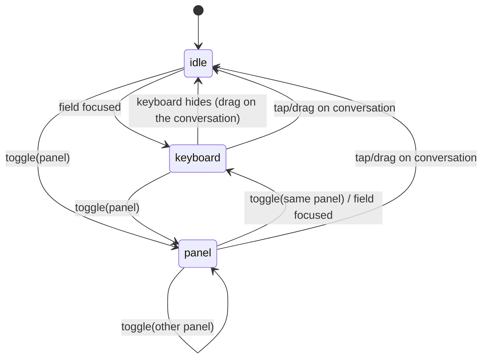

# Feature: Composer and keyboard panels

> Priority: P1 (post-1.0 polish, M16) · Milestone: M16 · Owner modules: `HaloDesignSystem/InputPanel`, `FeatureTimeline` (composer, emoji and attachment panels), `FeatureStickers` (sticker tab, KLIPY grids), `HaloDomain/Klipy`, `HaloDomain/Emoji/EmojiKeyboard`, `HaloApplication/Klipy`, `HaloPlatform/Klipy*` · Decisions: D97, D98 · Related: [STICKERS](STICKERS.md), [MESSAGING](MESSAGING.md), [MEDIA_ATTACHMENTS](MEDIA_ATTACHMENTS.md)

## 1. Purpose
One messaging input in the spirit of Telegram's, built natively in SwiftUI and in Halo's own look (Liquid Glass controls,
Halo tokens): the system keyboard and Halo's own panels (emoji, stickers, GIFs, attachments) take turns in the same
place under the composer, with no jumps while they swap.

## 2. User stories and user flows
- I tap the field and type with the iOS keyboard (dictation, predictive text, other languages: all native).
- I tap the sticker/smiley button inside the field and the keyboard turns into the emoji/sticker/GIF panel at the same height; tapping it again (now a keyboard icon) brings the keyboard back.
- In the panel I switch Emoji · GIFs · Stickers with a floating pill; it opens on Emoji the first time, then on the last tab used.
- I search GIFs and KLIPY stickers, keep favourites, and find what I sent recently.
- I long-press a GIF or sticker to preview it, send it or favourite it.
- I tap the paperclip and pick photos from an inline picker, a file, or a pasted image.
- Dragging or tapping the conversation puts the keyboard or panel away.

### 2a. Composer layout (founder, 2026-11-23, D99)
Telegram's arrangement in Halo's look: a round **paperclip** (attachment panel) · the **field** with a **face** icon inside
(opens the expression panel; a keyboard icon while it is open) · one round button on the right: the **mic** when the field
is empty and nothing is open, **↑** while a panel is open (pulls it up to a tall, sheet-like height that leaves room for the
navigation bar and composer) and **↓** to bring it back. Once there is text, the right button becomes a blue **send** button
(founder 2026-11-23: with send inside the field, a long message left an empty column down the field's right side; only the
face icon stays inside). A pasted image (edit menu, or the keyboard's paste suggestion) joins the pending photos (D106). The panel's content is laid out at the taller height while its area animates, so resizing
slides without a flash. **Voice messages:** tap the mic to record (the system asks for the microphone the first time), the
field shows a red dot, the time and Cancel; the right button sends. The recording is AAC `.m4a`, at most 5 minutes, sent
through the file path as `m.audio` (encrypted in encrypted rooms) and deleted from the device afterwards.

## 3. Functional requirements: input state (D97)
`ComposerInputState` (pure, `HaloDesignSystem/InputPanel`) is the single source of truth for what is under the composer:
`idle`, `keyboard` or `panel(expression | attachments)`, plus `panelSearching` (a field inside the panel raised the
keyboard), `lingeringPanel` (the panel being replaced while the keyboard rises) and `panelExpanded` (↑ / ↓, reset when the panel closes or the keyboard returns). `ComposerInputController` drives it
from the field's focus, the composer's toggles and UIKit keyboard notifications.

- **No jump (D102).** Halo owns the whole space under the composer: the timeline ignores the keyboard safe area, and the area's height (`ComposerPanelMetrics.areaHeight`) is the keyboard's height while the keyboard is up and the larger of the panel and keyboard heights while a panel is shown or the two hand over (keyboard + search strip while searching inside a panel). The panel's height is the docked keyboard's last height above the bottom safe area (250–420 pt; a hardware keyboard's shortcut bar never shrinks it), remembered for the whole app and across launches per window width (`KeyboardHeightMemory`); before the keyboard was ever seen at a width it is estimated from the window height (fitted to iPhone 16 and iPhone Air: within a point). So in a keyboard ⇄ panel swap the area does not change and the composer cannot move. The keyboard's own movement is followed with its measured curve (a critically damped spring, ω ≈ 22/s, `ComposerInputController.keyboardAnimation`). Measured per drawn frame on an iPhone 16 (`ComposerMotionTrace`, AC-CP1): letting the system move the composer while the panel compensated made the field dip 69–106 pt in every swap, with the old overdamped curve and with the measured one alike (founder: "keyboard panel, shake"); owning the space: 0.0 pt on every frame, and opening the keyboard from nothing follows the keyboard within a frame (founder: "not smooth"). The replaced panel stays drawn under the rising keyboard until it is covered. A finger dragging the conversation closes the keyboard or panel at once (a drag gesture: the list never dismisses the keyboard itself, and the scroll phase also changes for programmatic moves); interactive keyboard dismissal isn't used because iOS sends no keyboard frames while a finger drags it, so the composer could not follow. Switching the keyboard safe-area setting at run time rebuilds the message field, which loses focus, so it is applied always.
- **Focus bounce.** Opening a panel resigns the field's first responder; the field sometimes takes focus back by itself a moment later (a race with SwiftUI focus and the button tap, seen once in the prepush UI run). A focus gain within 500 ms of a panel opening is resigned again instead of swapping the panel for the keyboard; a later tap on the field swaps as usual.
- **Search inside a panel** raises the keyboard; the panel shrinks to its search height (190 pt) above it and its tab pill hides.
- **Composer independence.** The composer reads the mode only for its two toggle icons (paperclip ↔ keyboard, sticker/smiley ↔ keyboard) and sends events; panels insert or send through the timeline's view model and never reference the composer.

## 4. Emoji panel
The full emoji set from `EmojiKeyboard` (HaloDomain): sections by Unicode block (Smileys & People, Animals & Nature,
Food & Drink, Activity, Travel & Places, Objects, Symbols, Flags), only scalars with default emoji presentation, each
listed once; flags from ISO 3166 codes. Recently used first; a category strip jumps to a section; search matches curated
shortcodes, then word prefixes of Unicode names. Tapping inserts and keeps the panel open; a delete key removes one
whole emoji (flags and ZWJ families included). VoiceOver reads names.

## 5. Sticker tab
"My stickers" is the existing sticker panel (STICKERS §4) embedded in place of a sheet: sending keeps the panel open, and
the one-time "sticker images aren't encrypted" notice for encrypted rooms (STICKERS §3) is unchanged. With a KLIPY key a
segmented control adds the **KLIPY** source (a separate grid, D98); the choice is remembered.

## 6. GIFs and KLIPY stickers (D98)
KLIPY ([VERIFIED F-KLIPY-1]) provides GIF and sticker search. Its integration rules decide the design:

| Rule (KLIPY) | Halo |
|---|---|
| Load media directly from the returned URLs; never store, mirror, re-host or alter them | Previews and messages load from KLIPY's CDN through an ephemeral `URLSession`; media is held only in a 48 MB memory cache; nothing is written to disk |
| Requests come from the end-user client | `KlipyClient` (HaloPlatform) calls `api.klipy.com` from the device; no proxy |
| Keep search/trending order and composition; no blending with other sources | Trending/search pages are shown in KLIPY's order in their own grid; Halo packs and KLIPY are separate sources |
| "Search KLIPY" placeholder (required); "Powered by KLIPY" (optional) | Both |
| Share trigger | After a successful send, `POST …/share/{slug}` with the search text (best effort) |

**Sending.** A GIF or KLIPY sticker is sent as an ordinary text message whose body is the item's KLIPY media URL,
unchanged (a medium GIF for GIFs, a medium WebP for stickers). It goes through the SDK like any message, so it is
**end-to-end encrypted in encrypted rooms**; the media itself is public KLIPY content, never the user's. Re-uploading the
file as an encrypted `m.image` would re-host KLIPY media, which its rules forbid without written approval (Q-KLIPY-REHOST).

**Rendering.** A message whose whole text is one https KLIPY media link (`KlipyLink`) plays inline without a bubble,
at most 220 pt wide, only when KLIPY is configured and the room's media previews are on; otherwise it stays a link. Other
clients show the link.

**Data sent to KLIPY.** The app key, the search text, the device region, `content_filter=medium`, and `customer_id`, a
random per-install UUID (never a Matrix ID). Loading media tells KLIPY's CDN the device's IP address, like any link
preview; recipients' Halo loads it too (only with previews allowed). See [PRIVACY](../security/PRIVACY.md) §2.

**Favourites and Recent** (`KlipyShelf`) are kept on the device per account (UserDefaults, keyed by a hash of the user
ID): item metadata and URLs only, at most 200 favourites and 30 recents; dropped from memory on sign-out (D69).

**Key.** `HALO_KLIPY_API_KEY` in the git-ignored `ios/Config/Local.xcconfig` → Info.plist `HaloKlipyAPIKey`. Without it the
GIF tab and the KLIPY source are hidden and KLIPY links stay links. A client-side key is visible in the app binary by
design (KLIPY requires client-side calls); its limits live in KLIPY's Partner Panel. A testing key allows 100 requests per
hour (Q-KLIPY-PROD).

## 7. Attachment panel (D100)
Telegram's attach sheet as a panel: **Gallery · File · Location · Poll · Article** (Article per D101, §7a) in a floating pill with icons over titles, always
opening on Gallery.
- **Gallery:** the inline system Photos picker (`PhotosPicker`, `.inline`, continuous ordered selection; no photo-library permission is needed); checked photos join the composer's pending strip (M13 batching, caption on the first), unchecked ones leave it. GIFs keep their animation (ImagePreparer).
- **File:** Files picker (≤ 50 MiB, sent as is as `m.file`/`m.audio`/`m.video`) and Paste when the clipboard has an image.
- **Location:** a map with the user's position; **Send my current location** (`m.location`, `geo:` URI with accuracy, asset `m.self`) once a position is known, and **Send the pinned place** for the map's centre (asset `m.pin`). "While using" location access is asked for only when this tab opens; without it the pin still works. Sent through `Timeline.send_location` [VERIFIED F-FFI pinned SDK], encrypted in encrypted rooms. Received locations already render (TimelineMapper `.location`).
- **Poll:** a native form in a sheet (question, 2–20 distinct answers, multiple answers, hide results until the poll ends), sent with `Timeline.create_poll` (`m.poll.start`; `undisclosed` when results are hidden). Polls already render (`.poll`).
Domain: `OutgoingLocation`, `OutgoingPoll` (validation); ports `TimelineSession.sendLocation` / `createPoll` (adapter, fake, coordinator).

### 7a. Article (D101)
"Article" is a long message composed in Markdown (founder, 2026-11-23). The tab offers **New article** (or **Continue
article** when a draft exists) and opens a full-screen editor:
- **Write:** a monospaced `TextEditor` bound to `TimelineViewModel.articleDraft`, with a formatting bar (heading, bold,
  italic, strikethrough, link, bulleted and numbered lists, quote, inline code, code block) that acts on the selection
  (`ArticleMarkdown.apply`: inline formats wrap or unwrap, line formats prefix every touched line or remove the prefix,
  a link selects its `https://` placeholder) and a character count that turns red past 20,000 characters.
- **Preview:** headings, paragraphs, lists, quotes, fenced code and rules from `ArticleMarkdown.blocks`, inline styling
  by Foundation's Markdown parser; close to what Halo draws from the sent `formatted_body`.
- **Send** (enabled with text that fits) sends one text message through the ordinary path (`send` / `reply`): the SDK
  turns the Markdown into `formatted_body`, encrypted in encrypted rooms. **Close** keeps the draft in memory for the
  room; a failed send keeps it and says why. Nothing is stored on disk.

## 8. Data models and API boundaries
| Piece | Module | Uses |
|---|---|---|
| `ComposerInputState`, `ComposerPanelMetrics`, `ComposerInputController`, `ComposerPanelArea`, `PanelTabPill`, `ComposerCircleButton`, `PanelSearchField`, `AsyncAnimatedImage` | HaloDesignSystem | SwiftUI, UIKit keyboard notifications |
| `Composer`, `ExpressionPanel`, `EmojiPanel`, `AttachmentPanel` (Gallery/File/Location/Poll tabs, `PollComposer`), `VoiceRecorder`, `KlipyMessageMedia` | FeatureTimeline | `TimelineViewModel` (`sendKlipy`, `insertEmoji`, `deleteBackward`, `attachPhoto`, `sendFile`, `sendLocation`, `createPoll`) |
| `StickerTabView`, `KlipyPanelView`, `KlipyPanelModel`, embedded `StickerPanelView` | FeatureStickers | `KlipyCatalog`, `StickerPanelViewModel` |
| `KlipyKind/Item/Rendition/Page`, `KlipyResponseParser`, `KlipyLink`, `KlipyShelf`, `KlipyPort`, `KlipyShelfPort`, `EmojiKeyboard`, `OutgoingLocation`, `OutgoingPoll`, `TimelineSession.sendLocation/createPoll` | HaloDomain | — |
| `KlipyCatalog` (actor) | HaloApplication | `KlipyPort`, `KlipyShelfPort` |
| `KlipyClient`, `KlipyShelfStore` | HaloPlatform | URLSession (ephemeral), UserDefaults |
The composition root injects the Stickers and GIFs tabs into `TimelineView` as closures (features never import each other).

## 9. Error scenarios
KLIPY unreachable or slow → the grid shows a spinner, then "Couldn't load GIFs" with Try again · send fails → the panel stays open with "Can't reach the server. It wasn't sent." · share trigger fails → ignored · a preview fails → its tile stays a placeholder · a KLIPY message's media fails → the link is shown.

## 10. Non-functional requirements and edge cases
Panels appear within one frame of the tap (no loading for emoji; KLIPY grids show placeholders until previews arrive); grid previews are decoded off the main thread at tile size with at most 40 frames each, and KLIPY media stays within a 48 MB memory cache.

Hardware keyboard (no docked keyboard: panels use the minimum height, focus timeout clears the lingering panel) · iPad split views and floating keyboards (overlap measured against the key window) · Reduce Motion / Low Power Mode (first frame only) · a page repeating an item (shown once) · ads or items without usable files in a KLIPY page (skipped) · a thread timeline (emoji and attachments only).

## 11. Acceptance criteria
- AC-CP1 Switching keyboard ↔ panel keeps the composer at the same height (no visible jump) on iPhone. Debug builds launched with `-halo.debug.composerTrace YES` record the field's drawn position every display frame (`ComposerMotionTrace`); the UI test attaches each swap's frames and their largest deviation.
- AC-CP2 An emoji, a Halo sticker and a KLIPY GIF can each be sent within two taps of opening the panel.
- AC-CP3 A KLIPY GIF sent into an encrypted room arrives as an encrypted message whose body is the KLIPY URL; Halo shows it animated, Element shows the link.
- AC-CP5 ↑ / ↓ resizes an open panel smoothly and returns the composer to the same place (UI test measures it).
- AC-CP6 The Article editor's formatting bar writes Markdown, the preview draws it, Close keeps the draft and Send posts one formatted message (`ArticleMarkdownTests`, `ArticleComposerTests`, `testComposerPanelsSwapWithKeyboard`).
- AC-CP4 No KLIPY media file is written to disk (ephemeral session, memory cache only).

## 12. Test requirements
Unit: `ComposerInputStateTests` (transitions, hand-over sum), `ComposerInputControllerTests`, `EmojiKeyboardTests`, `KlipyModelsTests` (parser against a real response shape, links, shelf), `KlipyCatalogTests`, `KlipyClientTests`/`KlipyShelfStoreTests`, `KlipyPanelModelTests`, `ComposerKlipyTests` (send URL, refuse others, row detection, gating, delete). UI: `HaloUITests.testComposerPanelsSwapWithKeyboard`, `testStickerPanelAndPackCreationFlow`. Device (📱): AC-CP1 feel on hardware, AC-CP3 against Element.

## 13. Open questions
Q-KLIPY-REHOST, Q-KLIPY-PROD ([OPEN_QUESTIONS](../OPEN_QUESTIONS.md)).
