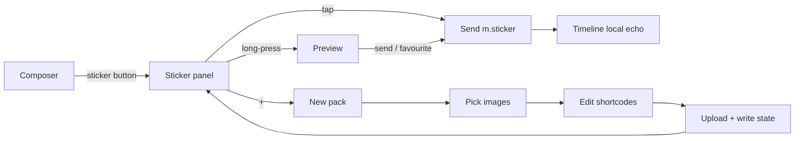

# Feature: Stickers

> Priority: MVP+ (v1, D45), P2 (v2) · Milestone: M4 (v1), later (v2) · Modules: FeatureStickers, FeatureComposer, FeatureTimeline, `HaloDomain/Stickers` (ImagePackParser, StickerLibrary model), `HaloApplication/StickerLibrary`, ports `RoomPort`, `AccountDataPort`, `MediaPort`, `TimelinePort` · Decisions: D13, D48, ADR-0011 · Requirements: R-ST-*, R-P2-ST

## 1. Purpose
A sticker experience like Discord's — fast panel, favourites, recents, search, personal packs — built **only on
spec-defined Matrix events** so stickers work in other clients.

## 2. User stories
- From the composer I open the sticker panel and send a sticker in two taps.
- My favourites and recently used stickers come first, on all my devices.
- I search stickers by shortcode or description.
- I long-press to preview (animated) before sending.
- I create my own pack from photos and use it in every room.
- (P2) I add a pack someone shared in a room to my collection; I manage, rename, reorder and delete packs.

## 3. Matrix representation **[VERIFIED F-SPEC-3, F-SDK-2]**

| Concept | Matrix | Notes |
|---|---|---|
| Pack | `m.room.image_pack` state event in a room; `state_key` = pack id; content `{ images: {shortcode: {url, body?, info?}}, pack?: {display_name?, avatar_url?, usage?: ["sticker","emoticon"], attribution?} }` | Shortcode `^[A-Za-z0-9_-]{1,100}$` |
| User's enabled packs | `m.image_pack.rooms` account data: `{ rooms: { roomId: { stateKey: {} } } }` | Preserve unknown inner properties when editing (spec) |
| Personal pack | **[DECISION D48]** A private, invite-only room owned by the user that holds one or more `m.room.image_pack` events, referenced in `m.image_pack.rooms` | The spec has no per-user account-data pack (v1.19) |
| Sending | `m.sticker` event: `body` = image body or shortcode; `info` = image info; `url` = mxc | via `Room.send_raw("m.sticker", json)` **[VERIFIED F-FFI-9]** |
| Rendering | Upstream `MsgLikeKind.Sticker{body, info, source}` **[VERIFIED F-FFI-8]** | |
| Favourites / recents | **[DECISION D51]** account data `one.mbm.halo.sticker_prefs`: `{ version: 1, favourites: [ {room, pack, shortcode} ], recents: [ {room, pack, shortcode, ts} ] (max 30) }` | Halo-only; other clients ignore it |
| Halo-created pack rooms | account data `one.mbm.halo.sticker_rooms`: `{ version: 1, rooms: [roomId] }` | Used to hide those rooms from the room list |
| Legacy packs | `im.ponies.user_emotes` (account data), `im.ponies.room_emotes` (state), `im.ponies.emote_rooms` (account data) — **read-only** | **[ASSUMPTION V-ST-3: legacy names as used by FluffyChat/Cinny; verify against MSC2545 history]** |

**Privacy [VERIFIED F-SPEC-3]:** image packs and their media are **not encrypted**. Halo shows a one-time notice when a
user first creates a pack or sends a sticker in an E2EE room, and a permanent hint in the pack manager.

## 4. Functional requirements (v1)
- FR-1 Pack sources, in this order (spec order): packs in `m.image_pack.rooms`; packs in the current room's state; legacy packs. (Canonical-space packs: P2.)
- FR-2 Only packs whose `usage` is empty or contains `sticker` appear in the sticker panel.
- FR-3 Panel sections: Favourites, Recent, then one section per pack (pack avatar/name header), plus search.
- FR-4 Search: case-insensitive prefix/substring on shortcode and body across all visible packs; results ranked favourites > recents > others.
- FR-5 Long-press preview with animation; actions: send, favourite/unfavourite.
- FR-6 Tap = send immediately (`m.sticker`); update recents (debounced write of account data, ≤ 1 write / 10 s).
- FR-7 Create personal pack: name → pick photos (1–120) → per image: convert to animated/static WebP or PNG, max 512×512 (spec SHOULD ≥ 512 — **[DECISION D52]** we produce exactly 512 px on the long side), upload (`upload_media`) → shortcode (auto from file name, editable, grammar-validated) → write `m.room.image_pack` → add the room to `m.image_pack.rooms` and `one.mbm.halo.sticker_rooms`.
- FR-8 Render incoming stickers at max 256 pt, animated per D13; tap → preview with pack info if known.
- FR-9 Animation: autoplay in the visible viewport; respects Reduce Motion (static first frame) and Low Power Mode (static).

**Composer integration (D97):** the panel is the "My stickers" source of the Stickers tab in the composer's expression panel ([COMPOSER_PANELS](COMPOSER_PANELS.md) §5); it stays open after a send. KLIPY stickers (D98) are a separate source there and are sent as links, not `m.sticker`.

## 5. Non-functional requirements
- Panel opens in < 150 ms with ≥ 200 stickers (thumbnails cached).
- Thumbnails decoded at panel cell size; at most 12 animations playing at once.

## 6. User flows


## 7. State transitions
Pack library: `Unloaded → Loading → Ready | Partial(sources failed)`; refreshed on account-data change or room-state change.
Pack creation: `Draft → Uploading(n/m) → Writing → Done | Failed(resume)` — uploads are resumable: already-uploaded mxc URLs are kept in the draft.

## 8. Data models (HaloDomain)
```swift
struct StickerPack { let ref: PackRef /*room+stateKey or legacy*/, displayName, avatar: MediaRef?, usage: Set<Usage>, attribution: String?, stickers: [Sticker], source: PackSource /*userEnabled|room|legacy*/ }
struct Sticker { let pack: PackRef, shortcode: String, body: String?, url: MXCURI, info: ImageInfo? }
struct StickerPrefs { var favourites: [StickerRef]; var recents: [StickerRefWithTime] }
```
`ImagePackParser` (pure): JSON → `StickerPack` with validation results (malformed shortcodes are kept and flagged; spec says render them).

## 9. API boundaries and the state-loading problem (V-ST-1)
Reading `m.room.image_pack` state needs the room state locally, but the FFI only stores state types that sliding
sync requests, and Halo can't add types **[VERIFIED F-FFI-9]**. Options:

| Option | How | Pros | Cons |
|---|---|---|---|
| A | `RoomPort.state(room, "m.room.image_pack")` via `Room.state_events(...)` | Clean | Likely empty for custom types — **verify first** |
| B | Adapter-internal authenticated GET `/_matrix/client/v3/rooms/{roomId}/state` (or `/state/m.room.image_pack/{key}`) with `URLSession` and the session's access token | Works today; read-only; small | A second HTTP path; must handle token expiry (on 401 → ask the SDK to refresh, retry once) **[ASSUMPTION V-ST-2: the FFI offers a way to trigger a token refresh or read the current token]** |
| C | Upstream contribution: let `RoomListService` / room subscriptions request extra `required_state` | Best long-term | Upstream timeline unknown |
| D | Halo-owned bindings (G-FFI fail path) | Full control | Big cost |

**[VERIFIED 2026-11-20, V-ST-1]** Option A returns nothing on Synapse 1.165 / SDK 26.11.17; Halo uses option B (`MatrixStickerPackPort`). **[DECISION ADR-0011, provisional]** Try A in M4 week 1; if empty → B behind `RoomPort` (so A/C/D can replace it later without
feature changes); propose C upstream in parallel. Writing uses `Room.send_state_event_raw` **[VERIFIED F-FFI-9]**.

**[DECISION D68]** Packs of the current room: the whole room state (`GET …/state`) is read only for rooms with at most
1,000 joined members (`Room.joinedMembersCount()`, local; a room not known locally is read whole); in larger rooms the state can be many megabytes, so only the
pack with the empty state key (`GET …/state/m.room.image_pack/`) is read there. A room's packs are kept in memory for 10
minutes (`RoomPackCache`); failures are not kept. Known limit: a large room's packs with a non-empty state key are not
offered unless the user enabled them (source 1). Requests use an ephemeral `URLSession` (no disk cache, no cookies).

**Pack creation cleanup.** If anything fails after the pack room was created (room not known within 30 s, state write,
account data), the pack is removed from `m.image_pack.rooms` again and the room is left and forgotten, so no empty
"Sticker pack" room stays in the room list and trying again doesn't make a second one. Uploaded media stay on the server.

## 10. Error scenarios
Upload failure (resume) · state write forbidden (not admin in that room) · account-data write conflict (read-modify-write with retry; preserve unknown keys) · referenced room not joined (spec: show "unavailable pack") · media 404.

## 11. Edge cases
Duplicate shortcodes across packs (disambiguate with the pack name, spec) · a pack with 0 images · a 5 MB animated sticker (warn on import > 1 MB, refuse > 5 MB) · a removed pack still in favourites (greyed out, removable) · personal pack rooms appearing in other clients' room lists (named "Sticker pack: <name>" — accepted).

## 12. Acceptance criteria
- AC-S1 Send a sticker in ≤ 2 taps from the composer (panel open → tap).
- AC-S2 A sticker sent from Halo renders as a sticker in Element Web and FluffyChat.
- AC-S3 A pack created in Halo is usable in a client that supports v1.19 image packs **[ASSUMPTION: at least one such client exists at M4; otherwise verify the events with a raw client]**.
- AC-S4 Favourites and recents appear on a second Halo device after sync.
- AC-S5 Shortcodes created in Halo always match the spec grammar.

## 13. Test requirements
Unit: `ImagePackParser` against spec examples + malformed inputs; prefs merge (last-writer-wins with union of favourites); search ranking; shortcode generation. Integration: S-ST-1 create pack → read back via raw state; S-ST-2 send sticker → other client sees `m.sticker`; S-ST-3 prefs sync across two sessions. Snapshot: panel states (empty, loading, many packs, search).

## 14. P2 — Sticker v2
Room packs management (admins), enabling a room's pack globally ("Add to my stickers"), sharing a pack (send a link to the pack room), importing from a folder or zip, reordering images (Halo order in `one.mbm.halo.sticker_prefs` since spec order is unspecified), canonical-space packs, custom emoticons in messages (``).

## 15. Open questions
V-ST-1, V-ST-2, V-ST-3.
