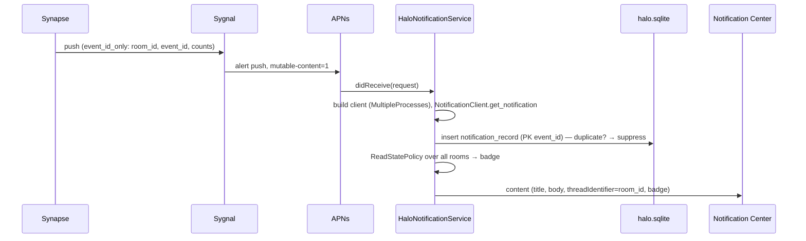

# Push Notifications

Decisions: D10, D11, D65, ADR-0010, ADR-0015. **Pushes are synchronisation hints, never truth (D65):** a push only makes the NSE fetch an event through the SDK, or wakes the app to reconcile from sync; the badge comes only from `BadgeCalculator`. Feature behaviour: [../features/NOTIFICATIONS.md](../features/NOTIFICATIONS.md).

## 1. Infrastructure

## 2. Pusher registration
- `Client.set_pusher(identifiers, kind, app_display_name, device_display_name, profile_tag, lang, append)` **[VERIFIED F-FFI-4]**; kind HTTP with `url = https://<sygnal>/_matrix/push/v1/notify`, `format = event_id_only`, `PusherKind.Http{data: HttpPusherData{url, format: .eventIdOnly, default_payload}}` **[VERIFIED F-FFI-16]**, with `default_payload` setting `aps.mutable-content = 1` and a generic `aps.alert` **[ASSUMPTION V-PUSH-1: Sygnal's APNs payload mapping of `default_payload`; verify against the Sygnal docs at M1]**.
- `app_id` = bundle ID `N` (+ `.dev` for the sandbox APNs environment, D63) → Sygnal config.
- Re-register on every launch if the APNs token changed; `delete_pusher` on logout.
- Synapse also sends **count-only** pushes to this pusher (no event id) whenever the badge changes; stock Sygnal would set them as `aps.badge` **[VERIFIED F-PUSH-1, F-PUSH-2]**. Halo's Sygnal deployment converts them into background pushes with Halo's pushkin and strips `aps.badge` and server counts from every payload (ADR-0015, accepted); the relay is only a fallback.
- `default_payload` never contains `badge`.

## 3. NSE pipeline
0. No `event_id` or `room_id` in the payload (a count-only push that wasn't converted, or a misconfiguration) → show nothing: suppress with the entitlement, otherwise a low-relevance generic notification that the app removes on the next run; log `PUSH_NO_EVENT`.
1. `init_platform` (lightweight runtime) once per process; build the client with `CrossProcessLockConfig.MultiProcess { holderName: "nse" }` **[VERIFIED F-FFI-10/13]**.
2. `NotificationClient.get_notification(room_id, event_id)` **[VERIFIED F-FFI-10]** → `NotificationStatus`:
   - `Event{item}` → step 3
   - `EventFilteredOut` → suppress (with entitlement) or a generic placeholder
   - `EventRedacted`, `EventNotFound` → suppress / placeholder
3. De-duplicate: insert `notification_record` — only for `Event{item}`, i.e. an event the SDK fetched from the homeserver (D65); if the PK already exists → suppress (AC-U7).
4. Already read? If the room's `notifiedThroughTs ≥ event ts` ([UNREAD_STATE.md](UNREAD_STATE.md) §5) → suppress.
5. Should notify? Use `item.is_noisy`, `item.has_mention` (on-device push-rule evaluation by the SDK) **[VERIFIED F-FFI-10 field names]** together with the room's mode.
6. Content: communication notification (`INSendMessageIntent`) with the sender's name and avatar, body (or "Sticker", "Image" …); `threadIdentifier = room_id`; `request identifier = event_id`.
7. Badge = `BadgeCalculator` over the policy inputs for all rooms that can be loaded within budget **[ASSUMPTION V-NSE-2: reading RoomInfo for all rooms in the NSE fits the time/memory budget; fallback = cached last badge ± this event's room]**.
8. Timeout (`serviceExtensionTimeWillExpire`) → deliver generic content with the cached badge.

**Suppression requires** `com.apple.developer.usernotifications.filtering` **[ASSUMPTION V-PUSH-3: Apple grants it; request in M1]**.
Without it, "suppress" becomes a low-relevance generic notification that the app removes on the next run.

## 4. Payload counts
Server counts (`counts.unread` from Synapse, `unread_count` in Sygnal's `event_id_only` payload, F-PUSH-2) are stripped by Halo's pushkin and, should one arrive anyway, **ignored** (cause C5, D65). No push reaches the device with `aps.badge` (ADR-0015 condition 1); the badge is set only by the app and the NSE via `BadgeCalculator`.

## 5. Clearing delivered notifications
When `notifiedThroughTs` for a room moves forward (any source):
`getDeliveredNotifications` → remove those with `threadIdentifier == room_id` and `event_ts ≤ notifiedThroughTs` (looked up via
`notification_record`) → delete those records → `setBadgeCount(badge)`.

**Notifications without a record.** If the NSE was killed or never ran, iOS shows the payload's own alert: it has no
`notification_record`, no `threadIdentifier`, and its request identifier is the APNs id, not the event id. The payload still
carries top-level `room_id` and `event_id` (Sygnal's `event_id_only` payload **[VERIFIED F-PUSH-2]**). Clearing therefore also
removes every delivered notification whose `userInfo["room_id"]` is the room and whose `event_id` has no record, **once the room
has no attention** (Halo can't know that event's timestamp, so it waits until nothing in the room is unread).
Triggers: every reconcile in the app, background push wake-ups, BG refresh (D11).

## 6. Failure modes

| Failure | Behaviour |
|---|---|
| NSE killed (memory) | iOS shows the original alert from the payload: Synapse's `default_payload` alert text must be a generic "New message" (no content) |
| Keys missing (UTD) | "Encrypted message" placeholder; once the app decrypts later, notification content isn't updated (iOS limitation) |
| Sygnal down | No pushes; the app catches up on foreground; the settings screen shows push health from the last delivery time |
| Relay fallback active instead of the pushkin (ADR-0015 condition 4) | No wrong badge; read-elsewhere clearing waits for the next foreground or NSE run; T-BADGEPUSH stays open until the pushkin is back |
| Sygnal deployed without the ADR-0015 handling | The icon shows the server's room count after every read until Halo next runs; the device checklist catches it (TEST_STRATEGY §8) |
