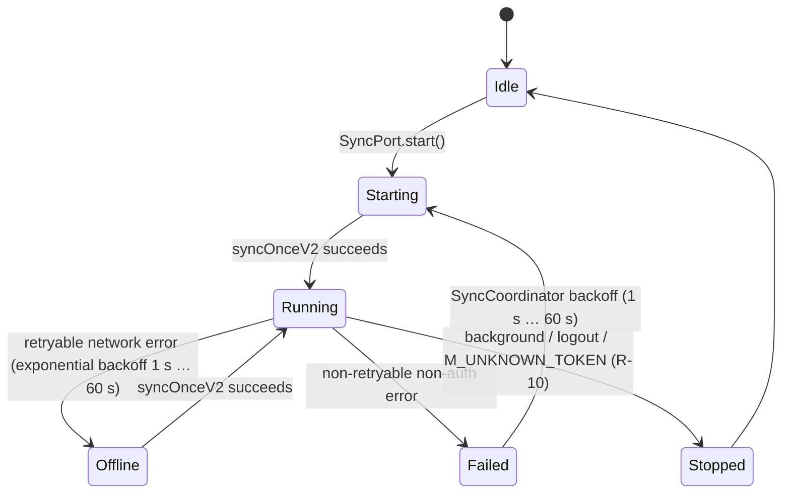

# Sync Engine

Halo does not implement Matrix sync protocol parsing; since **[DECISION D74]** it orchestrates the SDK's classic `/sync`
loop (`Client.syncOnceV2`, `slidingSyncVersionBuilder(.none)`) instead of sliding sync (`SyncService`, MSC4186), so that
every room carries real server notification/highlight counts alongside the SDK's own counts (`V-RS-7`, D73/D74).

## 1. States

- First request uses `timeoutMs: 0` (immediate catch-up); subsequent requests use an 8 s long poll (`MatrixSessionPort.longPollMilliseconds`).
- Recoverable offline errors (and the SDK's generic unreachable-host error) transition to `.offline` and back off in-loop (1 s → 60 s); upon recovery, send queues are re-enabled (`enableAllSendQueues(enable: true)`).
- Auth errors (`M_UNKNOWN_TOKEN`, hard or soft logout) stop sync immediately and emit `.loggedOut` / `.softLoggedOut` via `ClientDelegate` and `runSync` (R-10), so `SyncCoordinator` never retries a revoked session.

## 2. SyncCoordinator rules
1. `scenePhase == .active` → `start()`; `.background` → flush receipt outbox → `stop()`.
2. Entering `.running` → each sync response publishes changed room IDs (`SyncChange`) and post-sync present room IDs (`RoomListUpdate.synced`, in order with the list, R-04) so `ReadStateCoordinator` drops stale carry-over and reconciles; `ReadReceiptCoordinator` flushes queued receipts.
3. Expose `SyncStatus` (`.idle`, `.running`, `.offline`, `.failed`, `.stopped`) to the UI.
4. BG refresh and silent pushes (`BackgroundRefresh`, D118): one bounded `/sync` pass, then the evaluation is written ([../architecture/BACKGROUND_EXECUTION.md](../architecture/BACKGROUND_EXECUTION.md)).
5. The NSE never starts sync.

**In code:** `MatrixSessionPort.runSync` + `MatrixSyncPort` implement the classic sync loop; `SyncCoordinator` (HaloApplication) enforces rules 1–2 and restart backoff while `SessionCoordinator` is `.ready`.

**Start (M19-11):** each start of a sync (loop or background pass) first waits until message search listens, at most 1.5 s (`SearchStartGate`); what it would miss is read from the server later.

## 3. Offline behaviour
- Cached rooms and timelines are readable (SDK SQLite stores + event cache).
- Sends go to the SDK send queue (persists across restarts and re-enables on reconnect, verified by `offlineSend`); receipts go to Halo's durable GRDB outbox (`read_intent`).
- UI shows the offline status; nothing pretends to be delivered.

## 4. Recovery from missed events, reconnects and multi-device updates
| Situation | Handling |
|---|---|
| Long offline / limited timeline | SDK back-fills when a timeline is opened; read state relies on server + SDK counts (E2/E3) and doesn't require full history |
| Reconnect | Classic `/sync` delivers changed rooms + counts; `ReadStateCoordinator` reconciles all rooms and prunes superseded records |
| Read on another device | Server counts fall to 0 → E2 → clear + badge |
| Push rules / modes changed elsewhere | Account-data update in `/sync` → re-evaluate |
| Token refresh | `RefreshDelegate` persists new tokens immediately (shared Keychain in NSE + `SessionCoordinator` in app, R-11) |
| Remote sign-out | `ClientDelegate.didReceiveAuthError` + `runSync` stop sync and transition session out of `.ready` (R-10) |

## 5. Sync filter limitation
The pinned SDK FFI `SyncSettingsV2` exposes only `timeoutMs` and `fullState` (no filter / `lazy_load_members` parameter; tracked as R-18 in [../CODEBASE_REVIEW.md](../CODEBASE_REVIEW.md)). Because classic sync delivers full room state without sliding-sync `required_state` limits, `m.room.image_pack` state is readable through the SDK (verified by `AdapterContractTests.stickers`). The cost on large accounts is measured on fixtures (V-SCALE-1, TEST_STRATEGY §7): 9 MB and 11.8 s for 1,000 rooms without the search index; the index is the larger part (Q-SEARCH-INDEX, gate G-SCALE).
