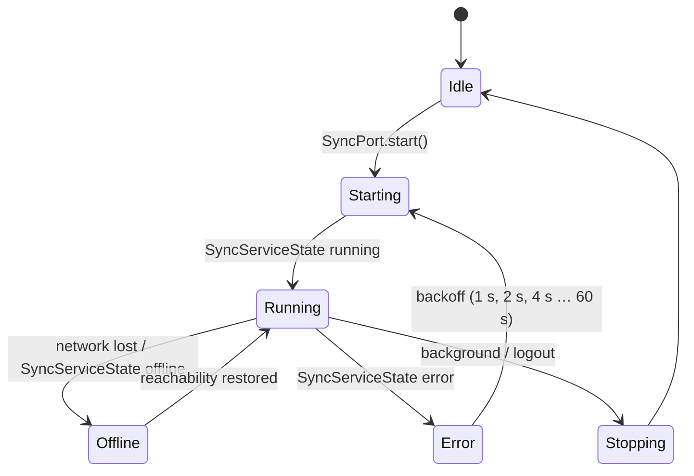

# Sync Engine

Halo does not implement sync; it **orchestrates** upstream `SyncService` (sliding sync, MSC4186).

## 1. States

`SyncServiceState = Idle | Running | Terminated | Error | Offline` **[VERIFIED F-FFI-17]**. `SyncServiceBuilder.with_offline_mode()`
**[VERIFIED F-FFI-5]** makes the service report offline instead of failing, and is enabled.

## 2. SyncCoordinator rules
1. `scenePhase == .active` → `start()`; `.background` → flush outbox → `stop()`.
2. Entering `Running` → `ReadStateCoordinator.reconcileAll()`, `ReceiptOutboxProcessor.flush()`, `NotificationCoordinator.clearCovered()`.
3. Expose `SyncStatus` (`.syncing`, `.upToDate`, `.offline`, `.error(code)`) to UI (room list header indicator; uses `RoomListService.sync_indicator` **[VERIFIED F-FFI-5]**).
4. BG refresh: start → wait for `upToDate` or 20 s → reconcile → stop.
5. The NSE never starts `SyncService`.

**In code (M1):** `SyncCoordinator` (HaloApplication) implements rules 1 and the restart backoff (1, 2, 4 … 60 s, reset once running); it follows `SessionCoordinator` (runs only while a session is ready) and the scene phase (`ios/App/HaloApp.swift`). Rules 2–4 (reconcile, outbox, `SyncStatus` in the UI, BG refresh) arrive with the read-state work (M3). Verified on the simulator: a message sent from another device appears in an open timeline.

## 3. Offline behaviour
- Cached rooms and timelines are readable (SDK stores + event cache).
- Sends go to the SDK send queue (survives restarts) **[ASSUMPTION V-SYNC-2: the send queue persists unsent events across app restarts]**; receipts go to Halo's outbox.
- UI shows the offline banner; nothing pretends to be delivered.

## 4. Recovery from missed events, reconnects and multi-device updates
| Situation | Handling |
|---|---|
| Long offline / limited timeline | SDK back-fills when a timeline is opened; read state relies on server counts (E2/E3) and doesn't require full history |
| Reconnect | Reconcile all rooms on entering Running |
| Read on another device | Server counts fall to 0 → E2 → clear + badge |
| Push rules / modes changed elsewhere | Account-data update → re-evaluate |
| Token refresh | Session delegate persists the new tokens before continuing |

## 5. Room list subscription and required state
`RoomListService` decides which state events and extensions sliding sync requests. Halo can't currently
add custom `required_state` (e.g. `m.room.image_pack`) through the FFI **[VERIFIED F-FFI-9 doc comment; OPEN V-ST-1]**.
Consequences and options are in [../features/STICKERS.md](../features/STICKERS.md) §9.
