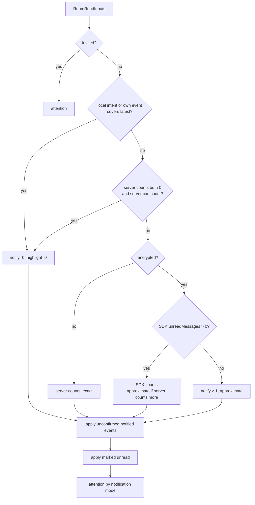
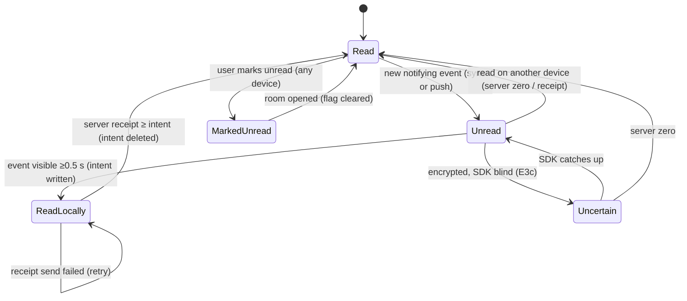

# Unread and Read-State Engine (P0)

Owner modules: `HaloDomain/ReadState` (pure policy), `HaloApplication/ReadStateCoordinator`,
`HaloPersistence` (intents, notification records, audit). Decisions: D5, D6, D9, D11, D17, D47, ADR-0007.
Related: [READ_RECEIPTS.md](READ_RECEIPTS.md), [PUSH_NOTIFICATIONS.md](PUSH_NOTIFICATIONS.md),
tests: [../testing/UNREAD_REGRESSION_TESTS.md](../testing/UNREAD_REGRESSION_TESTS.md).

## 1. Purpose
Make every unread indicator (room list, timeline, notifications, app badge) correct, consistent and
self-healing, and make that correctness **testable**.

## 2. The state types — definitions

| State | Defined by | Stored where | Halo uses it for |
|---|---|---|---|
| **Read receipt** (`m.read`, `m.read.private`) | Spec v1.4+ **[VERIFIED F-SPEC-1]**: "user has read up to event E"; shared across the user's devices | Server; SDK replica | The authoritative read position |
| **Threaded receipt** | `thread_id` on the receipt | Server | Not used until M10; Halo sends **unthreaded** receipts (D17), which cover threads |
| **Fully-read marker** (`m.fully_read`) | Room account data **[VERIFIED F-SPEC-4]** | Server | Position of the "new messages" line in the timeline only — never counts |
| **Marked unread** (`m.marked_unread`) | Room account data, spec v1.12 **[VERIFIED F-SPEC-2]** | Server; `RoomInfo.is_marked_unread` **[VERIFIED F-FFI-7]** | Forces attention |
| **Server notification counts** | `notification_count`, `highlight_count` computed by the homeserver from push rules for events after the latest receipt | `RoomInfo.notification_count/highlight_count` **[VERIFIED F-FFI-7]** | Authoritative in unencrypted rooms; "read elsewhere" signal everywhere |
| **Local (SDK) unread counts** | Computed on the device from cached, decrypted events after the latest receipt **[VERIFIED F-SDK-1]** | `RoomInfo.num_unread_messages/notifications/mentions` | Accurate notify/mention info in encrypted rooms |
| **Highlight** | Push-rule result `highlight` (mentions, keywords) | Both counts above | Mention badge (`@`) and attention in mentions-only rooms |
| **Local read intent** | Halo: a read position the user reached here that the server hasn't confirmed | `read_intent` table | Optimistic, instant clearing; durable outbox |
| **Notification delivery state** | Halo: notifications delivered to Notification Center | `notification_record` table | De-duplication, clearing, NSE↔app consistency |
| **Room attention** | Halo derived: should the room count towards the badge? | not stored (recomputed) | Room-list indicator, badge |
| **App badge** | Halo derived: number of rooms with attention (D5) | last value cached for the NSE fallback | Icon badge |

## 3. Why indicators go wrong (root causes the design addresses)

| # | Cause | Addressed by |
|---|---|---|
| C1 | Gaps in the local timeline (limited sliding-sync responses) → SDK counts too low or stale | Unencrypted: E3a uses the server counts. Encrypted: E3b marks the count approximate when the server counts more than the SDK; E3c covers rooms the SDK hasn't seen at all; a mention inside a gap of an encrypted room is caught only by E4 (push) — limitation in §9 |
| C2 | A receipt for an event the SDK doesn't know is held in a ring buffer of **10** pending receipts and can be dropped **[VERIFIED F-SDK-1]** → "read but still badged" | Rule E2 (server-zero) |
| C3 | Own receipts from other devices arrive late or not at all for rooms outside the active subscription | Rule E2 + reconcile triggers |
| C4 | Encrypted rooms: the server can't evaluate content rules and counts nearly every message | Rules E1/E2/E3 split by encryption |
| C5 | Two writers (app and NSE) setting the badge from different data; NSE using the push payload count | One `BadgeCalculator`; payload counts ignored |
| C6 | The badge incremented instead of recomputed | No counters anywhere (D9) |
| C7 | A receipt never sent (app suspended) | Durable outbox |
| C8 | A receipt moved backwards | Monotonic intent + receipt comparison |
| C9 | Thread events counted but receipts only on `main` | Unthreaded receipts (D17) |
| C10 | "Unread" vs "notifying" confusion | Separate `hasUnread` (quiet) and `attention` |
| C11 | Delivered notifications not removed when read elsewhere | Clearing on every read-position advance |
| C12 | Redacted or edited events still counted | Handled by the SDK counts + E2; covered by tests |
| C13 | A push arrives before the sync that contains the event → the app shows no unread while a notification is visible | Notification records feed the policy (E4) |

Upstream acknowledges backend-caused wrong iOS badges: `Client::mark_all_rooms_as_read` exists as a mitigation for
https://github.com/element-hq/element-x-ios/issues/3151 **[VERIFIED F-FFI-12]**.

## 4. Inputs and outputs

```swift
// HaloDomain — contract sketch (types are Halo-owned values; not implementation)
struct RoomReadInputs: Sendable, Equatable {
  let roomId: RoomID
  let sequence: UInt64                 // adapter-assigned, increasing per room
  let membership: Membership           // joined | invited | left …
  let isEncrypted: Bool
  let mode: NotificationMode           // allMessages | mentionsAndKeywords | mute
  let server: ServerCounts             // notificationCount, highlightCount
  let sdk: SDKCounts                   // unreadMessages, unreadNotifications, unreadMentions
  let isMarkedUnread: Bool
  let latestEvent: LatestEventRef?     // originServerTs + senderIsSelf (+ eventId only when a timeline is open)
                                       // [VERIFIED F-FFI-15: Room.latest_event() → LatestEventValue.Remote{timestamp, is_own, …}, no event id]
  let ownReceipt: ReceiptRef?          // later of m.read / m.read.private, unthreaded: eventId + receipt time
                                       // [VERIFIED F-FFI-15: UserReceipt{event_id, receipt.timestamp}; timestamp = when read, NOT the event's ts]
  let localIntent: ReadIntent?         // from read_intent (pending or sent)
  let unconfirmedNotified: [NotifiedRef] // notification_record rows with event_ts > max(notifiedThroughTs, latestEvent.ts)
}

struct RoomReadState: Sendable, Equatable {
  let roomId: RoomID
  let attention: Bool
  let hasUnread: Bool                  // quiet unread (bold title, no badge)
  let display: DisplayCount            // .none | .count(Int) | .mentions(Int) | .dot
  let confidence: Confidence           // .exact | .approximate
  let notifiedThroughTs: Timestamp?    // notification coverage (§5); drives clearing, pruning and NSE suppression
  let reasons: Set<ReasonCode>         // for the auditor and tests
}
```

`ReadStatePolicy.evaluate(_ inputs: RoomReadInputs) -> RoomReadState` is a **pure, total, deterministic**
function. `BadgeCalculator.badge(_ states: [RoomReadState]) -> Int` = `states.filter(\.attention).count`.

## 5. Evaluation rules

Evaluation order: E0 → compute `serverZero` → `readPosTs`, `notifiedThroughTs` → `unconfirmedNotified` → E1/E1b → E2/E2x → E3 → E4 → E5 → attention by mode.

Let **`serverZero`** = `server.notification == 0 ∧ server.highlight == 0 ∧ serverCanCount`, where
`serverCanCount` = `!isEncrypted ∨ mode == allMessages` (see "Why E2 is safe" below).

Two positions are derived, and they must not be confused **[DECISION D47]**:

| Position | Meaning | Maximum of | Used for |
|---|---|---|---|
| **`readPosTs`** | The user has *read* everything up to this event timestamp | `localIntent.eventTs`; the event timestamp of `ownReceipt.eventId` **if** the adapter can resolve it cheaply (open timeline) — optional | Receipt monotonicity ([READ_RECEIPTS.md](READ_RECEIPTS.md) §1), `hasUnread` |
| **`notifiedThroughTs`** | No *notifying* event up to this timestamp is unread | `readPosTs`; `latestEvent.ts` **if** `serverZero` holds for this snapshot | Clearing delivered notifications, pruning `notification_record`, NSE "already read" suppression, `unconfirmedNotified` |

Server zero says nothing about events that don't notify (quiet messages in mentions-only rooms, notices suppressed by push
rules), so it may advance `notifiedThroughTs` but **never** `readPosTs`. Otherwise a quiet message the user hasn't read would be
treated as read, and the receipt for it would never be sent.

**[DECISION D47]** Read state never needs to order receipts against each other: E1 uses the local intent, E2 uses server counts.
This avoids depending on receipt timestamps, which record *when* something was read, not *what* (limitation in §9).

| Rule | Condition | Effect | Reason code |
|---|---|---|---|
| **E0 Invite** | `membership == invited` | attention = true, display = .dot | `INVITE` |
| **E1 Local intent covers latest** | `localIntent` exists and `latestEvent.ts ≤ localIntent.eventTs` | notify = highlight = 0, hasUnread = false | `INTENT_COVERS` |
| **E1b Own latest** | `latestEvent.senderIsSelf` and no newer `unconfirmedNotified` | same as E1 (sending implies reading; an intent is created at the own event) | `OWN_LATEST` |
| **E2 Server zero** | `serverZero` (both server counts 0 **and** the server could have counted) | notify = highlight = 0 regardless of SDK counts; if SDK counts > 0 → audit (explained) | `SERVER_ZERO` (+`SDK_STALE`) |
| **E2x Server blind** | server counts are 0 but `!serverCanCount` (encrypted room in mentions/keywords or mute mode: the server can't see mentions in encrypted content and room rules suppress counting) | E2 does **not** apply; continue with E3b/E3c using SDK counts; confidence approximate if `sdk.unreadMentions > 0` and no intent covers the latest event | `SERVER_BLIND` |
| **E3a Unencrypted** | `!isEncrypted` and not E1/E2 | notify = server.notification, highlight = server.highlight, confidence exact | `SERVER_COUNTS` |
| **E3b Encrypted, SDK saw it** | `isEncrypted`, `sdk.unreadMessages > 0` | notify = sdk.unreadNotifications, highlight = sdk.unreadMentions; confidence exact, **except** approximate when `serverCanCount ∧ server.notification > sdk.unreadNotifications` (a possible gap, or C4 overcounting — Halo can't tell which) | `SDK_COUNTS` (+`ENC_SERVER_OVERCOUNT`) |
| **E3c Encrypted, SDK blind** | `isEncrypted`, `sdk.unreadMessages == 0`, server notification > 0 | notify = 1 (at least), highlight = unknown → 0, display .dot, confidence approximate | `ENC_SDK_BLIND` |
| **E4 Notified not yet synced** | `unconfirmedNotified` non-empty | notify ≥ count, highlight ≥ mentions among them | `NOTIFIED_UNSYNCED` |
| **E5 Marked unread** | `isMarkedUnread` | attention = true (all modes), display at least .dot | `MARKED_UNREAD` |

Then attention by mode:

| Mode | attention = |
|---|---|
| allMessages | `notify > 0 ∨ highlight > 0 ∨ markedUnread ∨ invite` |
| mentionsAndKeywords | `highlight > 0 ∨ markedUnread ∨ invite` |
| mute | `markedUnread ∨ invite` |

`hasUnread` (quiet indicator: bold title, no badge) **[DECISION D47]**:

| Case | `hasUnread` = | Why |
|---|---|---|
| E1 or E1b holds | `false` | The user saw (or sent) the latest event |
| E2 holds and `mode == allMessages` | `false`; if `sdk.unreadMessages > 0` → audit `SDK_STALE` (explained) | Every message notifies in this mode, so server zero means everything was read; a remaining SDK count is the C2 failure |
| E2 holds and `mode` is mentions/keywords or mute (unencrypted rooms only — encrypted rooms in these modes never reach E2) | `sdk.unreadMessages > 0` | Server zero carries no information about messages that don't notify |
| Otherwise | `sdk.unreadMessages > 0 ∨ notify > 0` | — |

Known limitation: in all-messages mode, messages that a push rule keeps from notifying (e.g. `m.notice`, suppressed by the default
rules) don't make the title bold once the server reports zero. This affects only the quiet indicator, never attention or the badge.

Display: `.mentions(n)` when highlight > 0, otherwise `.count(notify)` if confidence exact and notify > 0, otherwise `.dot` when attention.



**Why E2 is safe — and when it isn't** **[DECISION D47, validated by scenario tests]**: server counts are computed relative to
the user's latest receipt across all devices. If they are zero in a snapshot that already contains `latestEvent`, and the server
*could* have counted the room's events, every notifying event up to it has been read on some device. The server can count
everything in unencrypted rooms, and in encrypted rooms in all-messages mode (the default encrypted-room push rules notify for
every encrypted event). It **can't** in encrypted rooms whose mode is mentions/keywords or mute: room-level rules suppress
counting and mentions are hidden in the ciphertext — hence E2x **[ASSUMPTION V-RS-6: verify Synapse's counts for encrypted rooms per mode on the pinned version]**. A new event after that snapshot comes with new counts in the
next snapshot. Exception: an event known only from a push (not yet synced) — handled by E4.

## 6. Lifecycle of a room's read state



## 7. Coordinator responsibilities (`ReadStateCoordinator`)
1. Subscribe to room snapshots (port `RoomReadStatePort.updates()`: one lossless stream carrying a full `RoomReadInputsPart` per room change, [PORTS_CONTRACT.md](PORTS_CONTRACT.md) §2), local intents and notification records.
2. Keep the latest `RoomReadInputs` per room (dropping snapshots with a lower `sequence` for that room). Coalescing happens **per room id** only, never across rooms ([../architecture/CONCURRENCY.md](../architecture/CONCURRENCY.md) §3).
3. On any input change: `evaluate` → publish `RoomReadState`; recompute the badge; if `notifiedThroughTs` moved forward → clear covered notifications ([PUSH_NOTIFICATIONS.md](PUSH_NOTIFICATIONS.md) §5).
4. `markRead(room, event)` from the timeline: write the intent (monotonic upsert) → evaluate → enqueue the receipt.
5. `markUnread(room, flag)`: call the port; the state comes back through the snapshot (no optimistic flag).
6. `reconcileAll()`: re-evaluate every room from fresh snapshots; prune confirmed intents and notification records with `event_ts ≤ notifiedThroughTs`.
7. Audit: compare each state with the raw inputs and record disagreements with reason codes.

## 8. Persistence
Tables `read_intent` (at most one row per room; upsert only if `event_ts` is newer), `notification_record` (primary key
(account, event_id) → de-duplication, AC-U7), `audit_event` and `badge_cache`. The schema is defined only in
[../data/DATA_MODELS.md](../data/DATA_MODELS.md) §3; multi-process rules in [../data/PERSISTENCE.md](../data/PERSISTENCE.md) §4.
No counts and no attention are persisted. The NSE's last computed badge is cached only as a fallback value for timeouts.

## 9. Ordering, races and limitations

| Race / edge | Handling |
|---|---|
| Snapshot arrives after the intent but carries an older receipt | E1 still applies (intent covers latest); the intent stays until confirmed ([READ_RECEIPTS.md](READ_RECEIPTS.md) §1 "Confirmation") |
| App and NSE write simultaneously | Monotonic upserts; PK de-duplication; Darwin notify → the app reloads |
| Receipt for an event in the gap | Doesn't matter for E2 (server counts already reflect it) |
| Clock skew: `originServerTs` comparisons across servers (federation) | **Limitation**: ordering by timestamp can misorder federated events with skewed clocks. Mitigation: when both events are present in the timeline, the adapter supplies a timeline order index ([ASSUMPTION V-RS-3]); otherwise timestamps. Covered by tests with skewed timestamps |
| Redaction of the only unread event | SDK/server counts drop → E2/E3 rules |
| Push rules change on another device | Account data → snapshot → re-evaluate |
| Room left / forgotten | Removed from states; its notification records are cleared |
| User opens a room but scrolls nothing | Only visible events create intents (D6); the latest event may be visible at once |
| Mention inside a timeline gap of an **encrypted** room | **Limitation.** The server can't see mentions in ciphertext and the SDK hasn't seen the event, so only a push (E4) reveals it. In all-messages mode the room still gets attention once the SDK has seen any later message (E3b) or none at all (E3c); in mentions/keywords mode (E2x) nothing reveals it until the SDK catches up. Covered by S22 |
| Default mode for group rooms is mentions/keywords (NOTIFICATIONS FR-8) | **Trade-off.** Most encrypted group rooms therefore run on E2x — SDK counts only, no server cross-check, approximate confidence for mentions. This is the weakest path of the policy and the one most rooms use; the auditor reports `SERVER_BLIND` for it, and G-UNREAD must be judged with this default in place (S07, S21, S22) |

## 10. Acceptance criteria
AC-U1 … AC-U8 in [../REQUIREMENTS.md](../REQUIREMENTS.md). Gate **G-UNREAD** (M3): all scenario tests in
[../testing/UNREAD_REGRESSION_TESTS.md](../testing/UNREAD_REGRESSION_TESTS.md) green against a real Synapse.

## 11. Test requirements (summary)
- Unit: one test per rule row, per mode, per reason code.
- Property: P1–P10 ([../testing/UNREAD_REGRESSION_TESTS.md](../testing/UNREAD_REGRESSION_TESTS.md) §2).
- Integration: scenarios S01–S22 against Synapse.
- Regression: every bug → a recorded input trace as a fixture.
