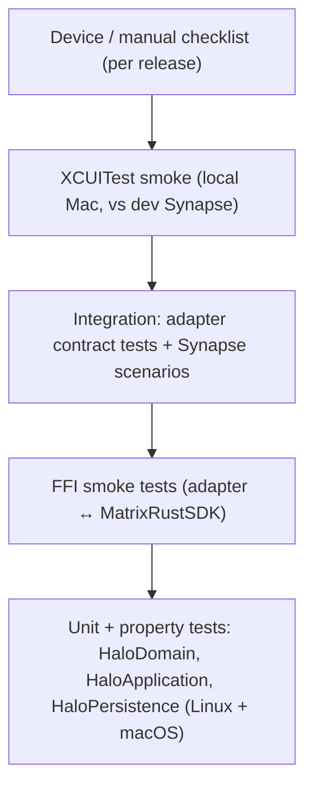

# Test Strategy

Decisions: D35, D36, ADR-0009.

## 1. Pyramid

| Layer | Scope | Tooling | Runs where | When |
|---|---|---|---|---|
| Unit | Pure policies, parsers, coordinators with fakes, repositories (in-memory GRDB) | Swift Testing (`@Test`), XCTest where needed | **Linux CI** (Swift toolchain in Docker) + local | Every PR |
| Property | `ReadStatePolicy`, `BadgeCalculator`, timeline diff application, bot indexer, prefs merge | A small seeded generator in `HaloTestSupport` (no dependency); seed printed on failure | Linux CI | Every PR |
| Persistence | Migrations from every released schema; multi-connection monotonic upserts | GRDB in-memory + temp files | Linux CI | Every PR |
| FFI smoke | Adapter builds a client, logs in, lists rooms, opens a timeline | XCTest on the iOS simulator | Local Mac (pre-merge for adapter changes) | Adapter/SDK changes |
| Adapter contract | The same port contract suite run against the fake **and** the real adapter | XCTest, dev Synapse in Docker | Local Mac | Adapter/SDK changes, SDK bumps |
| Matrix scenarios (sync / unread / offline / reconnect / races) | Real Synapse + scripted "other clients" | **Headless driver** (see §3) | Linux CI (Docker) | Every PR touching read state, nightly full |
| UI | Login, open room, send, sticker send, mark read | XCUITest | Local Mac | Before TestFlight |
| Performance | Cold start, room open, scrolling, NSE duration | XCTest `measure` + signposts | Local Mac (fixed device) | Weekly + before release |
| Push gateway | Halo's Sygnal pushkin (ADR-0015): payloads for every Synapse notification kind; never `aps.badge`; never server counts | Python unit tests against the pinned Sygnal | Linux CI (`pushkin.yml`) | PRs touching `infra/sygnal/` |
| Regression | Every fixed bug → a test at the lowest possible layer | — | — | With the fix (mandatory) |

## 2. Making Swift domain tests run on Linux
`HaloFoundation`, `HaloDomain`, `HaloApplication`, `HaloPersistence`, `HaloTestSupport` must build with the Linux Swift toolchain (no Apple-only imports; `#if canImport` only in HaloPlatform).
CI job `swift-linux` runs `swift test` for these packages; GRDB needs `libsqlite3-dev` in the image **[VERIFIED F-CI-1]**.

## 3. Scenario harness (deterministic sync bug reproduction)
Problem: Halo's real Matrix stack only runs on Apple platforms, but scenario tests must run in Linux CI.
Approach **[DECISION D35, ADR-0009]**:
1. The **policy under test is pure Swift**. Scenarios feed it with the *same inputs the adapter would produce*.
2. A Linux **scenario driver** (`tools/scenario-driver/run_scenarios.py`, plain HTTP to the CS API) controls several users and devices against a real Synapse (Docker): send events, send receipts from "device B", toggle `m.marked_unread`, change push rules, redact, go "offline".
3. After each step the driver fetches what the device's SDK would see — classic `/sync` (D74) for server counts, receipts, account data — and builds `RoomReadInputs` (server-count fields real; SDK-count fields simulated by a reference counter over the fetched events, or captured from the real SDK in local runs).
4. It asserts the policy's `RoomReadState` and badge against the scenario's expected values.
5. **Local Mac runs** additionally replay the same scenarios through the real adapter + SDK (FFI) and compare its inputs with the driver's — this catches adapter mapping bugs and SDK count behaviour.
6. Every scenario writes a trace (inputs + outputs as JSON); traces from failures become **replay fixtures** that run in unit tests without Synapse.

## 4. Race-condition tests
- Policy: order-independence and idempotence properties (P3, P4).
- Coordinator: deterministic schedulers (inject a test clock and an executor; run all interleavings of small event sets, e.g. intent write vs snapshot vs NSE record).
- Persistence: two `DatabasePool`s on one file in parallel threads performing monotonic upserts → final state = maximum.

## 5. Offline and reconnect tests
`infra/test` is a throwaway Synapse (in-memory Postgres) behind `fault_proxy.py` (standard library; runs in the Synapse image, so nothing more is pulled) **[DECISION ADR-0009]**. The proxy
drops, delays, throttles, cuts, hangs, refuses or answers requests with a status, loses the answer of a request the server handled, and counts requests and bytes per endpoint.
- `infra/test/run.sh scenarios [S04 F02 …]`: the scenario driver S01–S22 plus F01–F06 (server down, lost answer, 429, cut response, half-open, 5xx). In CI (`scenarios.yml`), where a client
  broken on purpose (`HALO_SCENARIO_BREAK`) must turn F02–F06 red.
- `infra/test/run.sh faults` (Mac): the real adapter and SDK behind the same faults (`FaultTests`). Result 2026-11-25, simulator: an outage ends 2.1 s after the server is back, a cut sync M18-11: `everyKindOnce` sends a reply, edit, reaction, photo, file and sticker through a lost answer, 429 and a dropped connection; each reaches the server once (the sticker, sent outside the queue, may be refused and shown as failed).
  response is fetched again in 1.2 s, three 502 answers in 3.5 s; a send meets a lost answer, two 429, two 503, a dropped connection or a slow network and arrives **exactly once, in order**.
  A half-open connection took **39 s** to recover (the SDK's 30 s request timeout); with Halo's 15 s request timeout it takes **24 s** (GA-29, M18-11). Risk: a single request, an upload included, is now cut after 15 s; checked only with the 4 s slow-network case.

## 6. Fixtures
Bot messages: copied **verbatim** from the bot repo's tests (MIT, attribution file in the fixture folder). Spec examples for image packs. Recorded sync traces (anonymised).

## 7. Performance tests
Targets in [../REQUIREMENTS.md](../REQUIREMENTS.md) NFR-1..3; measured with signposts ([../architecture/LOGGING_AND_DIAGNOSTICS.md](../architecture/LOGGING_AND_DIAGNOSTICS.md) §5) on a reference device; regressions > 20 % block release. From M15, cold start and timeline scrolling are also measured with XCTest metrics
(`XCTApplicationLaunchMetric`, `XCTOSSignpostMetric` scroll hitches, `XCTMemoryMetric`) on a physical iPhone 15-class device and recorded here (AC-UX-11).

**Physical-device baseline (2026-11-24, iPhone 16 `iPhone17,3`, iOS 27.2.1 `24B156`, `Halo-Debug`, signed-in `infra/dev` account, `TEST_RUNNER_HALO_RUN_PERF_TESTS=1`):**
- **NFR-1 cold launch (`testLaunchPerformanceMetric`, 5 iterations; now `HaloPerformanceTests`):** `AppLaunch` **0.348 s** avg (RSD 2.49%, values `0.332–0.357 s`); `ApplicationFirstFramePresentationResponsive` **0.357 s** avg (RSD 2.14%, values `0.345–0.367 s`) — well below the 1.0 s budget (dev-account room count; 300-room account still to validate).
- **Timeline memory (`testTimelineScrollPerformanceMetric` in `S10 scroll test`, 5 iterations):** `Memory Peak Physical` **76.8–78.1 MB** avg (`76,778–78,108 kB`, RSD 0.51–0.69%); `Absolute Memory Physical` **76.7–78.0 MB** avg — well below the 200 MB budget.
- **NFR-2 scroll hitch ratio (`XCTOSSignpostMetric.scrollingAndDecelerationMetric`):** did not emit hitch-ratio lines in non-interactive `xcodebuild` (device diagnostics timed out waiting for interactive auth); measure interactively via Xcode Test Navigator / Instruments Animation Hitches on device.

**Release budgets (gate G-PERF, ROADMAP M19).** Reference: iPhone 15-class device, **Release** build, signed in, Wi-Fi; scale rows on the M17-3 fixtures. Targets are the NFRs; the two baselines above are a **Debug** build on a small account and don't count for the gate.

| Budget | Target | Measured by | Baseline |
|---|---|---|---|
| NFR-1 launch → interactive list, 300 and 1,000 rooms | ≤ 1 s / record | `XCTApplicationLaunchMetric` + M17-1 signpost | small account 0.357 s (Debug) |
| NFR-2 scrolling, mixed media | hitch ratio ≤ 5 ms/s **[ASSUMPTION]** | Instruments Animation Hitches, 3 runs | none |
| NFR-11 room open p95 | ≤ 250 ms | signpost, 30 opens | simulator, scale300 (M19-4, 2026-11-26): p95 0.339 s → 0.238 s after the landing waits went from 80 + 60 ms to 16 + 32 ms; the 10× D95 landing check passed 10 of 10 there; a device number is open |
| NFR-12 memory | ≤ 200 / 300 MB, ≤ 10 % growth over 50 cycles | `XCTMemoryMetric` | 76.8–78.1 MB, one small room |
| NFR-13 main thread | no hang ≥ 250 ms | `main-thread-hang` signpost in the scripted sessions (`scripts/perf.py`); MetricKit in the field | see `perf-baseline.json` |
| NFR-14 sync at scale | ≤ 60 s first, ≤ 10 s after 24 h | `scripts/scale-measure.py` | table below (simulator) |
| NFR-15 energy | ≤ 4 %/h idle foreground | Xcode energy log, 1 h | none |
| Message search (MESSAGE_SEARCH §4, M19-11): first results p95 at 300,000 messages; sync budgets with the index on | ≤ 200 ms; NFR-14/15 | store test with generated messages; `scripts/scale-measure.py` | ≤ 109 ms, 164 MB for 300,000 messages (simulator, table below) |

**Scale (M17-4, V-SCALE-1), 2026-11-25.** `scripts/scale-measure.py` on the M17-3 fixture server; adapter and SDK as the app uses them, iPhone Air simulator on the dev Mac, no network latency: the work is
real, the seconds are a Mac's. Fixture messages are short and members have no profile, so real accounts send more bytes. Not yet: an iPhone, energy, a real public-server account (📱👤).

| Measurement | 300 rooms | 1,000 rooms | 1,000 rooms, search index off | one 10,000-member and one 20,000-event room |
|---|---|---|---|---|
| First sync → all rooms in the list (NFR-14 ≤ 60 s) | 8.8–14.8 s | 31.6–43.4 s | **11.8 s** | 2.0 s |
| First sync response | 2.7 MB | 9.0 MB | 9.0 MB | 2.8 MB |
| Peak memory, first sync (28 before) | 63–82 MB | 133–159 MB | 109 MB | 56 MB |
| Memory settled | 81–100 MB | 147–189 MB | 184 MB | 44 MB |
| Store on disk | 45–52 MB | 85–94 MB | 69 MB | 36 MB |
| CPU per idle minute, from 20 s after the first sync | 19–24 s | 25 s | **0.6 s** | 0.3 s |
| Threads after that minute | 113 (up to 925 seen) | 118–191 | **18** | — |
| Live message → in the list | 0.06–0.08 s | 0.09–0.12 s | 0.07 s | — |
| Restart: cached list complete | 0.3–0.7 s | 1.5–2.5 s | 0.8 s | 0.1 s |
| Catch-up, 200 rooms × 5 messages (NFR-14 ≤ 10 s) | 3.8–10.2 s | **12.6–19.2 s** | **0.9 s** | — |

What it says: classic sync itself carries 1,000 rooms well inside NFR-14. **The SDK's search index is what misses it**: one index per room, committed with a full disk sync, on a pool of threads each; leaving out only
the history sweep changes nothing (`HALO_SCALE_SEARCH=live`: 42.1 s, 12.6 s). Decided: Halo's own index (D123, ADR-0024), if the spike passes (M17-8, V-SEARCH-2). With the index off the SDK still indexes new events in memory (F-FFI-25), so that column includes it. Two smaller findings: every launch fetches the event behind the read receipt of each unread
room (344 requests at 1,000 rooms, GA-28), and the room list is rebuilt per response (GA-17).

**Search index spike (M17-8, V-SEARCH-2/3), 2026-11-25.** `scripts/scale-measure.py --search` (`HALO_SCALE_HISTORY=app|own|memory|listen|bulk`), `infra/test/run.sh search`, `SearchIndexMeasurements`; iPhone Air simulator on the dev Mac, Debug, no network latency, SDK search index off. Reading times include waits of the
test itself (10 ms per read, up to 300 ms after an empty page), so CPU and requests say more than seconds.

| Measurement | Result | Limit |
|---|---|---|
| 1,000 rooms, SDK index off, automatic back-pagination **on**: first sync / catch-up / idle CPU / threads | 16.3 s / 1.6 s / 0.6 s per min / 18 | 60 s / 10 s / 1 s / — |
| The same, back-pagination **off** | 12.4 s / 0.9 s / 0.6 s per min / 18 | |
| Unread suite with the SDK index off, back-pagination on and off (S01–S29 real-server scenarios, encrypted evidence, read markers, policy) | 7 of 7 tests green in both | green |
| Live lane on listeners (3,000 of them): registering / memory / catch-up / idle CPU | 0.03 s CPU / +22 MB (with drift) / 1.6 s / 0.5 s per min | +20 MB; 10 s; 1 s |
| … catch-up of 205 rooms, 5 of them with a gap: missing messages / gap reads | 0 of 1,300 / 0.9 s, 25 requests | 0 |
| History, 20,000-event room in slices of 500: time / CPU / requests / repeated | 11.9 s / 4.7 s / 245 / 40 (one per slice) | complete |
| … memory in the app's client / in a client of its own (80,000 events) | +10.6 MB and growing / flat at 34 MB | +20 MB |
| First indexing, 300 of 1,000 rooms to their start (23,278 messages), one client per 20 rooms: CPU / requests / memory | 30 s / 1,422 / +4 MB, peak +12 | +20 MB |
| Rejected: timeline reads in the app's client, every room once / each further time | +77 / +21 to +26 MB | +20 MB |
| Rejected: paging live timelines in a client of its own, per room | 0.4 s CPU, 104 threads | |
| Encrypted history on a new device, 400 messages under 40 keys: before / after recovery / key requests | 0 / 400 readable / 41 | all |
| FTS5 through GRDB, 300,000 messages: size / writing / slowest batch of 100 | 152 MB / 0.13 ms each / 87 ms | |
| … query p95: rare word, common word, one letter, one CJK character, in one room | 8, 24, 38, 52, 19 ms | 200 ms |

Not measured: an iPhone, energy, a real account, months of mixed encrypted history, the same numbers with network latency.

**Message search as shipped (M19-11), 2026-11-25.** Same simulator, server and limits; production code (`SearchIndexer`, `MatrixMessageIndexSource`, `SearchIndexStore`). `scripts/scale-measure.py` (search on), `--search` (full history), `SearchIndexMeasurements` (`TEST_RUNNER_HALO_SEARCH_MEASURE=1`), `infra/test/run.sh search`.
The spike's own test code is gone (in git history before this change).

| Measurement | With search | Without (same day) | Limit |
|---|---|---|---|
| 1,000 rooms: first sync → all rooms | 18.9 s | 17.2 s | 60 s |
| Catch-up, 200 rooms × 5 messages / all of them in the index | 1.6 s / 3.7 s, 1,000 of 1,000 found | 1.6 s | 10 s |
| CPU per idle minute (history paused / done) | 0.75 s / 0.59 s | 0.50 s | 1 s |
| Memory settled / peak of the first sync / peak of the catch-up | 182 / 133 / 195 MB | 162 / 94 / 198 MB | +20 MB settled |
| Threads; listening to every room at start | 18; 0.08 s | 18 | |
| Full history of 1,000 rooms (47,015 messages), without rests | 13 min, 104 s CPU, 4,509 requests, 32 MB | | |
| … memory while reading (listening: 179 MB) / after; index file | 186–194 / 185 MB; 20 MB | | +20 MB |
| Full history of the 20,000-event room (and the 10,000-member one) | 25 s, 10.6 s CPU, +2 MB; 10 MB | | |
| First results, 300,000 messages, p95: rare, common word, one letter, one CJK character, two CJK characters | 1, 45, 85, 108, 1 ms | | 200 ms |
| Index of 300,000 messages: size / writing / slowest slice of 500 / leaving a room of 500 | 164 MB / 0.11 ms each / 241 ms / 1.7 s in steps | | |
| Opening a message 1,300 back (local server) | 0.03–0.04 s | | 2 s |

The memory of the listeners is at its limit (+20 MB). Taking a row out of the index is slow on purpose (`secure-delete`, 3 ms). Not measured: an iPhone, energy, a real account, network latency.

**Performance suite (M17-5).** `scripts/perf.py` signs a simulator of its own in to the scale accounts (or uses a device's account, `--device`), runs `HaloPerformanceTests` with optimised code, reads the result bundle and prints
budget / measured / baseline / pass; over 20 % (a simulator: 50 %, its runs differ by up to 28 %) and the noise floor worse than `perf-baseline.json` for the same device fails, and a missed budget fails on a device. Numbers are compared only with the same device and OS.
First simulator run (2026-11-25, iPhone 17 simulator, not evidence for a budget): launch → rows 2.3 s at 300 and 1,000 rooms with a main-thread hang (0.7–1.1 s) in each of 5 launches; room open p95 0.33 s (median 0.23 s; 0.71 s p95 in a run
right after the first sync); media scrolling peaks at 208–266 MB (budget 200, GA-15); 50 room cycles peak at 105 MB and grow by 4 MB (4 %); 0.6 s and 1.5 s CPU per idle minute once settled. Hitches need a device.

Rules: same device and OS for baseline and gate; median of 5 unless p95 is named; over 20 % worse than the last release blocks. Simulator numbers show trends only.

## 7b. UI and accessibility tests
`HaloUITests` runs the golden path against `infra/dev` and `XCUIApplication.performAccessibilityAudit()` on every root screen
(AC-UX-8); a pseudo-language launch argument checks clipping (AC-UX-10; not run yet, ROADMAP M21-6). Visual regression tests: ROADMAP M21-4. Screenshots for App Store Connect come from the same
target with fixture data (Q-APPSTORE).

## 8. Device checklist (per TestFlight release)
Encrypted DM push on the lock screen · read on another client → banner gone and the icon badge matches Halo's count while Halo stays in the background (ADR-0015) · airplane mode 1 h → recover · force-quit during sync · low-power mode · 300-room account cold start · sticker send/receive with Element Web · bot card tick with the real bot · VoiceOver golden path and AX5 text size (AC-UX-9) · light/dark/Increase Contrast walk-through of every tab.

## 8b. Release test plan (what must be green, and when)
| Suite | Every push | Milestone exit | Beta build | Release candidate |
|---|---|---|---|---|
| `prepush.sh`, Linux CI | ✅ | ✅ | ✅ | ✅ |
| Adapter contracts incl. leftovers check | touched ones | full | full | full |
| Fault scenarios (M17-6) | read-state and send changes | full | full | full |
| Interop matrix (M17-7) | — | M17, M20 | spot check | full |
| Device read-state matrix (M18-10) | — | M18 | ✅ | ✅ |
| Performance budgets | — | M19 on | trend | gate, twice |
| VoiceOver, AX5, languages, iPad | — | M21 | spot check | full |
| Upgrade from every shipped build | — | M18 on | ✅ | ✅ |
| Sign-out, restore, lost-key drills | — | M18 | ✅ | ✅ |

## 9. Reporting rule
Test results are reported **as executed**, with commands and output (AGENTS.md §0 step 5, §13). "Should pass" isn't a result.
