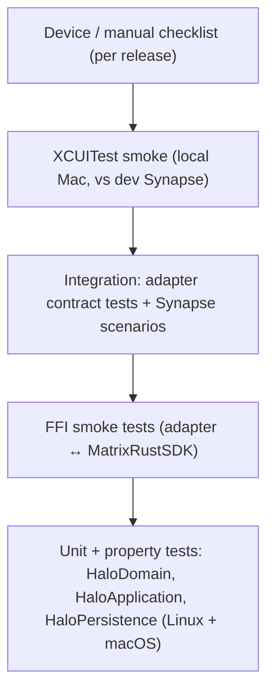

# Test Strategy

Decisions: D35, D36, ADR-0009.

## 1. Pyramid

| Layer | Scope | Tooling | Runs where | When |
|---|---|---|---|---|
| Unit | Pure policies, parsers, coordinators with fakes, repositories (in-memory GRDB) | Swift Testing (`@Test`), XCTest where needed | **Linux CI** (Swift toolchain in Docker) + local | Every PR |
| Property | `ReadStatePolicy`, `BadgeCalculator`, timeline diff application, bot indexer, prefs merge | A small seeded generator in `HaloTestSupport` (no dependency); seed printed on failure | Linux CI | Every PR |
| Persistence | Migrations from every released schema; multi-connection monotonic upserts | GRDB in-memory + temp files | Linux CI | Every PR |
| FFI smoke | Adapter builds a client, logs in, lists rooms, opens a timeline | XCTest on the iOS simulator | Local Mac (pre-merge for adapter changes) | Adapter/SDK changes |
| Adapter contract | The same port contract suite run against the fake **and** the real adapter | XCTest, dev Synapse in Docker | Local Mac | Adapter/SDK changes, SDK bumps |
| Matrix scenarios (sync / unread / offline / reconnect / races) | Real Synapse + scripted "other clients" | **Headless driver** (see §3) | Linux CI (Docker) | Every PR touching read state, nightly full |
| UI | Login, open room, send, sticker send, mark read | XCUITest | Local Mac | Before TestFlight |
| Performance | Cold start, room open, scrolling, NSE duration | XCTest `measure` + signposts | Local Mac (fixed device) | Weekly + before release |
| Push gateway | Halo's Sygnal pushkin (ADR-0015): payloads for every Synapse notification kind; never `aps.badge`; never server counts | Python unit tests against the pinned Sygnal | Linux CI (`pushkin.yml`) | PRs touching `infra/sygnal/` |
| Regression | Every fixed bug → a test at the lowest possible layer | — | — | With the fix (mandatory) |

## 2. Making Swift domain tests run on Linux
`HaloFoundation`, `HaloDomain`, `HaloApplication`, `HaloPersistence`, `HaloTestSupport` must build with the Linux Swift toolchain (no Apple-only imports; `#if canImport` only in HaloPlatform).
CI job `swift-linux` runs `swift test` for these packages; GRDB needs `libsqlite3-dev` in the image **[VERIFIED F-CI-1]**.

## 3. Scenario harness (deterministic sync bug reproduction)
Problem: Halo's real Matrix stack only runs on Apple platforms, but scenario tests must run in Linux CI.
Approach **[DECISION D35, ADR-0009]**:
1. The **policy under test is pure Swift**. Scenarios feed it with the *same inputs the adapter would produce*.
2. A Linux **scenario driver** (`tools/scenario-driver`, Swift on Linux, plain HTTP to the CS API) controls several users and devices against a real Synapse (Docker): send events, send receipts from "device B", toggle `m.marked_unread`, change push rules, redact, go "offline".
3. After each step the driver fetches what the device's SDK would see — `/sync` (sliding sync `POST /_matrix/client/unstable/org.matrix.simplified_msc3575/sync` **[VERIFIED F-SPEC-5]**) for server counts, receipts, account data — and builds `RoomReadInputs` (server-count fields real; SDK-count fields simulated by a reference counter over the fetched events, or captured from the real SDK in local runs).
4. It asserts the policy's `RoomReadState` and badge against the scenario's expected values.
5. **Local Mac runs** additionally replay the same scenarios through the real adapter + SDK (FFI) and compare its inputs with the driver's — this catches adapter mapping bugs and SDK count behaviour.
6. Every scenario writes a trace (inputs + outputs as JSON); traces from failures become **replay fixtures** that run in unit tests without Synapse.

## 4. Race-condition tests
- Policy: order-independence and idempotence properties (P3, P4).
- Coordinator: deterministic schedulers (inject a test clock and an executor; run all interleavings of small event sets, e.g. intent write vs snapshot vs NSE record).
- Persistence: two `DatabasePool`s on one file in parallel threads performing monotonic upserts → final state = maximum.

## 5. Offline and reconnect tests
Scenario driver toggles a Toxiproxy-like proxy **[DECISION ADR-0009: a tiny proxy container in `infra/test`]** between the device's client and Synapse to simulate drops, latency and blackholes during the local FFI runs.

## 6. Fixtures
Bot messages: copied **verbatim** from the bot repo's tests (MIT, attribution file in the fixture folder). Spec examples for image packs. Recorded sync traces (anonymised).

## 7. Performance tests
Targets in [../REQUIREMENTS.md](../REQUIREMENTS.md) NFR-1..3; measured with signposts ([../architecture/LOGGING_AND_DIAGNOSTICS.md](../architecture/LOGGING_AND_DIAGNOSTICS.md) §5) on a reference device; regressions > 20 % block release. From M15, cold start and timeline scrolling are also measured with XCTest metrics
(`XCTApplicationLaunchMetric`, `XCTOSSignpostMetric` scroll hitches) on a physical iPhone 15-class device and recorded here (AC-UX-11).

## 7b. UI and accessibility tests (M14)
`HaloUITests` runs the golden path against `infra/dev` and `XCUIApplication.performAccessibilityAudit()` on every root screen
(AC-UX-8); a pseudo-language launch argument checks clipping (AC-UX-10). Screenshots for App Store Connect come from the same
target with fixture data (Q-APPSTORE).

## 8. Device checklist (per TestFlight release)
Encrypted DM push on the lock screen · read on another client → banner gone and the icon badge matches Halo's count while Halo stays in the background (ADR-0015) · airplane mode 1 h → recover · force-quit during sync · low-power mode · 300-room account cold start · sticker send/receive with Element Web · bot card tick with the real bot · VoiceOver golden path and AX5 text size (AC-UX-9) · light/dark/Increase Contrast walk-through of every tab.

## 9. Reporting rule
Test results are reported **as executed**, with commands and output (AGENTS.md §0 step 5, §13). "Should pass" isn't a result.
